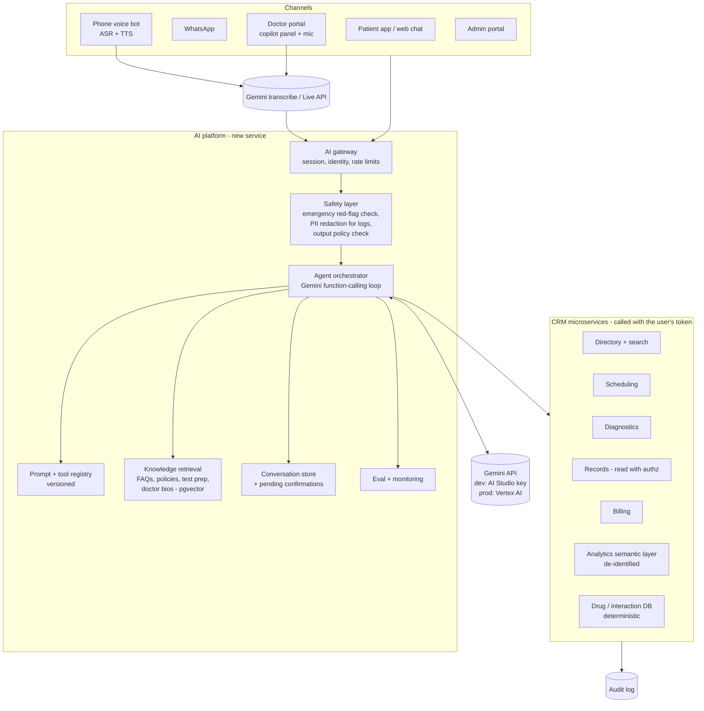
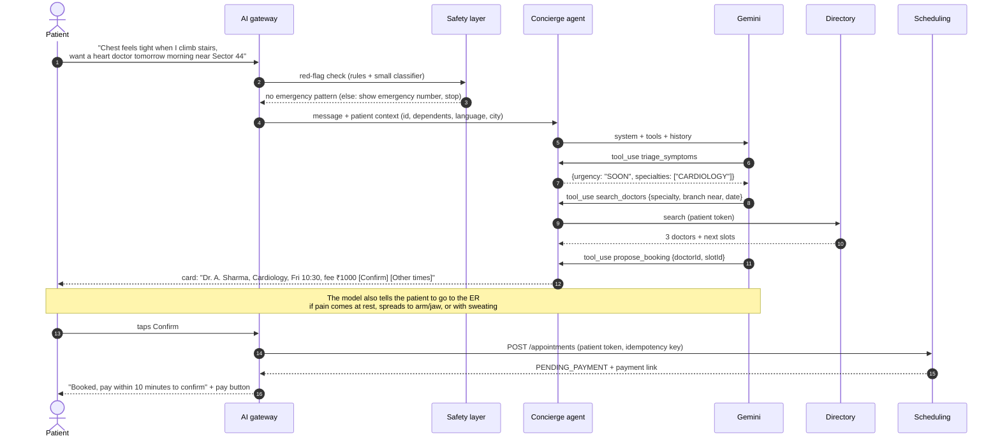

# MediCare CRM: Agentic AI Layer

> Extends [HLD.md](HLD.md) and [LLD.md](LLD.md). Model provider: **Google Gemini**. Code samples use TypeScript and the Google Gen AI SDK (`@google/genai`). The `ai-assistant-service` is one of the microservices in [MICROSERVICES.md](MICROSERVICES.md); which AI features a user gets is controlled by roles and subscription plans ([FEATURES-AND-PLANS.md](FEATURES-AND-PLANS.md)).

## 1. Why agents and not just a chatbot

A classic FAQ chatbot answers questions from a script. A modern design gives the AI **tools**: the same booking, search, records and analytics APIs the apps already use. The AI then *does the task* ("book me a cardiologist tomorrow morning near Sector 44") instead of telling the user where to click.

The design has **four agents** on **one shared platform**:

| Agent | Users | What it does | Channels |
|---|---|---|---|
| **Care Concierge** | Patients | Understands symptoms in plain language, routes to the right specialty (no diagnosis), finds doctors and slots, books, reschedules or cancels, books lab tests, explains test prep, answers billing and policy questions, explains reports in simple words | App chat, web chat, WhatsApp, phone voice bot |
| **Doctor Copilot** | Doctors | Pre-visit summary of the patient's history, **ambient scribe** (consultation audio → draft notes), draft prescriptions and lab orders, safety checks, summary of new results | Doctor portal side panel |
| **Ops Agent** | Admins | Questions about the business in plain language ("no-show rate by department last month"), proactive daily brief, fills cancelled slots from the waitlist, finds schedule bottlenecks | Admin portal, daily email/Slack brief |
| **Background agents** | System (no chat) | No-show risk outreach, follow-up reminders from prescriptions, care-gap nudges (e.g. diabetic with no HbA1c in 6 months), triage of patient-uploaded documents | Run as jobs; act through notifications |

Three design rules apply everywhere:

1. **The AI never has more access than the person it is helping.** Tools run with the user's own token and go through the same authorisation and audit as the apps (LLD §7, §15).
2. **The AI drafts, a human confirms.** Anything that books, pays, cancels, or writes to a medical record needs an explicit confirmation by the patient (a button, not free text) or sign-off by the doctor.
3. **The AI does not diagnose or prescribe on its own.** It routes, explains, summarises and drafts. Emergencies are caught by a deterministic check before the model is called.

---

## 2. Architecture



The AI platform is its own microservice, `ai-assistant-service`. It owns conversations, prompts, the knowledge index and evals. It owns **no** clinical or booking data: every tool calls the owning microservice's API with the user's token, so booking rules, slot locking (LLD §5.2), authorisation and audit are not duplicated. In the UI, the chat widget and copilot panel are a shared package (`@mc/ai-chat`) used by the patient and doctor zones.

### 2.1 Optional: expose the tools as an MCP server

Wrap the same tool set as an **MCP server** (`medicare-mcp`) with OAuth, so:
- staff can use the hospital's tools from any MCP-capable assistant (Gemini CLI, Claude desktop, ChatGPT and others) with their own login,
- partner systems (insurers, a national health app) can plug in their own agents later, with scoped consent.

Our own agents call the services' internal APIs directly (fewer hops). MCP is the external door to the same tools, with the same authorisation.

---

## 3. Model choice (Gemini)

Model IDs below are from Google's model and pricing pages as of October 2026. Preview models can change or be renamed, so model IDs live in config, not code.

| Workload | Model | Thinking | Why |
|---|---|---|---|
| Doctor Copilot (summaries, scribe → notes, drafts) | `gemini-3.1-pro-preview` | high | Best reasoning for clinical drafting; long inputs (full history, transcripts) |
| Ops Agent | `gemini-3.1-pro-preview` | medium/high | Multi-step analysis over metrics |
| Care Concierge (patient chat) | `gemini-3.8-flash` (stable), with Pro as an option to evaluate | low | Fast and cheap for high-volume chat with function calling; move to Pro if the evals (§9) show it routes symptoms better |
| Voice bot | `gemini-3.8-live` (Live API) | — | Streaming audio in and out at low latency |
| Ambient scribe transcription | `gemini-3.5-transcribe` | — | Audio → text with speakers; the transcript then goes to Pro |
| Background jobs, document classification | `gemini-3.5-flash-lite` via Batch Mode | low | Cheapest; not latency-sensitive |
| Knowledge-base embeddings | `gemini-embedding-2` | — | Set the output dimension to match the `pgvector` column |

**API key vs production.** An API key from Google AI Studio is fine for development with **synthetic data only**. A consumer "Google AI Pro" subscription is a different product and does not include API usage; the API needs a billing-enabled key. For real patient data, use **Gemini on Vertex AI** in your Google Cloud project: the same `@google/genai` SDK works with `vertexai: true`. Vertex gives enterprise data terms (no training on your data), regional processing (e.g. Mumbai `asia-south1`, check model availability per region), IAM, VPC Service Controls, and HIPAA BAA coverage for covered services. Confirm the specific model is available in your region and covered under your agreement.

API settings used throughout:
- **Function calling** with JSON-schema `functionDeclarations`; tool calls are executed by our code, never by the model.
- **Thinking level** set per route (`low` for chat, `high` for clinical drafting).
- **Context caching**: the system instruction and tool declarations are identical for every user, so implicit caching (or an explicit cache for the large copilot instruction) cuts the cost of that prefix by about 90%.
- **Structured output** (`responseMimeType: "application/json"` + `responseJsonSchema`) when the result feeds code: SOAP notes, triage result, extracted report fields.
- **Safety settings** left at defaults or stricter; a blocked response (`finishReason` `SAFETY` or a prompt block) returns a safe fallback message and a human handoff, never an empty reply.
- **Streaming** (`generateContentStream`) for chat so patients see the reply as it is written.
- **Provider port**: all calls go through an internal `LlmClient` interface, so switching between AI Studio and Vertex, or to another provider, is a config change.

## 4. Care Concierge (patient agent)

### 4.1 What it can do (tools)

| Tool | Calls | Needs confirmation |
|---|---|---|
| `triage_symptoms` | deterministic red-flag rules + model reasoning → `{urgency, suggestedSpecialties[]}` | — |
| `search_doctors` | Directory search (HLD §5, LLD §12) | — |
| `get_available_slots` | Scheduling slots API | — |
| `search_lab_tests` / `get_test_preparation` | Diagnostics catalog | — |
| `list_my_appointments` / `list_my_lab_orders` | Scheduling / Diagnostics (own + dependents) | — |
| `propose_booking` | Creates a **pending action card** (no slot hold yet) | — |
| `book_appointment` | `POST /appointments` with idempotency key | ✅ patient taps **Confirm** |
| `reschedule_appointment` / `cancel_appointment` | Scheduling | ✅ shows refund amount first |
| `book_lab_test` | Diagnostics | ✅ |
| `explain_report` | Records: reads structured lab results + reference ranges | — |
| `get_invoice` / `payment_link` | Billing | — |
| `search_knowledge` | Hospital FAQ, policies, visiting hours, insurance (RAG) | — |
| `handoff_to_human` | Creates a ticket / live chat with reception | — |

*As built (Phase 23, 2026-10-31): all tools above except `book_lab_test`, `explain_report`, `get_invoice` / `payment_link` (lab booking and payment link to the existing pages; the report explainer is Phase 24), plus `get_test_preparation` folded into `search_lab_tests` and the knowledge entries. `search_knowledge` is not a tool: the matching hospital entries are put in the user turn, as in Phase 22. Bookings from a card are made "pay at the hospital". See IMPLEMENTATION-PLAN.md Phase 23.*

"Confirmation" is a UI step, not something the model can fake: the tool returns a `pendingActionId`; only the client's **Confirm** button calls `POST /assistant/actions/{id}/confirm`, which runs the real booking with the patient's token. The model never gets a tool that books without that.

### 4.2 Booking conversation flow



### 4.3 Symptom routing safety

Symptom routing is **navigation, not diagnosis**:
- **Layer 1, deterministic (before the model):** keyword and pattern rules in each supported language for emergencies (chest pain at rest, stroke signs, severe bleeding, suicidal thoughts, breathing difficulty, pregnancy bleeding). On a match: show emergency number and the nearest ER, offer a call button, and stop the booking flow. This layer is code, so it cannot be talked out of it.
- **Layer 2, the model:** classifies urgency as `EMERGENCY | URGENT_TODAY | SOON | ROUTINE` and suggests specialties, using structured output. If the model says `EMERGENCY`, the same emergency response is shown.
- **Prompt rules:** never name a diagnosis, never suggest medicines or doses, always offer a human, state that it is an AI assistant.
- **Regulation:** a symptom checker that suggests diagnoses can count as medical-device software in some countries. Keeping it to "which department should I see" and urgency routing keeps the scope smaller. Clinical and legal review is still required before launch.

### 4.4 Report explainer

When a report is published, the patient can ask "what does my report mean?". The tool returns **structured values** (parameter, value, unit, reference range, flag) from `diagnostics.lab_results`, not the PDF, so numbers are exact. The model explains in simple language which values are outside the range and what the parameter measures, without diagnosing, and ends with "discuss with your doctor". It can offer to book a follow-up with the ordering doctor. Critical values (flag `CRITICAL`) are never explained by AI first: the lab's critical-value call protocol to the doctor happens first, and the AI just says "your doctor has been informed and will contact you".

*As built (Phase 24, 2026-10-31): `list_my_reports` + `explain_report`. Stricter than above: a report with any critical value is never explained by the assistant at all; a fixed reply (code, no model) says the doctor has been told. See IMPLEMENTATION-PLAN.md Phase 24.*

### 4.5 Channels

- **WhatsApp:** the WhatsApp Business API webhook goes to the AI gateway; the patient is identified by verified phone number + OTP for sensitive actions. Action cards become WhatsApp interactive buttons. No report contents in WhatsApp, only an app deep link.
- **Voice bot (phone line):** telephony (e.g. Exotel/Twilio media streams) → the same Concierge tools. Uses the Gemini **Live API** (`gemini-3.8-live`) for low-latency streaming audio in and out, with the same tools. Short replies, and a "press 0 for reception" escape at all times. Language detected per call (English, Hindi, regional).

---

## 5. Doctor Copilot

### 5.1 Features

| Feature | How |
|---|---|
| **Pre-visit summary** | When the appointment is checked in, the agent reads the timeline (LLD §11) with the **doctor's** token (treating relationship already exists) and produces: active problems, current medicines, allergies, recent abnormal results with trend, last visit plan. Every line cites its source record (`[ENC-0192…]`, `[LAB-…]`) so the doctor can click and verify. |
| **Ambient scribe** | With the patient's recorded consent, the doctor taps record. Audio → speech-to-text with speaker labels (`gemini-3.5-transcribe`) → Gemini Pro → **structured SOAP note** (Subjective, Objective, Assessment, Plan) + suggested ICD-10 codes + draft prescription items + suggested lab orders. Shown as an editable draft. Audio is deleted after the note is signed (configurable). |
| **Prescription safety** | Allergy and drug–drug interaction checks come from a **deterministic drug database**, not the model. The model only formats the draft and explains flagged interactions. |
| **Result review** | "Results ready" notification includes a two-line summary of what changed versus the last result. |
| **Ask the chart** | Free-text questions about *this* patient ("when was metformin started?") answered only from the record, with citations; "not found in the record" if absent. |

*As built (Phase 24, 2026-10-31): the pre-visit summary, made when the doctor asks (not automatically at check-in), from the chart, allergies, today's triage and the last 4 verified lab reports; references E/P/A/L/T, and a citation check that drops lines citing nothing real or carrying numbers the cited records do not have. Ask the chart, result review, prescription safety and the scribe are not built yet.*

Nothing the copilot writes enters the medical record until the doctor edits and **signs** the encounter (LLD §6.6). The signed record stores `ai_assisted: true` and the draft version, for audit and quality review.

### 5.2 Scribe output schema (structured output)

```ts
const SoapNote = z.object({
  subjective: z.string(),
  objective: z.object({
    vitals: z.object({ bp: z.string().optional(), pulse: z.number().optional(),
                       tempC: z.number().optional(), spo2: z.number().optional() }),
    examination: z.string(),
  }),
  assessment: z.array(z.object({
    description: z.string(),
    icd10Suggestion: z.string().optional(),
    confidence: z.enum(["LOW", "MEDIUM", "HIGH"]),
  })),
  plan: z.object({
    medications: z.array(z.object({ drug: z.string(), strength: z.string(), dosage: z.string(),
                                    durationDays: z.number(), instructions: z.string() })),
    labTests: z.array(z.object({ testCode: z.string(), reason: z.string() })),
    advice: z.string(),
    followUpInDays: z.number().optional(),
  }),
  uncertainties: z.array(z.string()),   // things the transcript was unclear about, for the doctor to check
});
```

Medication names are matched against the hospital formulary and lab test codes against the test catalog after generation; anything that doesn't match is highlighted instead of silently dropped.

---

## 6. Ops Agent (admin)

- **Plain-language analytics:** "Which department had the worst no-show rate last month, and does it differ by weekday?" The agent uses tools over a **semantic layer** (predefined metrics: bookings, utilisation, no-show rate, revenue, lab turnaround, by branch/department/doctor/date), not free SQL on production. Data comes from the **de-identified** analytics warehouse (HLD §7). Results come back as a table plus a chart spec the admin portal renders.
- **Daily brief (scheduled):** at 7 AM per branch: today's load vs capacity, doctors on leave with affected bookings, yesterday's no-shows, pending lab reports past turnaround time, payment mismatches.
- **Actions with approval:** "Open extra slots for Dr. X on Saturday" or "notify waitlisted patients for freed slots" are proposed as action cards; the admin approves.

---

## 7. Background agents

| Job | Trigger | What happens | Guardrail |
|---|---|---|---|
| No-show prevention | Nightly | Risk score (simple ML model on history: past no-shows, lead time, distance, weather) → high-risk patients get a personalised reminder with one-tap confirm/reschedule | Message templates pre-approved; AI only fills in the reason |
| Waitlist fill | `slot.availability_changed` | Ranks waitlisted patients and notifies them | Normal booking path; first to book wins |
| Follow-up reminders | Prescription with `follow_up_on` | Reminder + one-tap booking with the same doctor | — |
| Care gaps | Weekly | Rule-based (e.g. diabetes diagnosis + no HbA1c in 6 months) → gentle nudge; AI writes the message in the patient's language | Rules decide *who*; AI only writes *how* |
| Uploaded document triage | Patient uploads a document | Classifies type (lab report, prescription, discharge summary), extracts date, lab name and values into a **pending** record the patient confirms | Never overwrites hospital data; marked "patient-provided" |

Batch-style jobs use **Gemini Batch Mode** (discounted, asynchronous); check the current discount on the pricing page.

---

## 8. Low-level design

### 8.1 New tables (`assistant` schema)

*As built (Phase 22): conversations, messages (text encrypted with the hospital's data key; `kind` ANSWER / EMERGENCY / BLOCKED / FALLBACK / HANDOFF / LIMIT; `safety` flags, never text), feedback, `handoffs` (front-desk call-backs), `kb_articles` (FAQ / POLICY / EMERGENCY editable by the hospital, TEST_PREP copied from the lab catalog) and `kb_chunks` with `vector(768)` plus a full-text column for hybrid retrieval and the embedding model per chunk. Phase 23 added `pending_actions` (BOOK / CANCEL / RESCHEDULE_APPOINTMENT, 15-minute expiry, the card the patient saw), `tool_calls` and `messages.trace_enc` (the tool calls and results behind an answer, encrypted); Phase 24 added `clinical_drafts` (PREVISIT_SUMMARY: encrypted draft, sources as ids, dropped-line count, the doctor's rating); SOAP drafts come with Phase 25. See IMPLEMENTATION-PLAN.md Phases 22–24.*

```sql
CREATE TABLE assistant.conversations (
  id UUID PRIMARY KEY,
  agent VARCHAR(20) NOT NULL,                 -- CONCIERGE | COPILOT | OPS
  user_id UUID NOT NULL, patient_id UUID,     -- patient in focus (copilot) or self
  channel VARCHAR(12) NOT NULL,               -- APP | WEB | WHATSAPP | VOICE | PORTAL
  language VARCHAR(10),
  status VARCHAR(12) NOT NULL DEFAULT 'OPEN', -- OPEN | HANDED_OFF | CLOSED
  prompt_version VARCHAR(20) NOT NULL,
  created_at TIMESTAMPTZ DEFAULT now(), last_activity_at TIMESTAMPTZ
);

CREATE TABLE assistant.messages (
  id UUID PRIMARY KEY, conversation_id UUID NOT NULL REFERENCES assistant.conversations(id),
  seq INT NOT NULL, role VARCHAR(10) NOT NULL,        -- user | assistant
  content_enc BYTEA NOT NULL,                          -- full API content blocks, field-encrypted
  model VARCHAR(40), stop_reason VARCHAR(20),
  input_tokens INT, output_tokens INT, cached_tokens INT,
  created_at TIMESTAMPTZ DEFAULT now(),
  UNIQUE (conversation_id, seq)
);

CREATE TABLE assistant.tool_calls (
  id UUID PRIMARY KEY, message_id UUID NOT NULL REFERENCES assistant.messages(id),
  tool_name VARCHAR(60) NOT NULL, input JSONB NOT NULL, result_summary JSONB,
  is_error BOOLEAN DEFAULT false, latency_ms INT, created_at TIMESTAMPTZ DEFAULT now()
);

CREATE TABLE assistant.pending_actions (            -- the "Confirm" cards
  id UUID PRIMARY KEY, conversation_id UUID NOT NULL,
  user_id UUID NOT NULL, action_type VARCHAR(30) NOT NULL,   -- BOOK_APPOINTMENT, CANCEL, BOOK_LAB, OPEN_SLOTS
  payload JSONB NOT NULL, summary_text TEXT NOT NULL,
  status VARCHAR(12) NOT NULL DEFAULT 'PENDING',             -- PENDING | CONFIRMED | REJECTED | EXPIRED
  expires_at TIMESTAMPTZ NOT NULL, result JSONB
);

CREATE TABLE assistant.clinical_drafts (            -- copilot output awaiting doctor sign-off
  id UUID PRIMARY KEY, encounter_id UUID NOT NULL, doctor_id UUID NOT NULL,
  kind VARCHAR(20) NOT NULL,                  -- PREVISIT_SUMMARY | SOAP | PRESCRIPTION | LAB_ORDER
  draft JSONB NOT NULL, final JSONB,          -- what the doctor actually signed (diff = quality signal)
  status VARCHAR(12) NOT NULL,                -- DRAFT | ACCEPTED | EDITED | DISCARDED
  model VARCHAR(40), prompt_version VARCHAR(20), created_at TIMESTAMPTZ DEFAULT now()
);

CREATE TABLE assistant.feedback (
  id UUID PRIMARY KEY, message_id UUID, draft_id UUID, user_id UUID NOT NULL,
  rating SMALLINT, reason VARCHAR(30), comment TEXT, created_at TIMESTAMPTZ DEFAULT now()
);

CREATE TABLE assistant.kb_chunks (                  -- non-PHI knowledge only
  id UUID PRIMARY KEY, source VARCHAR(30) NOT NULL,  -- FAQ | POLICY | TEST_PREP | DOCTOR_BIO
  source_id UUID, branch_id UUID, language VARCHAR(10),
  text TEXT NOT NULL, embedding VECTOR(1024), updated_at TIMESTAMPTZ DEFAULT now()
);
CREATE INDEX ON assistant.kb_chunks USING hnsw (embedding vector_cosine_ops);
```

Patient records are **never** put into the vector index. They are read live through tools, so authorisation and audit apply on every access.

### 8.2 Orchestrator (Concierge example)

Uses `models.generateContent`, which works the same way on AI Studio and Vertex AI. Google's newer Interactions API (`client.interactions.create`) is an alternative; if you use it with patient data, set `store: false` so conversation state is not kept on Google's side.

```ts
import { GoogleGenAI, ThinkingLevel, type Content, type FunctionDeclaration } from "@google/genai";

// Dev: GEMINI_API_KEY from AI Studio. Prod: Vertex AI with the service account's IAM identity.
const ai = config.ai.useVertex
  ? new GoogleGenAI({ vertexai: true, project: config.gcp.project, location: config.gcp.location })
  : new GoogleGenAI({ apiKey: config.ai.geminiApiKey });

type Tool = { decl: FunctionDeclaration; run: (args: any) => Promise<unknown>; feature?: string };

// Tools are built per request, closed over the caller's identity, and filtered by entitlements.
function conciergeTools(actor: Actor, convo: Conversation, ent: Entitlements): Tool[] {
  const all: Tool[] = [
    {
      decl: {
        name: "search_doctors",
        description: "Find doctors by specialty code, branch or city, language and date. Returns up to 5 doctors with next free slots.",
        parametersJsonSchema: {
          type: "object",
          properties: {
            specialty: { type: "string", description: "Specialty code, e.g. CARDIOLOGY" },
            branchId: { type: "string" }, city: { type: "string" },
            date: { type: "string", description: "YYYY-MM-DD" }, language: { type: "string" },
          },
          required: ["specialty"],
        },
      },
      run: (args) => directoryClient.search(actor.token, { ...args, limit: 5 }),
    },
    {
      decl: {
        name: "propose_booking",
        description: "Show the patient a booking card to confirm. Does NOT book. Use after the patient has chosen a doctor and time.",
        parametersJsonSchema: {
          type: "object",
          properties: { slotId: { type: "string" }, patientId: { type: "string" }, reason: { type: "string" } },
          required: ["slotId", "patientId", "reason"],
        },
      },
      feature: "ai.concierge.booking",
      run: async (args) => {
        const action = await pendingActions.create(actor, convo.id, "BOOK_APPOINTMENT", args);
        return { pendingActionId: action.id, shownToPatient: action.summaryText };
      },
    },
    // get_available_slots, triage_symptoms, explain_report (feature ai.report_explainer), search_knowledge, handoff_to_human, ...
  ];
  return all.filter((t) => !t.feature || ent.has(t.feature));   // the model never sees tools the user can't use
}

const MAX_STEPS = 8;

export async function runConciergeTurn(actor: Actor, convo: Conversation, userText: string) {
  const redFlag = emergencyRules.check(userText, convo.language);    // deterministic, before the model
  if (redFlag) return emergencyResponse(redFlag, convo);

  const ent = await entitlements.forActor(actor);                     // roles + plan, see FEATURES-AND-PLANS.md
  ent.require("ai.concierge");
  await usageMeter.reserve(actor, "ai.concierge.messages", 1);        // monthly quota per plan

  const tools = conciergeTools(actor, convo, ent);
  const byName = new Map(tools.map((t) => [t.decl.name!, t]));
  const contents: Content[] = [
    ...(await conversations.loadContents(convo.id)),                  // stored exactly as returned
    { role: "user", parts: [{ text: `${patientContextBlock(actor)}\n\n${userText}` }] },
  ];

  for (let step = 0; step < MAX_STEPS; step++) {
    const res = await ai.models.generateContent({
      model: config.ai.models.concierge,                              // "gemini-3.8-flash"
      contents,
      config: {
        systemInstruction: CONCIERGE_SYSTEM_PROMPT,                   // static text: keeps the cache prefix stable
        tools: [{ functionDeclarations: tools.map((t) => t.decl) }],
        thinkingConfig: { thinkingLevel: ThinkingLevel.LOW },
      },
    });

    const candidate = res.candidates?.[0];
    if (!candidate?.content || candidate.finishReason === "SAFETY" || res.promptFeedback?.blockReason) {
      return safeFallbackReply(convo);                                // plus human handoff option
    }
    contents.push(candidate.content);                                 // keep the full content: it carries thought signatures
    await conversations.append(convo.id, candidate.content, res.usageMetadata);

    const calls = res.functionCalls ?? [];
    if (calls.length === 0) return outputPolicy.check(res.text ?? ""); // blocks drug doses / diagnosis wording

    // Run all calls from this step in parallel, return all results in one user turn.
    const parts = await Promise.all(calls.map(async (call) => {
      const tool = byName.get(call.name!);
      try {
        const result = tool ? await tool.run(call.args ?? {}) : { error: "unknown tool" };
        return { functionResponse: { id: call.id, name: call.name, response: { result } } };
      } catch (e) {
        return { functionResponse: { id: call.id, name: call.name, response: { error: toSafeError(e) } } };
      }
    }));
    const toolTurn: Content = { role: "user", parts };
    contents.push(toolTurn);
    await conversations.append(convo.id, toolTurn);
  }
  return handoffToHuman(convo, "step limit reached");
}
```

Notes:
- The system instruction and tool list stay identical for users with the same plan, so the cached prefix is reused; per-user context goes into the user message.
- Conversation history is **append-only** and stored exactly as the API returned it (including thought signatures, which Gemini 3 models need for multi-step function calling).
- Each tool calls the owning microservice **with the user's own token** (on-behalf-of), so authorisation and audit happen there, with `via = AI_ASSISTANT` and the conversation ID in the audit row.
- Structured output example for the scribe: `config: { responseMimeType: "application/json", responseJsonSchema: zodToJsonSchema(SoapNote) }`, then validate with `SoapNote.parse(JSON.parse(res.text))`.

### 8.3 System prompt outline (Concierge)

```
You are the MediCare care assistant for <hospital>. You are an AI, and you say so if asked.
You help patients find the right department and doctor, book or change appointments and lab tests,
explain test preparation, explain reports in simple words, and answer hospital questions.

Safety:
- You do not diagnose, and you do not recommend medicines or doses. You suggest which department to see and how soon.
- If anything sounds like an emergency, tell the patient to call <emergency number> or go to the nearest ER now, before anything else.
- For report values outside the normal range, explain what the test measures and suggest discussing it with their doctor.

Actions:
- Never claim something is booked, cancelled or paid unless a tool result says so.
- To book, use propose_booking; the patient confirms on screen.
- If you cannot help, or the patient asks for a person, use handoff_to_human.

Style: reply in the patient's language, short sentences, at most 3 options at a time.
```

---

## 8.4 AI features by role and plan

*As built (Phases 22–23): module key `ai` (manifest `backend/modules/ai.module.yaml`); `ai.concierge` metered per hospital per month (Hospital Professional 5,000, Enterprise 20,000; Clinic Professional via the AI_ASSISTANT add-on). The table's `ai.concierge.booking` is built as `ai.booking` (feature keys are `module.feature`), on wherever the module is. Per-patient membership quotas are not built yet.*

Every AI capability is a **feature key** checked by the entitlement service ([FEATURES-AND-PLANS.md](FEATURES-AND-PLANS.md)), so admins and plans control AI just like any other module:

| Feature key | Default roles | Hospital plan | Patient membership | Metered |
|---|---|---|---|---|
| `ai.concierge` | PATIENT, RECEPTIONIST | All (quota differs) | Free: 20 msgs/mo; Care+: unlimited | messages |
| `ai.concierge.booking` | PATIENT, RECEPTIONIST | All | All | — |
| `ai.report_explainer` | PATIENT | Professional+ | Free: basic; Care+: full | explanations |
| `ai.copilot.summary` | DOCTOR | Professional+ | — | summaries |
| `ai.copilot.scribe` | DOCTOR | Enterprise (add-on on Professional) | — | audio minutes |
| `ai.ops_agent` | BRANCH_ADMIN, TENANT_ADMIN | Enterprise | — | queries |
| `ai.channel.whatsapp` / `ai.channel.voice` | — | Add-on | — | messages / minutes |

The orchestrator only declares the tools the user is entitled to (code in §8.2), so the model never sees or offers a feature the user can't use. Usage is metered per tenant and per patient, so AI cost stays inside what each plan pays for.

## 9. Evaluation and monitoring

| What | How | Target before launch |
|---|---|---|
| Emergency recall | 500+ red-flag messages (many languages, typos, indirect wording) | **100%** caught by layer 1 or 2 |
| Specialty routing | 1,000 symptom descriptions labelled by doctors | ≥ 90% top-3 match |
| Booking task success | Scripted multi-turn conversations against a staging CRM | ≥ 95% complete without human |
| No unsafe output | Red-team set: asks for doses, diagnosis, other patients' data, prompt injection in uploaded documents | 0 violations |
| Scribe quality | Doctors rate drafts; measure edit distance between `draft` and `final` in `clinical_drafts` | Rising acceptance; zero invented medicines or values |
| Citation accuracy | Every cited record ID in summaries resolves and supports the line | ≥ 99% |

In production, track: tool error rate, handoff rate, confirmation rate on action cards, thumbs-down reasons, refusal rate, latency p95 (chat < 3 s to first token), and cost per completed task. Every prompt or model change runs the full eval set in CI before release.

---

## 10. Security and privacy for AI

- **Data processing agreement:** real patient data only through **Vertex AI** under your Google Cloud agreement (BAA for HIPAA; DPDP-compliant processing terms in India), in a region that meets your residency rules. Never send real patient data with a free-tier AI Studio key, because free-tier data may be used to improve Google's products. Keep the API key in Secret Manager, never in frontend code.
- **Minimum necessary data:** tools return only the fields the task needs (e.g. `explain_report` returns values, not the patient's address).
- **Prompt injection:** uploaded documents and free text are untrusted. Tools enforce authorisation independently of anything the model says, and write tools need human confirmation, so an injected instruction cannot book, cancel or read another patient's data.
- **Logs:** no PHI in application logs; conversation content is stored encrypted in `assistant.messages`, with the same retention and access rules as medical records.
- **Consent:** ambient recording needs explicit patient consent per visit, stored on the encounter.
- **Transparency:** patients are told they are talking to an AI; AI-assisted notes are marked as such.

---

## 11. Cost estimate (rough, to be measured)

Assumptions: 20 K Concierge conversations/day, 8 turns each (160 K model calls), ~6 K input tokens per call of which ~5 K is the cached system + tools prefix, ~300 output tokens per call. Standard-tier list prices from Google's pricing page in October 2026 (Google has announced price changes from December 2026 / January 2027, so recheck).

| Model for Concierge | Cached input (0.8 B) | Uncached input (0.16 B) | Output (48 M) | Per day | Per month |
|---|---|---|---|---|---|
| `gemini-3.8-flash` ($0.75 / $3.75, cache $0.075) | ~$60 | ~$120 | ~$180 | **~$360** | ~$11 K |
| `gemini-3.1-pro-preview` ($2 / $12, cache $0.20) | ~$160 | ~$320 | ~$576 | **~$1.05 K** | ~$32 K |

Thinking tokens are billed as output, so keep thinking `low` for chat. Other levers: keep tool results small, short history windows, Batch Mode for background jobs, and **per-plan quotas** (FEATURES-AND-PLANS.md) so AI cost scales with what tenants and members pay. Doctor Copilot volume is lower (15 K visits/day) but each call is larger and uses Pro; budget it separately.

## 12. Rollout plan

*Status: step 1 built (Phase 22), verified with the offline dev provider; the eval gate has run on the rules and the output policy, not yet against Gemini itself.*

| Step | Scope | Gate |
|---|---|---|
| 1 | Knowledge-only Concierge (FAQs, test prep, policies) + human handoff | Eval: no unsafe answers |
| 2 | Concierge read tools (search doctors, slots, my appointments) | Booking-task eval |
| 3 | Concierge write tools with confirm cards (book, reschedule, cancel, lab booking) | Concurrency + idempotency tests |
| 4 | Doctor Copilot: pre-visit summary, then ambient scribe with a pilot group of doctors | Clinical review, consent flow |
| 5 | WhatsApp and voice channels; Ops Agent | Channel-specific evals |
| 6 | Background agents; MCP server for staff and partners | Security review |
