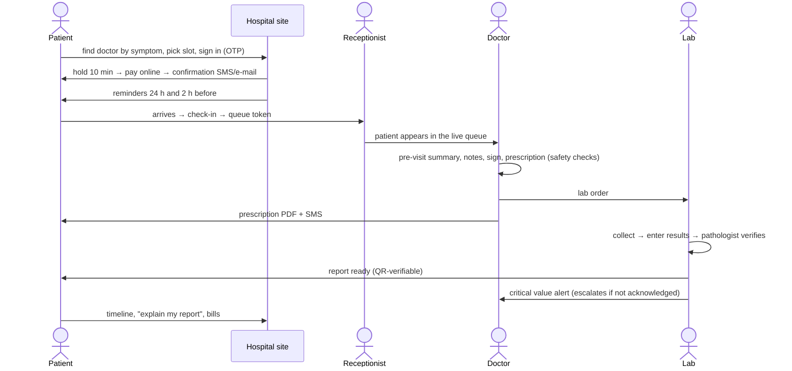

# MediCare: complete app flow by login

What every kind of user can do in MediCare, which account to sign in with locally, and how the journeys connect from one role to the next. It covers everything built through Phase 30 part 1 (2026-11-01).

The flows were checked against the running code: the zones' page routes, the module manifests' role grants, and the accounts that exist in the local databases. For the design behind each feature see [FEATURES-AND-PLANS.md](FEATURES-AND-PLANS.md), [PRODUCT-MODULES-AND-PLANS.md](PRODUCT-MODULES-AND-PLANS.md) and [AI-AGENTS.md](AI-AGENTS.md); for the gap review see [ROLE-FLOWS-AND-GAPS.md](ROLE-FLOWS-AND-GAPS.md).

---

## 1. Before you start

### 1.1 Start the stack

```bash
cd platform
node scripts/mc.mjs dev            # all 17 services + 8 web zones (keep it running)
node scripts/mc.mjs seed demo      # citycare, sunrise and MediCare HQ (skips those that exist)
node scripts/mc.mjs seed showcase  # Aarogya Hospitals: the demo hospital with believable data
```

### 1.2 Addresses

| What | URL |
|---|---|
| MediCare marketing site, pricing, signup | http://localhost:3400 |
| A hospital's own site (white-label) | http://`<slug>`.localhost:3400, e.g. http://aarogya.localhost:3400 |
| MediCare platform console | http://medicare.localhost:3400/platform |
| Mailpit: every e-mail **and every SMS / OTP** in dev | http://localhost:61825 |
| API gateway (Kong) | http://localhost:61000 |

Each hospital lives on its own address. Signing in on `aarogya.localhost` signs you into Aarogya only; the same e-mail cannot reach another hospital's data.

### 1.3 Passwords

| Who | How they sign in |
|---|---|
| **All staff** (doctors, desk, lab, admins, MediCare staff) | `/login` → **Staff sign-in** → e-mail + the dev staff password. The password is the value of `DEV_STAFF_PASSWORD` in `platform/.env` (generated by `mc configure`; every seeded staff account shares it). See it with `grep DEV_STAFF_PASSWORD platform/.env`. |
| **Patients** | `/login` → mobile number → a 6-digit code. In dev the "SMS" lands in **Mailpit** (http://localhost:61825). |
| **Production** | Staff get a Keycloak invitation e-mail (set password, TOTP two-step code). Patients get a real SMS through MSG91 once an account is connected. |

> The password value is deliberately **not** written in this file: the repository is public, and the value is per machine.

---

## 2. Login directory

### 2.1 Aarogya Hospitals: the demo hospital (use this for demos)

http://aarogya.localhost:3400 · plan **Hospital Enterprise** · 3 branches (Gurugram Sector 29, Noida Sector 62, Dwarka New Delhi) · modules on: everything in the plan plus `analytics`, `ai_ops` and `memberships`.

| Role | Login | Lands on |
|---|---|---|
| Hospital admin (owner) | `admin@aarogya.test` | `/admin` |
| Receptionist | `desk@aarogya.test` (Pooja Desk) | `/desk` |
| Doctor: General Medicine | `sameer.khan@aarogya.test` | `/doctor` |
| Doctor: Cardiology | `ananya.sharma@aarogya.test`, `rohan.mehta@aarogya.test` | `/doctor` |
| Doctor: Pediatrics | `meera.kapoor@aarogya.test` | `/doctor` |
| Doctor: Dermatology | `kavya.iyer@aarogya.test` | `/doctor` |
| Doctor: Orthopedics | `arjun.nair@aarogya.test` | `/doctor` |
| Doctor: others | `aditya.rao` (Ophthalmology), `farah.siddiqui` (Endocrinology), `ishita.banerjee` (Psychiatry), `karan.malhotra` (Gastroenterology), `neha.gupta` (ENT), `priya.bhatt` (Obstetrics & Gynecology), `rahul.verma` (Dentistry), `vikram.singh` (Neurology), all `@aarogya.test` | `/doctor` |
| Patients (20) | mobile **+91 98155 50000** to **+91 98155 50019** (e.g. +91 98155 50000 = Aarav Malhotra, …50001 = Diya Sethi, …50002 = Kabir Anand) | `/care` |

Aarogya has no lab staff. Use City Care for the lab roles, or invite them from Admin → Staff.

### 2.2 CityCare Clinic: every role (the test hospital)

http://citycare.localhost:3400 · plan **Hospital Enterprise**. The test suites run here, so it is full of test data (hundreds of `dr.*`, `amend.*` and `concierge.*` doctors). Use it to try roles Aarogya doesn't have.

| Role | Login | Lands on |
|---|---|---|
| Hospital admin | `admin@citycare.test` | `/admin` |
| Receptionist | `desk@citycare.test` | `/desk` |
| Doctor | `asha.rao@citycare.test` | `/doctor` |
| Lab technician | `lab@citycare.test` | `/lab` |
| Pathologist | `path@citycare.test` | `/lab` |
| Phlebotomist (home collection) | `ravi.phleb@citycare.test`, `sunil.phleb@citycare.test` | `/lab/visits` |
| Branch admin, nurse | not seeded with a fixed name: invite one from Admin → Staff (role `BRANCH_ADMIN` or `NURSE`, pick the branch) | `/admin`, `/desk` |
| Patients | any mobile number: the first booking creates the record | `/care` |

### 2.3 Other hospitals (show plan differences)

| Hospital | URL | Plan | Login |
|---|---|---|---|
| Sunrise Diagnostics | sunrise.localhost:3400 | Hospital Professional | `admin@sunrise.test` |
| Greenleaf Clinic | greenleaf.localhost:3400 | Clinic Starter | `admin@greenleaf.test` |
| Bright Smile Dental | brightsmile.localhost:3400 | Clinic Starter | `admin@brightsmile.test` |

On a Clinic Starter hospital the lab, AI, analytics and home-collection menus are absent. The plan hides those screens, and the APIs refuse them.

### 2.4 MediCare HQ: the company that sells the product

http://medicare.localhost:3400/platform · plan **MediCare HQ**.

| Role | Login | Can do |
|---|---|---|
| Product manager | `product@medicare.test` (Priya Product) | Build plans and plan versions, edit the price book, submit for approval |
| Approver | `approver@medicare.test` (Arjun Approver) | Approve or reject what product submitted (two-person rule: nobody approves their own) |
| Support | `support@medicare.test` (Sana Support) | Look after hospitals: contracts, feature overrides, suspend/reactivate, offboarding |
| HQ admin | `admin@medicare.test` | Everything on the console, plus MediCare's own staff and roles |

---

## 3. Flows by login

Legend: **[module]** is the sellable module the screen belongs to; the screen is hidden when the hospital's plan doesn't include it.

### 3.1 Visitor and prospect (no login)

**On the MediCare site (localhost:3400)**
1. `/`: product home with live published plans.
2. `/pricing`: plans built from the console (Clinic Starter ₹4,999/month up to Hospital Enterprise ₹59,999/month).
3. `/signup`: a hospital owner picks an address (`<slug>`), plan and e-mail. The address is held for 24 h and a confirmation e-mail goes out (Mailpit).
4. `/signup/verify` → `/signup/status`: the confirmation link starts provisioning: its own database, login realm, modules, trial and file storage. Five readiness checks tick green. An owner e-mail says "your hospital is ready".
5. The owner signs in and lands on the **setup wizard** (see 3.10).

**On a hospital's site (aarogya.localhost:3400)**
1. Home page in the hospital's colours and logo: search, next available doctors, specialties, packages, branches.
2. `/care/doctors`: search by name, specialty or **symptom** ("chest pain" → Cardiology), or "next available". Doctor profile with fee, languages, experience and a slot picker.
3. `/care/tests`: lab tests and packages with prices, fasting and turnaround time **[diagnostics]**.
4. Pages made for search engines (and for sharing), each with its own title and description:
   - `/care/specialties/cardiology`: the specialty's doctors;
   - `/care/branches/noida-sector-62`: address, map link and the doctors there;
   - `/care/tests/hba1c` and `/care/packages/full-body`: price, sample, fasting, report time and a Book button;
   - doctor profiles at readable addresses such as `/care/doctors/ananya-sharma-cardiology`.
   - Each hospital has its own `sitemap.xml` and `robots.txt`.
5. `/care/verify/<code>`: anyone can scan the QR code on a lab report and see that it is genuine.
6. Picking a slot asks the visitor to sign in, then brings them back to the same slot.

### 3.2 Patient (mobile number + OTP)

Try: Aarogya, +91 98155 50000. The OTP arrives in Mailpit.

| Screen | What the patient does |
|---|---|
| `/care` | Their panel: next visit, reports ready, bills due, health record shortcuts |
| `/care/doctors` → `/care/book/[slot]` | Book for **self or a family member**, give a reason, choose **pay online** or **pay at hospital** **[appointments]** |
| `/care/pay/[invoice]` | Online payment (the slot is held 10 minutes; a late payment is refunded automatically) **[billing]** |
| `/care/appointments` | Upcoming and past visits; **reschedule** (`/reschedule`) or **cancel** within the hospital's own cut-off (refunds follow its policy and show on the bill); join the **waitlist** when full; fill in a **pre-visit form** (`/form`) the hospital set up **[workflows]** |
| `/care/tests` → `/care/tests/book` | Book a lab test or package **at the lab or at home** **[diagnostics, home_collection]** |
| `/care/lab-orders` | Order status: booked → sample collected → in lab → report ready; download the report PDF |
| `/care/prescriptions` | Every prescription with PDF |
| `/care/timeline` | The whole health record: visits, reports, prescriptions, uploads (virus-scanned), allergies; switch between family members |
| `/care/sharing` | Give or withdraw consent for another doctor to see the record |
| `/care/access-log` | **Who opened my record, when and why**, including emergency (break-glass) access |
| `/care/bills` | Invoices and receipts (PDF); a bill page with each payment and refund status |
| `/care/membership` | Buy a hospital membership (Care+, Family+): free follow-ups, discounts, priority slots **[memberships]** |
| `/care/assistant` | **AI concierge**: ask about timings, fees and departments; "book a cardiologist tomorrow morning" → it proposes slots and a **Confirm card** (nothing is booked until the patient presses Confirm); "explain my report" in plain language (never for reports with a critical value); emergency words get 112/108 at once; "talk to a person" goes to the desk **[ai]** |
| `/care/profile` | Profile, family members (add and edit), notifications, **Download my data** (JSON) |

Notifications the patient gets (Mailpit in dev): booking confirmation, reminders 24 h and 2 h before, prescription ready, report ready, payment and refund receipts, waitlist slot open, care-gap reminders ("your HbA1c is due") **[ai_ops]**, and no-show outreach.

### 3.3 Receptionist (front desk)

Try: `desk@aarogya.test` or `desk@citycare.test`.

| Screen | What they do |
|---|---|
| `/desk` | **Today's board** per branch, live: booked, checked in, with doctor, done, no-show; any other day by date; KPI tiles |
| `/desk/patients` | Find by phone, MRN or name; **register** the phone owner and family members (duplicates refused); `/desk/patients/[id]` the patient page with the hospital's custom fields |
| `/desk/book` | **Walk-in** for today, or a **phone booking** for a later day (day chips for the next week or two) |
| Check-in | One click gives an **atomic queue token** (never duplicated, even with several desks) |
| Collect payment | Cash, UPI or card (a reference is needed for UPI and card); **Receipt** PDF next to paid visits |
| `/desk/move/[appointment]` | Reschedule a visit for the patient |
| Cancel / no-show / left | A no-show of today can still be checked in ("Arrived late: check in"), keeping the slot and the payment |
| `/desk/collections` | End-of-day collections; **cash refunds to hand back** ("Handed back" closes them) |
| `/desk/assistant` | **Chat requests** from the AI concierge ("talk to a person"); emergencies first, live updates **[ai]** |
| `/lab/book` | Book a lab test for a walk-in or a doctor's order **[diagnostics]** |

### 3.4 Nurse

Invite one from Admin → Staff (role `NURSE`). Home: `/desk`.
- Today's board and check-in.
- "Vitals" on the desk board → `/desk/triage/[appointment]`: after check-in, record **vitals**, a **priority** (routine / urgent / emergency) and the complaint, at the nurse's own branches. The doctor's queue shows the priority and the note starts with the vitals **[emr]**.
- Custom fields the hospital added to the visit **[workflows]**.

### 3.5 Doctor

Try: `sameer.khan@aarogya.test` (General Medicine) or `asha.rao@citycare.test`.

| Screen | What they do |
|---|---|
| `/doctor` | **Today**: next patient, who is waiting, notes still to sign, critical lab values, the week ahead; a morning agenda e-mail at 7 a.m. |
| `/doctor/queue` | Live queue: call in, start, left, no-show, complete (one patient at a time) |
| `/doctor/consult/[appointment]` | The consultation (two columns): vitals; **notes** with complaint and ICD-10 diagnoses; **sign** (needs a diagnosis) and **amend** later with a reason; **prescription** with a PDF and an SMS to the patient; **lab order**; allergies; documents; history. On the right the **AI copilot**: **pre-visit summary** from the record (every line cites its source) **[ai]** |
| Prescription safety | Every medicine is checked against the patient's **allergies** and **drug interactions**. A major interaction is refused unless the doctor gives a reason, which is recorded. |
| AI scribe | With the patient's consent, **record the consultation** → a draft SOAP note and prescription appear → the doctor edits and presses "Use in visit notes". The audio is encrypted and deleted when the note is signed. **[ai]** |
| `/doctor/schedule` | Weekly hours per branch, consult modes, **leave** (cancels and fully refunds the bookings, and tells the patients) |
| `/doctor/appointments` | The next 7 days, with links to each chart |
| `/doctor/patients` | Open a chart by MRN. Access needs a **treating relationship** or **consent**; otherwise **break-glass** (reason, 4 hours, audited, shown to the patient) |
| `/doctor/lab-results` | Results of tests they ordered, **unacknowledged critical values first**; acknowledge. Criticals escalate to the branch admin if nobody acknowledges them. |

### 3.6 Lab technician

Try: `lab@citycare.test`. Home: `/lab` **[diagnostics]**.
1. `/lab`: **worklist** by branch and day, including doctor orders that are waiting for a time.
2. `/lab/book`: book a test for a walk-in or a paper order.
3. Take payment at the counter (collection stays blocked until paid).
4. `/lab/labels`: print **barcode labels** for the tubes, then mark the sample **collected**, or **reject it** and ask for a recollection.
5. `/lab/orders/[id]`: **enter results**. Values are parsed and checked against reference ranges ("450 mg/dL" works) and flagged LOW / HIGH / **CRITICAL**.
6. `/lab/pending`: results waiting for the pathologist.
7. `/lab/critical`: open critical values, who has been told, and escalation.
8. `/lab/home`: assign **home collections** to phlebotomists **[home_collection]**.

### 3.7 Pathologist

Try: `path@citycare.test`. Home: `/lab`.
- `/lab/pending`: **verify and publish** reports. (A rule that a second person must verify is planned, gap C-6; today a pathologist can verify their own entry.)
- Publishing makes the **QR-verifiable PDF** and notifies the patient and the ordering doctor. A critical value alerts the doctor at once.

### 3.8 Phlebotomist

Try: `ravi.phleb@citycare.test`. Home: `/lab/visits` **[home_collection]**.
- **My visits** for the day with address and slot; on the way → collect the sample and take payment at the door → done; or "Cannot visit" → the patient is asked to pick a new time. The lab tech can reassign a visit until a tube is collected; overdue visits are flagged.

### 3.9 Branch admin

Invite one from Admin → Staff (role `BRANCH_ADMIN`, choose the branch). Sees the admin zone **limited to their branch**:
- Overview dashboard for their branch; schedules of their doctors; billing and **refunds**; lab orders; critical-value escalations; audit.
- Assistant chat requests, the AI knowledge base, analytics and the **Ops agent** for their branch **[ai, analytics, ai_ops]**.
- Cannot invite staff, change roles, change the plan or touch other branches (the server refuses it, not only the menu).

### 3.10 Hospital admin (owner)

Try: `admin@aarogya.test`. Home: `/admin`.

**First day: `/admin/setup` wizard.** Branding (logo, colours) → first branch → first doctor → hours → bank account for payouts → finish.

**Running the hospital**

| Screen | What they do |
|---|---|
| `/admin` | **Overview**: KPIs, the week ahead, booking channels (online, desk, assistant), busiest doctors |
| `/admin/analytics` | **Dashboards** from the hospital's own warehouse: revenue, visits, no-shows, lab turnaround, by branch and doctor **[analytics]** |
| `/admin/ops` | **Ops agent**: ask "which branch had the most no-shows last week?" in plain English; **morning brief** e-mail; approve **care-gap** reminder wording before any patient gets it **[ai_ops]** |
| `/admin/branches` | Branches, addresses, timings, deactivate (future bookings are cancelled and the patients told) |
| `/admin/doctors`, `/admin/specialties`, `/admin/schedules` | The doctor directory, publishing profiles, fees, hours |
| `/admin/staff`, `/admin/staff/[user]` | Invite staff with a role and branch; deactivate, re-invite, reset sign-in |
| `/admin/roles` | Edit role permissions or create **custom roles** (nobody can grant a permission they don't hold) |
| `/admin/billing`, `/admin/billing/[id]` | Invoices, payments, refunds, the **payout account** (changing it needs a step-up code; payouts are held for a while after a change) |
| `/admin/lab-catalog` | Tests, reference ranges, fasting, turnaround, packages **[diagnostics]** |
| `/admin/home-collection` | Home-collection areas, slots and charges **[home_collection]** |
| `/admin/memberships` | Design patient membership plans (price, free visits, discounts, priority slots) **[memberships]** |
| `/admin/messages` | SMS and e-mail templates (SMS also in Hindi), with their DLT template IDs |
| `/admin/knowledge` | What the AI concierge may say: timings, fees, policies **[ai]** |
| `/admin/custom-fields`, `/admin/workflows` | **Custom fields** on patients and visits, **pre-visit forms** per specialty, **workflow rules** ("when a lab result is critical, then…") **[workflows]** |
| `/admin/integrations` | **Webhooks**, **API keys**, the read-only **FHIR API**, the **LIS connector** for lab machines **[integrations]** |
| `/admin/settings` | Cancellation cut-off and refund rules, reschedule limit, booking horizon, reminders (within the ranges the plan allows) |
| `/admin/audit` | Every admin change and every record access |
| `/admin/plan` | The hospital's MediCare plan and what it includes |

**The hospital's own MediCare subscription: `/account`**

| Screen | What they do |
|---|---|
| `/account` | Subscription status, trial days left, renewal date |
| `/account/plan` | **Upgrade or downgrade** the plan; add-ons |
| `/account/usage` | Doctors, branches, SMS and AI messages against the plan limits |
| `/account/invoices` | MediCare's invoices to the hospital (PDF); card mandate; an expired or cancelled hospital **resubscribes** here |

Leaving MediCare: support exports the hospital's data (`mc tenant export`); a deleted hospital is kept for 30 days, then its data keys are destroyed and the database dropped.

### 3.11 MediCare product manager, approver, support and HQ admin

Try: `product@medicare.test`, `approver@medicare.test`, `support@medicare.test`, `admin@medicare.test` at medicare.localhost:3400/platform.

| Screen | Who | What |
|---|---|---|
| `/platform` | all | **Hospitals**: every customer with plan and status |
| `/platform/hospitals/[id]` | support | **Contract** (custom price, discount, waived setup fee), **feature overrides** with end dates, **extend a trial**, **credit notes**, take offline and back, delete (type the address to confirm), reactivate. Every action needs a reason and is audited. |
| `/platform/plans`, `/platform/plans/versions/[id]` | product → approver | Build a plan version (modules, limits, feature flags, settings ranges, add-ons) → **submit** → approver **publishes** or rejects. Existing customers keep their version (grandfathering). |
| `/platform/pricebook` | product → approver | Prices per plan: flat, per doctor, per branch or tiered |
| `/platform/editions` | product | Ready-made bundles: Clinic, Diagnostic Center, Hospital, Telehealth, Specialty chain |
| `/platform/registry` | all | The module registry: every module, its features, settings and dependencies (read-only; built by developers) |
| `/platform/audit` | all | Who changed which plan, price or contract |

**Operations (CLI, MediCare engineers)**: `mc search reindex <slug>|--all`, `mc tenant create|move|ring|export`, `mc migrate --max-ring`, `mc backup run|list|drill|status`, `mc server add`, `mc keys rotate`, `mc events dlq|replay`. See [MULTI-TENANCY.md](MULTI-TENANCY.md) §3.4–3.5.

---

## 4. End-to-end journeys (role to role)

### 4.1 Online booking to follow-up



1. Patient +91 98155 50000 books Dr. Sameer Khan on aarogya.localhost:3400 and pays online.
2. `desk@aarogya.test` checks them in on `/desk` (token).
3. `sameer.khan@aarogya.test` opens `/doctor/queue` → consult → notes, diagnosis, sign → prescription → lab order.
4. Patient sees the prescription on `/care/prescriptions` and books the test on `/care/lab-orders`.
5. On City Care: `lab@citycare.test` collects and enters results; `path@citycare.test` verifies and publishes.
6. Patient downloads the report, asks the assistant to explain it, and sees the visit in `/care/timeline` and who opened it in `/care/access-log`.

### 4.2 Walk-in

Desk registers the patient (`/desk/patients`) → `/desk/book` today → check-in → collects cash → the doctor sees them in the queue → the desk opens the receipt PDF.

### 4.3 Home sample collection

Patient books a test at home (`/care/tests/book`) → lab tech assigns it on `/lab/home` → phlebotomist does it on `/lab/visits` (labels, payment at the door) → the lab runs the test → the pathologist publishes → the patient is told.

### 4.4 AI concierge booking

Patient on `/care/assistant`: "book a cardiologist tomorrow morning" → slots for Dr. Ananya Sharma and Dr. Rohan Mehta → "the second one" → a **Confirm card** → Confirm → booked (shows as "Assistant" on the admin's booking-channel chart). "Talk to a person" → appears on `/desk/assistant`.

### 4.5 New hospital, self-serve

Prospect at localhost:3400/signup → confirmation e-mail → provisioning (own database) → owner signs in → setup wizard → first doctor and hours → their site at `<slug>`.localhost:3400 takes bookings → the trial ends → card mandate on `/account`.

### 4.6 New plan, two-person rule

`product@medicare.test` creates a plan version on `/platform/plans` and submits → `approver@medicare.test` publishes it → it appears on `/pricing` → hospitals on the old version keep it until they choose to move.

### 4.7 Custom deal for one hospital

`support@medicare.test` opens Greenleaf on `/platform/hospitals/[id]` → custom price and a feature override (e.g. AI for 30 days) → the hospital sees the feature at once → it switches off by itself on the end date. Every step is in `/platform/audit`.

### 4.8 Branch-scoped control

Invite a branch admin for "Noida, Sector 62" → they see only Noida's bookings, refunds and doctors; trying another branch's data is refused by the server.

---

## 5. What each plan unlocks

| | Clinic Starter ₹4,999 | Clinic Pro ₹9,999 | Diagnostic Starter ₹6,999 | Diagnostic Pro ₹12,999 | Hospital Pro ₹24,999 | Hospital Enterprise ₹59,999 |
|---|:-:|:-:|:-:|:-:|:-:|:-:|
| Patients, branches, staff, roles, audit (core) | ✅ | ✅ | ✅ | ✅ | ✅ | ✅ |
| Doctor directory and search | ✅ | ✅ | | | ✅ | ✅ |
| Online booking, reminders, waitlist | ✅ | ✅ | | | ✅ | ✅ |
| Front desk, tokens, counter payments | ✅ | ✅ | | | ✅ | ✅ |
| Medical record, prescriptions | ✅ | ✅ | | | ✅ | ✅ |
| Billing and online payments | ✅ | ✅ | ✅ | ✅ | ✅ | ✅ |
| Lab: tests, samples, reports | | | ✅ | ✅ | ✅ | ✅ |
| Home sample collection | | | | ✅ | ✅ | ✅ |
| AI: concierge, report explainer, copilot, scribe | | | | | ✅ | ✅ |
| Analytics, Ops agent, memberships, workflows, integrations | add-on modules, switched on per hospital (Aarogya has analytics, Ops agent and memberships on) |||||
| Dedicated database server, higher limits | | | | | | ✅ |

Prices are monthly list prices from the published plans; contracts can change them per hospital.

---

## 6. What is not live yet

| Area | State |
|---|---|
| Video consultations | Skipped for now (Phase 28): video slots are hidden. |
| AI | Runs on the offline dev model locally (`LLM_PROVIDER=dev`); it understands the demo phrases in §4.4. A valid Gemini key switches it to the real model. |
| SMS, WhatsApp | SMS and OTP go to Mailpit; the MSG91 and WhatsApp (Meta) adapters are built and need accounts. |
| Payments | Patient payments and MediCare's own billing use a simulated gateway locally; Razorpay keys are needed. |
| Drug database | A starter formulary for development; production needs a licensed drug database. |
| Cloud | Kubernetes, Terraform, backups and CronJobs are written and validated; no GCP project yet. |
