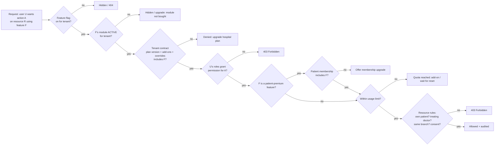
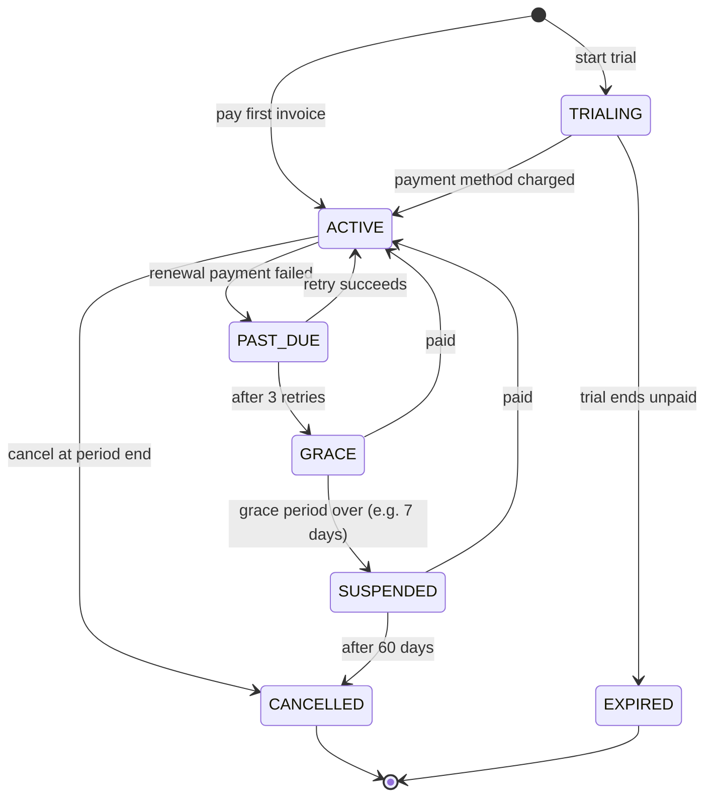

# MediCare CRM: Configurable Roles, Features and Subscription Plans

> Owned by **entitlement-service** and **subscription-service** ([MICROSERVICES.md](MICROSERVICES.md)). Used by every service (guards) and every zone (UI gates, [MICROFRONTENDS.md](MICROFRONTENDS.md)).

Goal: admins change **who can do what** and the business changes **what each plan includes** through admin screens, with **no code change or deploy**.

This doc is about **runtime access checks**. How the product is packaged and sold (modules, editions, plan builder, pricing, contracts, turning modules on/off) is in [PRODUCT-MODULES-AND-PLANS.md](PRODUCT-MODULES-AND-PLANS.md).

---

## 1. Concepts

| Concept | Meaning | Example | Who edits it |
|---|---|---|---|
| **Permission** | Smallest action on a resource, with a scope | `appointment:cancel:own`, `encounter:write:treating`, `price:update:branch` | Developers (in code; new ones ship with features) |
| **Role** | Named bundle of permissions; system roles + **custom roles per tenant** | `DOCTOR`, `RECEPTIONIST`, custom `SENIOR_NURSE` | Tenant admin in the role editor |
| **Module** | Sellable unit (e.g. `diagnostics`, `emr`, `ai_copilot`) declared in a manifest with its features, permissions, settings, screens and jobs | `diagnostics` | Developers (manifest); packaged by business |
| **Edition** | Preset module bundle for a hospital type | Clinic, Diagnostic Center, Multi-specialty Hospital | Platform owner |
| **Contract** | What one hospital actually bought: plan version + add-ons + overrides + custom prices + term | Apollo-example 3-year Enterprise deal | Sales, platform owner |
| **Feature** | A product capability inside a module that can be switched on/off or sold | `lab.home_collection`, `video_consult`, `ai.copilot.scribe` | Product/platform owner |
| **Plan** | Bundle of features + limits, with a price | Hospital `PROFESSIONAL`; patient `CARE_PLUS` | Platform owner (plan editor) |
| **Subscription** | A subscriber on a plan for a period | Apollo hospital on `PROFESSIONAL`; patient Ravi on `CARE_PLUS` | Self-service checkout, sales, platform owner |
| **Add-on** | Extra feature or quota bought on top of a plan | `+5,000 AI messages`, `WhatsApp channel` | Same |
| **Feature flag** | Technical rollout switch (percentage, tenant allowlist, kill switch) | `ai.copilot.scribe` on for 3 pilot tenants | Engineering/product |
| **Override** | Exception for one tenant or user | Free trial of `analytics.advanced` for 30 days | Platform owner / tenant admin |
| **Entitlement** | The *computed* answer: can this user use this feature now, with what limit | `{enabled: true, limit: 2000, used: 412}` | Computed by entitlement-service |

### Two kinds of subscription

MediCare is sold to many hospitals ([MULTI-TENANCY.md](MULTI-TENANCY.md)), so both exist, owned by different parties:

- **A. Hospital plans (B2B SaaS), owned by MediCare:** each **tenant** (hospital) subscribes to a platform plan that decides which modules its staff and patients get. Paid to MediCare.
- **B. Patient memberships (B2C), owned by each hospital:** if the hospital's plan includes `patient_memberships`, the hospital defines its own tiers, prices and benefits (within the features its plan allows) and sells them to its patients. Paid into the hospital's connected payment account.

---

## 2. How access is decided



In one line:

```
allowed = flagOn(F, tenant)
        ∧ moduleActive(module(F), tenant)       // module bought and activated
        ∧ tenantEntitled(F)                     // plan ∪ add-ons ∪ overrides − suspensions
        ∧ rolesGrant(U, permission(A))          // configurable roles
        ∧ (¬premium(F) ∨ memberEntitled(U, F))  // patient membership, if relevant
        ∧ withinLimit(F)                         // metered quotas
        ∧ resourcePolicy(U, A, R)                // ownership, treating relationship, branch, consent (LLD §7)
```

Roles and plans are **independent**. The plan says *what the hospital has bought*; the role says *which staff member may use it*. For example, the AI scribe needs the tenant on `ENTERPRISE` (plan) **and** the user to have `ai.copilot.scribe:use` (role).

---

## 3. Example catalogue

### 3.1 Hospital plans (B2B)

> Example tiers for the **Multi-specialty Hospital** edition. Other editions (Clinic, Diagnostic Center, Telehealth, ...) and how plans are built from modules are in [PRODUCT-MODULES-AND-PLANS.md](PRODUCT-MODULES-AND-PLANS.md) §3–4.

| Feature / limit | Starter | Professional | Enterprise |
|---|:-:|:-:|:-:|
| Doctors / branches | 10 / 1 | 100 / 5 | Unlimited |
| Online booking, doctor directory, patient app | ✅ | ✅ | ✅ |
| Online payments | ✅ | ✅ | ✅ |
| Lab module (catalog, orders, reports) | — | ✅ | ✅ |
| Home sample collection | — | ✅ | ✅ |
| Video consultation | — | ✅ | ✅ |
| WhatsApp channel | Add-on | ✅ | ✅ |
| AI Care Concierge (patients) | 1,000 msgs/mo | 20,000 msgs/mo | 100,000 msgs/mo |
| AI Doctor Copilot: pre-visit summary | — | ✅ | ✅ |
| AI Doctor Copilot: ambient scribe | — | Add-on | ✅ |
| AI Ops Agent | — | — | ✅ |
| Advanced analytics and exports | — | Basic | ✅ |
| Custom roles | — | ✅ | ✅ |
| Patient memberships (sell own tiers) | — | ✅ (up to 2 tiers) | ✅ unlimited |
| Own database | ✅ (shared server) | ✅ (shared server) | ✅ on a **dedicated server**, choice of region |
| Custom branding / own domain | — | Branding | ✅ |
| FHIR API / integrations (LIS, ABDM, insurance) | — | — | ✅ |
| SSO with hospital directory (SAML/OIDC) | — | — | ✅ |
| Audit log retention | 1 year | 3 years | 10 years |
| SMS included | 2,000/mo | 20,000/mo | 100,000/mo |

### 3.2 Patient memberships (B2C)

| Benefit | Free | Care+ | Family+ |
|---|:-:|:-:|:-:|
| Book appointments and lab tests | ✅ | ✅ | ✅ |
| Advance booking window | 14 days | 30 days | 30 days |
| Priority slots (held back for members) | — | ✅ | ✅ |
| Free video consults | — | 2/month | 4/month (shared) |
| Lab test discount | — | 15% | 20% |
| Free home sample collection | — | ✅ | ✅ |
| AI concierge messages | 20/month | Unlimited (fair use) | Unlimited (fair use) |
| AI report explainer | Basic | ✅ | ✅ |
| Family members on account | 2 | 2 | 6 |
| Health record storage (uploads) | 500 MB | 5 GB | 20 GB |
| Annual health check-up package | — | — | 1 per member |

The table above is an **example template** offered to hospitals; each hospital edits names, prices and benefits in its admin zone. A patient can hold a different membership at each hospital they use. Hospital plan names, prices and limits are edited by MediCare in the platform console.

---

## 4. Data model

**Where these tables live:** the feature/permission catalogue, flags, MediCare's hospital plans and hospital subscriptions are in the **control-plane database**. Each hospital's custom roles, role assignments, overrides, patient-membership plans, patient subscriptions and usage counters are in **that hospital's own database** (in the `entitlement` and `membership` schemas), so the `tenant_id` / `owner_tenant_id` columns below are only needed in the control-plane copies.

### 4.1 entitlement-service

```sql
CREATE TABLE permissions (
  code VARCHAR(80) PRIMARY KEY,            -- 'appointment:cancel:own'
  resource VARCHAR(40) NOT NULL, action VARCHAR(30) NOT NULL, scope VARCHAR(20) NOT NULL,
  description TEXT, is_sensitive BOOLEAN DEFAULT false   -- PHI-related: extra confirmation in the role editor
);

CREATE TABLE features (
  key VARCHAR(80) PRIMARY KEY,             -- 'ai.copilot.scribe'
  name VARCHAR(120) NOT NULL, description TEXT,
  type VARCHAR(10) NOT NULL,               -- BOOLEAN | METERED | LIMIT
  unit VARCHAR(20),                        -- 'messages', 'doctors', 'GB'
  audience VARCHAR(10) NOT NULL,           -- TENANT | PATIENT | BOTH
  parent_key VARCHAR(80) REFERENCES features(key),   -- 'ai.copilot.scribe' needs 'ai.copilot'
  zone VARCHAR(20)                         -- micro-frontend that hosts it (for nav)
);

CREATE TABLE feature_permissions (         -- which permissions only make sense if the feature is on
  feature_key VARCHAR(80) REFERENCES features(key),
  permission_code VARCHAR(80) REFERENCES permissions(code),
  PRIMARY KEY (feature_key, permission_code)
);

CREATE TABLE roles (
  id UUID PRIMARY KEY,
  tenant_id UUID,                          -- NULL = system role template
  code VARCHAR(40) NOT NULL, name VARCHAR(80) NOT NULL,
  base_role_id UUID REFERENCES roles(id),  -- custom role cloned from a system role
  is_system BOOLEAN NOT NULL DEFAULT false, -- system roles: editable per tenant via copy-on-write
  version INT NOT NULL DEFAULT 0,
  UNIQUE (tenant_id, code)
);

CREATE TABLE role_permissions (
  role_id UUID REFERENCES roles(id), permission_code VARCHAR(80) REFERENCES permissions(code),
  PRIMARY KEY (role_id, permission_code)
);

CREATE TABLE user_roles (
  tenant_id UUID NOT NULL, user_id UUID NOT NULL, role_id UUID REFERENCES roles(id),
  branch_id UUID,                          -- NULL = all branches
  valid_until TIMESTAMPTZ,                 -- temporary assignment (locum doctor)
  PRIMARY KEY (tenant_id, user_id, role_id, branch_id)
);

CREATE TABLE feature_flags (
  feature_key VARCHAR(80) REFERENCES features(key),
  env VARCHAR(10) NOT NULL,
  state VARCHAR(10) NOT NULL,              -- OFF | ON | PERCENT | ALLOWLIST
  percent SMALLINT, tenant_allowlist UUID[],
  PRIMARY KEY (feature_key, env)
);

CREATE TABLE entitlement_overrides (
  id UUID PRIMARY KEY, subject_type VARCHAR(10) NOT NULL,   -- TENANT | USER
  subject_id UUID NOT NULL, feature_key VARCHAR(80) REFERENCES features(key),
  enabled BOOLEAN, limit_value BIGINT, reason TEXT NOT NULL,
  expires_at TIMESTAMPTZ, created_by UUID NOT NULL
);
```

### 4.2 subscription-service

```sql
CREATE TABLE plans (
  id UUID PRIMARY KEY, code VARCHAR(40) NOT NULL,            -- 'PROFESSIONAL', 'CARE_PLUS'
  owner_tenant_id UUID,                                       -- NULL = MediCare platform plan; set = a hospital's patient membership
  audience VARCHAR(10) NOT NULL,                              -- TENANT | PATIENT
  name VARCHAR(80) NOT NULL, description TEXT,
  status VARCHAR(10) NOT NULL DEFAULT 'ACTIVE',               -- DRAFT | ACTIVE | RETIRED
  trial_days SMALLINT DEFAULT 0, sort_order SMALLINT,
  UNIQUE (owner_tenant_id, code)
);

CREATE TABLE plan_prices (
  id UUID PRIMARY KEY, plan_id UUID REFERENCES plans(id),
  interval VARCHAR(10) NOT NULL,                              -- MONTH | YEAR
  amount NUMERIC(12,2) NOT NULL, currency CHAR(3) NOT NULL DEFAULT 'INR',
  per_unit VARCHAR(20),                                       -- NULL = flat, 'doctor' = per seat
  gateway_plan_id VARCHAR(80),                                -- Razorpay/Stripe plan id
  valid_from DATE NOT NULL, valid_to DATE
);

CREATE TABLE plan_features (               -- plan version snapshot: changes create a new plan version
  plan_id UUID REFERENCES plans(id), feature_key VARCHAR(80) NOT NULL,
  enabled BOOLEAN NOT NULL DEFAULT true,
  limit_value BIGINT,                      -- NULL = unlimited
  reset_period VARCHAR(10),                -- MONTH | NEVER
  overage VARCHAR(10) DEFAULT 'BLOCK',     -- BLOCK | ALLOW_BILL | SOFT_WARN
  PRIMARY KEY (plan_id, feature_key)
);

CREATE TABLE subscriptions (
  id UUID PRIMARY KEY,
  subscriber_type VARCHAR(10) NOT NULL,    -- TENANT | PATIENT
  subscriber_id UUID NOT NULL, tenant_id UUID NOT NULL,
  plan_id UUID NOT NULL REFERENCES plans(id), price_id UUID REFERENCES plan_prices(id),
  quantity INT NOT NULL DEFAULT 1,         -- seats (doctors)
  status VARCHAR(12) NOT NULL,             -- TRIALING | ACTIVE | PAST_DUE | GRACE | SUSPENDED | CANCELLED | EXPIRED
  current_period_start TIMESTAMPTZ NOT NULL, current_period_end TIMESTAMPTZ NOT NULL,
  cancel_at_period_end BOOLEAN DEFAULT false,
  gateway_subscription_id VARCHAR(80) UNIQUE,
  version INT NOT NULL DEFAULT 0
);
CREATE UNIQUE INDEX one_live_sub ON subscriptions (subscriber_type, subscriber_id)
  WHERE status IN ('TRIALING','ACTIVE','PAST_DUE','GRACE');

CREATE TABLE subscription_addons (
  subscription_id UUID REFERENCES subscriptions(id), feature_key VARCHAR(80) NOT NULL,
  limit_value BIGINT, quantity INT DEFAULT 1, price_id UUID,
  PRIMARY KEY (subscription_id, feature_key)
);

CREATE TABLE usage_counters (
  subscriber_type VARCHAR(10) NOT NULL, subscriber_id UUID NOT NULL,
  feature_key VARCHAR(80) NOT NULL, period_start DATE NOT NULL,
  used BIGINT NOT NULL DEFAULT 0,
  PRIMARY KEY (subscriber_type, subscriber_id, feature_key, period_start)
);
```

### 4.3 Subscription lifecycle



What each state means for features:

| State | Hospital (tenant) | Patient membership |
|---|---|---|
| TRIALING / ACTIVE / PAST_DUE | Full plan | Full benefits |
| GRACE | Full plan + banner to admins | Full benefits + reminder |
| SUSPENDED | **Read-only**: existing appointments and records stay accessible to patients and doctors (patient safety), no new bookings via paid modules, admin banner | Falls back to Free |
| CANCELLED | Data export available; retained per legal retention rules | Free tier |

Never block access to **medical records** or **existing appointments** for billing reasons. Only new or premium actions are blocked.

**Upgrades** apply immediately with prorated charge; **downgrades** apply at the end of the period. If a downgrade puts a tenant over a limit (e.g. 40 doctors on a 10-doctor plan), nothing is deleted: the admin picks which doctors stay bookable; the others become inactive for new bookings.

Payments go through **billing-service** using the gateway's subscription feature (Razorpay Subscriptions / Stripe Billing); webhooks → `payment.succeeded/failed` → subscription-service updates state → `subscription.changed` → entitlement-service recomputes.

**As built (Phase 19):** hospital (SaaS) billing lives in **subscription-service** (control plane), not billing-service (which handles patients' payments inside each hospital's database). Periods are calendar months; renewals charge a saved card mandate through a recurring-payment port (simulated gateway in dev; the Razorpay adapter is not built yet); sales-led hospitals pay invoices by bank transfer (no dunning). Dunning: 3 retries a day apart → 7 days' grace → suspended. `subscription.status_changed` → entitlement-service: SUSPENDED / CANCELLED / EXPIRED read every module except core as READ_ONLY (the Phase 17 read-only rule: GET by signed-in users only). Upgrades by the hospital apply now with a prorated invoice; downgrades at the period end; changes made by MediCare support apply now without proration.

---

## 5. Enforcement in code

### 5.1 Four layers

| Layer | What it checks | Purpose |
|---|---|---|
| **Micro-frontend** | `<Feature>`, `<Can>`, nav from capabilities | Good UX: hide, disable or show upsell |
| **Gateway (Kong plugin)** | Route → required feature (e.g. `/api/v1/video/*` needs `video_consult`) using a cached tenant entitlement set | Cheap early rejection |
| **Service** (authoritative) | Permission + feature + limit + resource policy, via `@mc/entitlements-sdk` | Real security boundary |
| **Database** | Each hospital has its own database; the router verifies `tenant_meta` on connect | Last line of defence against cross-tenant leaks |

### 5.2 Service guard (NestJS)

```ts
@Post("/encounters/:id/scribe")
@RequireFeature("ai.copilot.scribe")                 // tenant plan + flag (+ membership if patient feature)
@RequirePermission("ai.copilot.scribe:use")          // role
@Metered("ai.copilot.scribe.minutes", (req) => req.body.estimatedMinutes)
async startScribe(@Param("id") id: string, @CurrentActor() actor: Actor) {
  await this.policy.assertTreatingDoctor(actor, id);  // resource rule (LLD §7)
  return this.scribe.start(actor, id);
}
```

```ts
// entitlements-sdk: cached, push-invalidated
export class EntitlementsClient {
  // Local LRU cache keyed by (tenantId, userId, capabilitiesVersion); TTL 5 min.
  // Kafka consumer on 'entitlements.changed' evicts affected keys immediately.
  async forActor(actor: Actor): Promise<Entitlements> { /* GET /internal/entitlements/{tenant}/{user} */ }
}

export class Entitlements {
  has(feature: string): boolean;
  can(permission: string): boolean;
  limit(feature: string): { limit: number | null; used: number };
  require(feature: string): void;          // throws FeatureNotEntitledError → 402/403 with upgrade hint
}
```

Error response when a plan doesn't include a feature:

```json
{
  "type": "https://medicare.example/errors/feature-not-in-plan",
  "status": 403,
  "code": "FEATURE_NOT_IN_PLAN",
  "feature": "ai.copilot.scribe",
  "requiredPlan": "ENTERPRISE",
  "upgradeUrl": "/account/plans"
}
```

### 5.3 Usage metering

1. `@Metered` reserves usage atomically in Redis: `INCRBY usage:{subscriber}:{feature}:{period}` and compares with the limit (Lua script, so check-and-increment is atomic).
2. Over the limit → `BLOCK` (429 `QUOTA_EXCEEDED` with add-on link), `SOFT_WARN` (allow + banner), or `ALLOW_BILL` (allow + overage line on next invoice).
3. A worker flushes Redis counters to `usage_counters` every minute and publishes `usage.limit_reached` at 80% and 100% (notification to admins/patients).
4. Failed operations release their reservation.

**As built (Phase 19):** `UsageMeter` (`@mc/entitlements-sdk`) keeps `usage:<tenant>:<feature>:<YYYY-MM>` (calendar month) with a Lua reserve; limits and overage rules come from entitlement-service (`GET /internal/tenants/:id/features`, cached and evicted on changes). subscription-service flushes counters to `usage_counters` every 30 s and before each invoice, bills ALLOW_BILL overage on the next invoice, and e-mails the account owner at 80% and 100% once per month. Login codes count but are never blocked. The first metered feature is `core.sms`.

### 5.4 Computing capabilities (entitlement-service)

```ts
async function computeCapabilities(tenantId: UUID, userId: UUID): Promise<Capabilities> {
  const [tenantSub, memberSub, roles, flags, overrides] = await Promise.all([
    subs.liveFor("TENANT", tenantId),
    subs.liveFor("PATIENT", await patients.idForUser(userId)),   // null for staff or free patients
    roleRepo.rolesWithPermissions(tenantId, userId),             // includes branch scopes, expiry
    flagRepo.forTenant(tenantId),
    overrideRepo.active(tenantId, userId),
  ]);

  const tenantFeatures = applyOverrides(union(planFeatures(tenantSub), addons(tenantSub)), overrides.tenant);
  const memberFeatures = applyOverrides(planFeatures(memberSub ?? await plans.free("PATIENT")), overrides.user); // no membership = Free plan
  const permissions = new Set(roles.flatMap((r) => r.permissions));

  const features = Object.fromEntries(catalog.all().map((f) => {
    const flagOn = flags.isOn(f.key, tenantId);
    const tenantOk = f.audience === "PATIENT" || tenantFeatures.has(f.key);
    const memberOk = f.audience !== "PATIENT" || memberFeatures.has(f.key);
    const enabled = flagOn && tenantOk && memberOk && dependenciesMet(f, tenantFeatures);
    return [f.key, { enabled, ...limitsFor(f, tenantFeatures, memberFeatures), ...(enabled ? {} : upgradeHint(f)) }];
  }));

  // Permissions tied to a disabled feature are removed, so roles can't grant what the plan lacks.
  for (const p of [...permissions]) if (!featureForPermission(p).every((k) => features[k]?.enabled)) permissions.delete(p);

  return { roles: roles.map((r) => r.code), permissions: [...permissions], features,
           nav: buildNav(features, permissions), home: homeFor(roles), version: await versions.current(tenantId, userId) };
}
```

Results are cached in Redis per `(tenant, user)` and invalidated on `subscription.*`, role edits, flag changes and overrides. JWTs carry only `tenant`, `roles` and a `capabilitiesVersion`, not the full permission list (keeps tokens small and changes take effect without re-login).

---

## 6. Admin screens

| Screen | Zone | Who | What |
|---|---|---|---|
| **Role editor** | admin | Tenant admin | Grid of permissions grouped by module (rows) × roles (columns); create custom role by cloning; sensitive (PHI) permissions need confirmation; changes versioned and audited; "Preview as role" opens the app with that role's capabilities |
| **User access** | admin | Tenant admin | Assign roles per branch, temporary roles with expiry, see effective permissions and *why* (which role grants it) |
| **Plan & billing** | account | Tenant owner | Current plan, usage meters, upgrade/downgrade, add-ons, invoices |
| **My membership** | account | Patient | Compare this hospital's plans, subscribe, family members, usage (video consults left) |
| **Membership editor** | admin | Tenant admin | Define the hospital's own patient membership tiers, prices and benefits (only features the hospital's plan includes) |
| **Plan editor** | platform-console | Platform owner | Create plan versions, attach features and limits, set prices; existing subscribers stay on their version until migrated |
| **Feature flags** | platform-console | Engineering/product | Rollout %, tenant allowlist, kill switch |
| **Overrides** | platform-console | Platform owner | Give a tenant or user a feature/limit temporarily, with reason and expiry |

Guardrails:
- At least one tenant admin must always exist; a user can't remove their own admin role.
- System role templates can't be deleted; tenants edit a copy.
- Every role, plan, flag or override change writes to the audit log with before/after.

---

## 7. Default role templates

Starting point for each new tenant (editable):

| Role | Default permissions (summary) |
|---|---|
| `PATIENT` | own profile, dependents, book/cancel own appointments and lab tests, own records, own invoices, AI concierge |
| `DOCTOR` | own schedule and leave, own queue, treating-patient chart, encounters, prescriptions, lab orders, copilot features |
| `NURSE` | queue, vitals entry, check-in, read treating-patient summary (no notes editing) |
| `LAB_TECH` | lab worklist, sample collection, result entry |
| `PATHOLOGIST` | result verification and report signing |
| `RECEPTIONIST` | walk-in booking, check-in, counter payments, patient demographics (no clinical data) |
| `BRANCH_ADMIN` | doctors, schedules, prices, catalog, dashboards, audit for their branch |
| `TENANT_ADMIN` | everything in the tenant incl. role editor and plan & billing |
| `PLATFORM_OWNER` | platform-console only (tenants, plans, flags); no access to tenants' clinical data |

**As built (Phase 18):** MediCare's own staff are staff of an internal account (slug `medicare`, internal plan `MEDICARE_HQ` with the internal `platform` module), so they sign in like any hospital's staff and never get a token for a hospital. `PLATFORM_OWNER` is split into `PLATFORM_PRODUCT` (build plans), `PLATFORM_APPROVER` (publish/reject/retire, never what they built or submitted) and `PLATFORM_SUPPORT` (move hospitals between plans, overrides); the account's hospital admin has all three. Override expiry and feature flags are not built yet.
