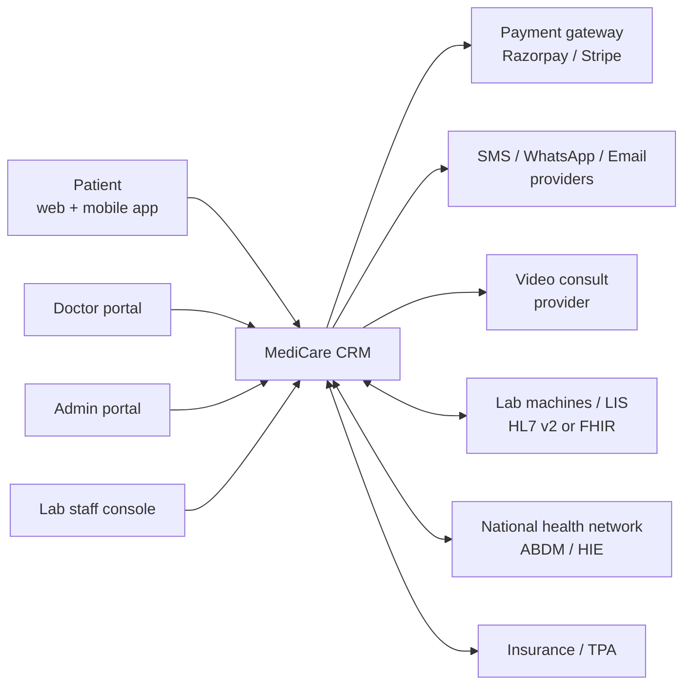
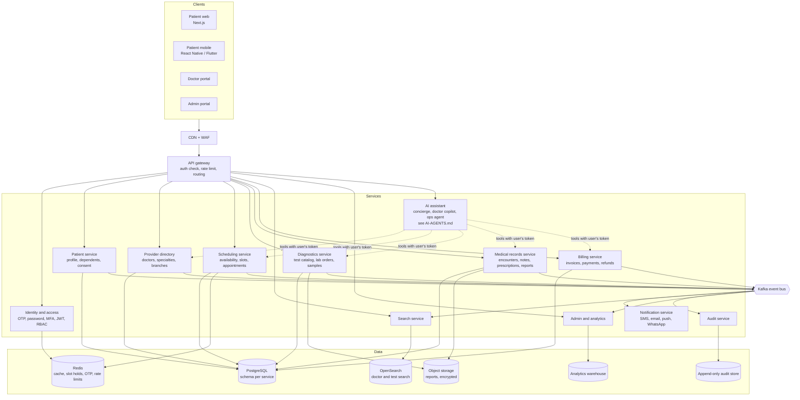
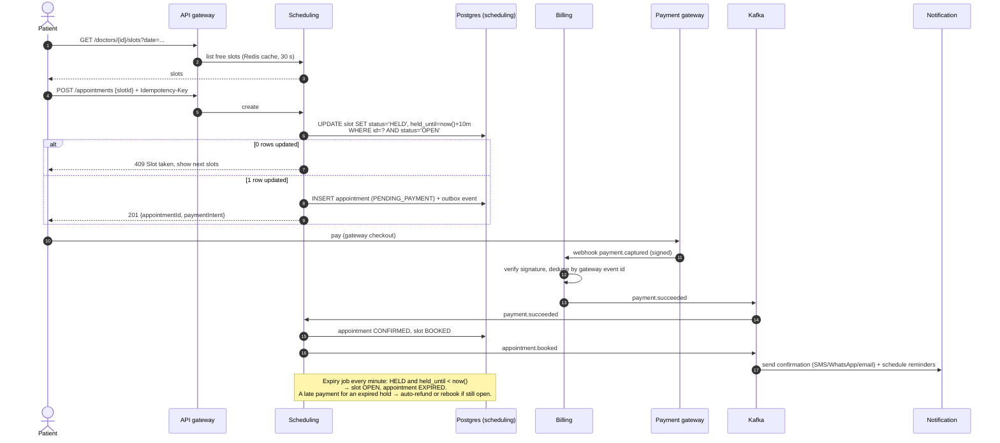
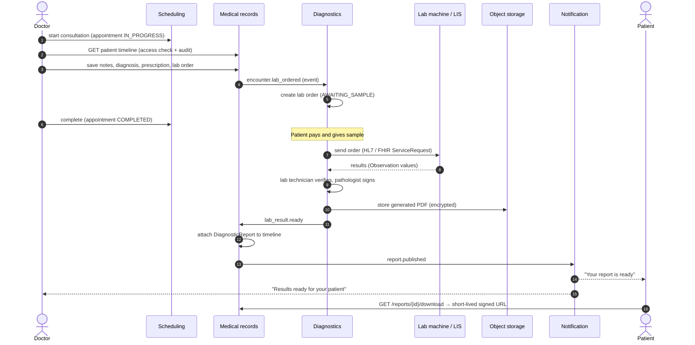
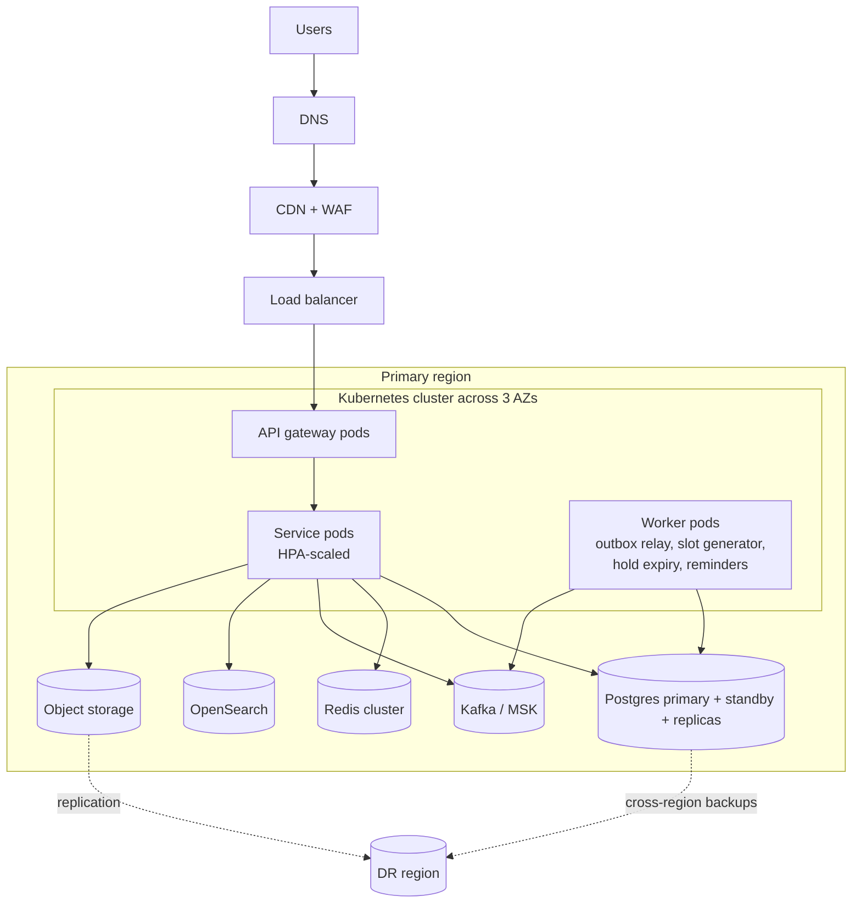

# MediCare CRM: High-Level Design (HLD)

> A **multi-tenant SaaS** CRM sold to many hospitals and clinic chains (see [MULTI-TENANCY.md](MULTI-TENANCY.md)); each hospital gets its own branded, isolated instance. Patients find doctors by specialty, book appointments and lab tests, and see their reports and full medical history. Doctors manage their schedule, consultations and prescriptions. Admins run the hospital: doctors, departments, test catalog, pricing and analytics.

---

## 1. Scope and actors

| Actor | What they do |
|---|---|
| **Patient** (and family members on the same account) | Register or log in, search doctors by specialty/location/availability, book, reschedule or cancel appointments, book lab tests (in-clinic or home sample collection), pay, download reports and prescriptions, see their health timeline |
| **Doctor** | Log in, set weekly availability and leave, see the day's queue, open a patient's history (only patients they treat), write consultation notes, prescriptions and lab orders, review lab results |
| **Platform owner** (MediCare SaaS operator) | Manage tenants (hospitals), plans, prices, feature flags; no access to clinical data |
| **Admin** (hospital or branch) | Onboard doctors and staff, manage departments, specialties, branches, test catalog and pricing, override bookings, view dashboards, handle audits |
| **Lab technician** (staff sub-role) | Collect samples, update test status, upload or verify reports |
| **Receptionist** (staff sub-role, optional) | Walk-in booking, check-in, payment at counter |

The three roles you asked for (patient, doctor, admin) are the core. Lab technician and receptionist are staff roles with narrower permissions; they come almost for free from the same RBAC model.

---

## 2. Functional requirements

**Patient**
1. Sign up with phone OTP or email; optional link to a national health ID (for India, ABHA under ABDM).
2. Manage profile and dependents (child, parent), allergies, chronic conditions, insurance.
3. Browse **specialties → doctors**; filter by branch, language, fee, gender, rating and next available slot.
4. View doctor profile: qualifications, experience, fee, consultation modes (in-person, video).
5. Book, reschedule or cancel an appointment for a specific slot; get a confirmation and reminders.
6. Browse the **test catalog** (single tests and packages such as "Full body checkup"), see preparation instructions (e.g. fasting), and book a slot at a lab or a home collection.
7. Pay online (or pay at counter); get invoices; get refunds on cancellation as per policy.
8. View and download **reports** (lab reports, prescriptions, discharge summaries), and upload outside reports.
9. See a **health timeline**: every visit, prescription, test and report in date order.
10. Share a record with another doctor through a time-limited link (consent).

**Doctor**
1. Log in (password + MFA).
2. Define availability templates (e.g. Mon–Fri 10:00–13:00, 15 min slots, branch X) and block leave.
3. See today's queue with check-in status; start, complete or mark no-show.
4. See the patient's history when an appointment exists (or via break-glass in emergencies, which is audited).
5. Write consultation notes, diagnosis, prescription, and order lab tests.
6. Get notified when ordered test results are ready; mark them reviewed.

**Admin**
1. CRUD for branches, departments, specialties, doctors, staff, test catalog, packages, prices.
2. Approve doctor profiles; deactivate users.
3. View and override any appointment (with a reason, audited).
4. Dashboards: bookings per day, doctor utilisation, no-show rate, revenue, test turnaround time.
5. Configure policies: cancellation window, refund rules, max advance booking days, reminder schedule.
6. Search the audit log (who accessed which patient record and when).

---

## 3. Non-functional requirements

| Area | Target |
|---|---|
| Availability | 99.9% for booking and records (about 43 min downtime a month) |
| Latency | Doctor search p95 < 300 ms; booking p95 < 500 ms; report download start < 1 s |
| Consistency | **No double booking**: strong consistency on slots and payments. Search and dashboards can be eventually consistent (seconds). |
| Security and privacy | Patient data is sensitive health data: encryption in transit (TLS 1.2+) and at rest, field-level encryption for the most sensitive fields, least-privilege access, MFA for staff, immutable audit log |
| Compliance | India: DPDP Act 2023, ABDM health data guidelines, Telemedicine Practice Guidelines 2020 for video consults. US: HIPAA. EU: GDPR. Design for consent, data minimisation, right to access and erasure (subject to medical record retention laws). |
| Retention | Medical records kept for the legally required period (often 3–10+ years; configurable per record type), then archived |
| Scalability | Horizontal scaling of stateless services; peak at 9–11 AM booking rush and on report-release batches |
| Interoperability | Expose and accept **HL7 FHIR R4** resources so the system can talk to lab machines (LIS), HIS, insurance and national health networks |
| Observability | Tracing across services, per-endpoint SLOs, alerts on booking failures and payment mismatches |

---

## 4. Capacity estimate (mid-size hospital chain)

Assumptions are **per large tenant**: 20 branches, 500 doctors, 2 M registered patients, 300 K monthly active. Platform-wide target for year 2: ~300 tenants (mostly small clinics plus ~10 large groups on dedicated database servers), roughly 10–20× the numbers below. Each hospital has its own database, so the per-tenant numbers below are also the per-database sizing (MULTI-TENANCY.md §3).

| Item | Estimate |
|---|---|
| Appointments/day | 500 doctors × 30 = **15 K/day**; peak ~10× average QPS during the morning rush → ~5 booking writes/s, which is small |
| Doctor search reads | ~50 searches per booking → 750 K/day, peak ~100 req/s |
| Slots stored | 500 doctors × 30 slots × 90 days advance = **1.35 M slot rows** live |
| Lab orders/day | ~10 K, each with 1–20 test results |
| Reports (PDF + images) | ~10 K/day × 300 KB ≈ 3 GB/day ≈ **1 TB/year** in object storage (DICOM imaging would be far more; keep it in a PACS, link to it) |
| Structured DB | Tens of GB per year; one PostgreSQL primary with read replicas handles this comfortably |

Takeaway: the problem is **not raw scale**. It is correctness (slots, payments), security (who can see what) and auditability. The design favours strong consistency and clean boundaries over heavy sharding.

---

## 5. Architecture

### 5.1 Context diagram

### 5.2 Container diagram

### 5.3 Service responsibilities

| Service | Owns (source of truth) | Publishes events | Consumes |
|---|---|---|---|
| **Identity and access (IAM)** | users, credentials, roles, sessions, MFA | `user.registered`, `user.role_changed` | — |
| **Patient** | patient profile, dependents, allergies, insurance, consents | `patient.updated`, `consent.granted/revoked` | `user.registered` |
| **Provider directory** | doctors, specialties, departments, branches, fees, qualifications | `doctor.updated`, `doctor.activated` | — |
| **Scheduling** | availability templates, leaves, slots, appointments, queue/check-in | `appointment.booked/rescheduled/cancelled/completed/no_show`, `slot.availability_changed` | `doctor.updated`, `payment.succeeded/failed` |
| **Diagnostics (lab)** | test catalog, packages, lab orders, samples, results | `lab_order.created`, `sample.collected`, `lab_result.ready` | `payment.succeeded`, `encounter.lab_ordered` |
| **Medical records (EMR)** | encounters, clinical notes, diagnoses, prescriptions, documents/reports, timeline | `encounter.completed`, `report.published` | `appointment.completed`, `lab_result.ready` |
| **Billing** | invoices, payments, refunds, payment-gateway webhooks | `payment.succeeded/failed`, `refund.processed` | `appointment.booked/cancelled`, `lab_order.created` |
| **Notification** | templates, delivery log, user channel preferences | `notification.sent/failed` | almost every business event |
| **Search** | read-only search index | — | `doctor.*`, `slot.availability_changed`, test catalog events |
| **Audit** | append-only access and change log | — | every service (plus direct sync writes for PHI reads) |
| **AI assistant** | conversations, prompts, knowledge index, pending confirmations, clinical drafts (no clinical data of its own) | `assistant.action_confirmed` | calls other modules as tools; see [AI-AGENTS.md](AI-AGENTS.md) |
| **Admin and analytics** | dashboards, policies/config | `policy.updated` | all business events → warehouse |

### 5.4 Monolith or microservices?

**Decision: microservices + micro-frontends** (updated). The bounded contexts above become separate services, each with its own database, talking through REST/gRPC and Kafka events. Three platform services are added: **tenant-service**, **entitlement-service** (configurable roles, features, flags) and **subscription-service** (hospital plans and patient memberships).

- Services, communication, sagas and multi-tenancy: [MICROSERVICES.md](MICROSERVICES.md)
- Portals as independently deployed Next.js zones: [MICROFRONTENDS.md](MICROFRONTENDS.md)
- Role- and subscription-based features: [FEATURES-AND-PLANS.md](FEATURES-AND-PLANS.md)

The load (Section 4) does not *require* microservices; the reasons are independent team ownership, independent deploys, and selling modules separately through plans. The cost is operational complexity, so the rollout starts with a core set of services (MICROSERVICES.md §9).

## 6. Key flows

### 6.1 Book an appointment (with online payment)

The hard requirement is that two patients can never get the same slot. We use a short **hold** on the slot, then confirm on payment.

"Pay at clinic" skips the payment step: the appointment goes straight to `CONFIRMED`.

### 6.2 Consultation → lab order → report

### 6.3 Login and authorisation

- **Patient**: phone + OTP (OTP in Redis, 5 min TTL, 5 attempts, rate-limited per phone and IP). Optional password or passkey.
- **Doctor / Admin / Staff**: email + password + **mandatory MFA** (TOTP or passkey). Admins can be restricted to hospital network/VPN.
- Tokens: short-lived **access JWT (15 min)** with `sub`, `roles`, `branchIds`, and a **refresh token (rotating, stored hashed, revocable)**. Use an OIDC provider (Keycloak, Cognito, Auth0) rather than writing auth from scratch.
- Authorisation is two layers:
  1. **RBAC** at the gateway and controller: "a doctor may call `GET /patients/{id}/timeline`".
  2. **Relationship check (ABAC)** in the service: "this doctor has an appointment/encounter with this patient in the last N months, or an active consent, or is in break-glass mode." Every read of patient health data writes an audit record.

---

## 7. Data design (summary)

Full schema is in [LLD.md](LLD.md). High-level choices:

| Data | Store | Why |
|---|---|---|
| Users, patients, doctors, slots, appointments, orders, invoices, clinical records | **PostgreSQL** (schema per service) | Transactions, constraints (unique slot booking), relational queries, JSONB for flexible clinical fields |
| Doctor and test search | **OpenSearch** | Full-text + filters + geo + "next available" sort; fed by events |
| Slot list cache, OTPs, rate limits, idempotency keys | **Redis** | Low latency, TTLs |
| Report PDFs, images, uploaded documents | **S3-compatible object storage**, SSE-KMS, private bucket | Cheap, durable; access only through signed URLs |
| Audit log | Append-only table (insert-only DB role) or WORM storage (S3 Object Lock) | Tamper-evident trail required for health data |
| Analytics | Warehouse (BigQuery/Redshift/ClickHouse) fed by CDC/events, with **de-identified** data | Dashboards without touching production or exposing PHI |

**FHIR alignment** so integrations are easy later:

| Our entity | FHIR R4 resource |
|---|---|
| Patient | `Patient` |
| Doctor, doctor at a branch with a specialty | `Practitioner`, `PractitionerRole` |
| Branch / department | `Organization`, `Location` |
| Availability, slot | `Schedule`, `Slot` |
| Appointment | `Appointment` |
| Consultation | `Encounter` |
| Diagnosis | `Condition` |
| Prescription | `MedicationRequest` |
| Lab order | `ServiceRequest` |
| Lab result value | `Observation` |
| Lab report | `DiagnosticReport` |
| Uploaded PDF | `DocumentReference` |
| Consent | `Consent` |

---

## 8. Cross-cutting concerns

### 8.1 Security and privacy

- **Network**: WAF + CDN in front, services in private subnets, DBs not internet-reachable, mTLS between services (service mesh) if microservices.
- **Encryption**: TLS everywhere; disk encryption with KMS; **application-level field encryption** (envelope encryption) for things like diagnosis text, government IDs and insurance numbers; searchable fields use a blind index (HMAC).
- **Least privilege**: doctors see only their patients; lab staff see orders, not consultation notes; admins see operational data but not clinical notes by default.
- **Break-glass**: a doctor can access any record in an emergency after typing a reason; this alerts compliance and is reviewed.
- **Audit**: who, what, when, from where, why (for every PHI read and every write), kept for years, append-only.
- **Consent**: patient-controlled sharing with other doctors/hospitals; time-limited; revocable.
- **Secrets**: in a vault (AWS Secrets Manager / HashiCorp Vault), rotated.
- **OWASP**: input validation, parameterised SQL, file upload scanning (antivirus + MIME check), CSP headers, rate limits on OTP and login.

### 8.2 Reliability

- Stateless services on Kubernetes across **3 availability zones**; HPA on CPU and request rate.
- Postgres: managed (RDS/Cloud SQL/Aurora) with synchronous standby in another AZ, read replicas for search-heavy reads, PITR backups.
- **Transactional outbox** so a DB change and its event are never out of sync; consumers are idempotent.
- Retries with exponential backoff + dead-letter topics; circuit breakers around the payment, SMS and video providers.
- DR: cross-region backups and object-storage replication. Target **RPO ≤ 5 min, RTO ≤ 1 h**.
- Graceful degradation: if search is down, fall back to a simple DB query by specialty; if notifications are down, bookings still succeed and messages are retried later.

### 8.3 Observability

- OpenTelemetry traces + metrics + structured logs (no PHI in logs: log IDs, not names or diagnoses).
- Dashboards: booking success rate, slot conflict (409) rate, payment webhook lag, notification failure rate, report turnaround.
- Alerts: booking error rate > 1%, payment captured but appointment not confirmed > 5 min, outbox lag > 1 min.

### 8.4 Notifications

Channel per user preference (SMS, WhatsApp, email, push). Reminders: 24 h and 2 h before the appointment, fasting instructions 12 h before a test, "report ready", follow-up reminders from the prescription. Templates are versioned and localised (English, Hindi, regional).

---

## 9. Deployment view

---

## 10. Suggested tech stack

| Layer | Choice | Alternatives |
|---|---|---|
| Patient web / portals | Next.js + TypeScript, **Multi-Zones micro-frontends** | Module Federation |
| Mobile | React Native or Flutter | Native |
| Backend | NestJS (TypeScript) or Spring Boot (Java) | Go, .NET |
| Auth | Keycloak (self-hosted OIDC) | Cognito, Auth0 |
| API gateway | Kong | Envoy, Apigee |
| Roles, features, plans | entitlement-service + subscription-service (own), Razorpay Subscriptions / Stripe Billing | OpenFGA/OPA for policies, Unleash for flags |
| AI | Google Gemini (`gemini-3.1-pro-preview`, `gemini-3.8-flash`); Vertex AI for production patient data | — |
| DB | PostgreSQL 16 | — |
| Cache | Redis 7 | — |
| Search | OpenSearch / Elasticsearch | Postgres full-text for v1 |
| Events | Kafka (or Redis Streams / RabbitMQ for v1) | SQS/SNS |
| Storage | S3 / MinIO | GCS, Azure Blob |
| Infra | Docker, Kubernetes (GKE fits Vertex AI), Helm, Argo CD, Terraform, GitHub Actions | EKS, ECS |
| Observability | OpenTelemetry, Prometheus, Grafana, Loki | Datadog |
| Integrations | HAPI FHIR (FHIR facade), Razorpay/Stripe, Twilio/MSG91/WhatsApp Business API | — |

---

## 11. Phased roadmap

| Phase | Scope |
|---|---|
| **1. MVP** | IAM (patient OTP, staff password+MFA), doctor directory with specialties, availability + slot booking, pay-at-clinic, admin CRUD, email/SMS confirmation |
| **2. Diagnostics and records** | Test catalog and lab booking, report upload and download, patient timeline, prescriptions, doctor's patient view with audit |
| **3. Payments and engagement** | Online payment + refunds, reminders, reschedule, waitlist, reviews/ratings |
| **4. Scale and integrations** | OpenSearch, FHIR APIs, LIS integration, video consultation, ABDM/insurance, analytics warehouse |
| **5. Agentic AI** | Care Concierge, Doctor Copilot, Ops Agent, background agents ([AI-AGENTS.md](AI-AGENTS.md) §12 has its own staged rollout; the knowledge-only concierge can start as early as phase 2) |

---

## 12. Risks and trade-offs

| Decision | Trade-off |
|---|---|
| Pre-generated slot rows (vs computing free time on the fly) | More rows, but trivial conflict detection with a row update, easy "next available" queries, and clear audit. Regenerate when templates change. |
| Hold + payment confirm | Slot may be held for 10 min by someone who never pays; short TTL and max active holds per user limit abuse. |
| Microservices + micro-frontends | Independent teams, deploys and sellable modules; costs more infrastructure, eventual consistency and harder debugging (see MICROSERVICES.md §9). |
| Eventual consistency for search | "Next available" may be a few seconds stale; booking always re-checks in Postgres so correctness is not affected. |
| Field-level encryption | Strong protection for PHI, but fields cannot be queried with LIKE; use blind indexes or keep searchable fields unencrypted where acceptable. |
