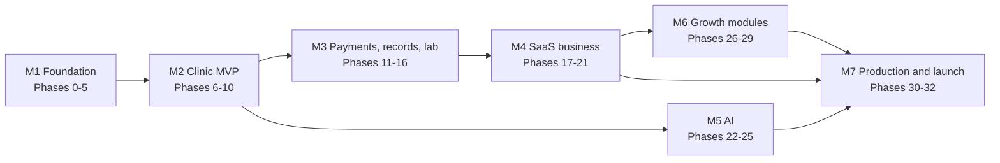

# MediCare CRM: Implementation Plan

> Small, demoable phases that build the design in [HLD](HLD.md), [LLD](LLD.md), [MULTI-TENANCY](MULTI-TENANCY.md), [MICROSERVICES](MICROSERVICES.md), [MICROFRONTENDS](MICROFRONTENDS.md), [FEATURES-AND-PLANS](FEATURES-AND-PLANS.md), [PRODUCT-MODULES-AND-PLANS](PRODUCT-MODULES-AND-PLANS.md) and [AI-AGENTS](AI-AGENTS.md).

## How to use this plan

- Each phase is a **vertical slice** sized for roughly **1–2 weeks for 1–2 developers**. It ends with something you can **demo**, plus tests and updated docs.
- Phases are in dependency order. Within a milestone, some phases can run in parallel (noted).
- Every phase follows the same **definition of done**:
  - [ ] Unit + integration tests (Testcontainers) pass in CI
  - [ ] **Cross-tenant test**: the new APIs return 404 for another hospital's IDs
  - [ ] **Entitlement test**: the new APIs and screens are denied when the module/feature/permission is missing
  - [ ] OpenAPI and event schemas updated in `@mc/contracts`
  - [ ] Runs in local docker-compose; deployed to staging (from Phase 9 on)
  - [ ] Docs updated if the design changed
- Use **synthetic data only** until Phase 30 (production readiness). No real patient data in dev or staging.

## Status

| Milestone | Status |
|---|---|
| **M1 Foundation (Phases 0–5)** | ✅ Done 2026-10-23, verified locally (see below) |
| **M2 Clinic MVP** | Phases 6–10 ✅ done (6–9 on 2026-10-23, 10 on 2026-10-24; Phase 9 staging: built and validated, **not deployed**: needs a GCP project) |
| **M3 Payments, records and lab** | ✅ Phases 11–16 done 2026-10-24 (Phase 11: simulated Razorpay locally, real adapter needs test keys; Phase 13: dev virus scanner locally, clamd adapter tested against a protocol fake, real ClamAV not run) |
| **M4 SaaS business** | ✅ Phases 17–21 done 2026-10-25 (plans, contracts, module lifecycle; platform console with plan builder and two-person approval; SaaS billing; self-serve signup, setup guide, settings, role editor, custom domains; search with OpenSearch. Razorpay recurring and Route are simulated) |
| **M5 AI (Gemini)** | Phase 22 ✅ done 2026-10-25 (AI foundation and knowledge-only concierge); Phase 23 ✅ done 2026-10-31 (booking tools with Confirm cards); Phase 24 ✅ done 2026-10-31 (report explainer, doctor pre-visit summary); Phase 25 ✅ done 2026-10-31 (scribe, prescription safety, WhatsApp). All verified with the offline dev provider: **no working Gemini key yet**, the Gemini/Vertex adapter (incl. function calling) is built and typechecked but has not called the real API. M5 complete (real Gemini and WhatsApp runs pending) |
| **M6 Growth modules** | Phase 26 ✅ done 2026-10-31 (patient memberships); Phases 27–29 not started |
| M7 | Not started |

**Review 2026-10-25:** [ROLE-FLOWS-AND-GAPS.md](ROLE-FLOWS-AND-GAPS.md) traces every role's flows through the code and lists the gaps: production blockers, branch scoping, clinical safety and dead ends. It recommends fixing waves 1–2 before Phase 23. **Wave 1 done 2026-10-25; wave 2 (branch scoping, offboarding, split permissions, admin audit, nurse triage, critical-value escalation, desk chat alerts) done 2026-10-30** (fix log: §8 of that document; `mc test gaps`, `mc test wave2`). **Wave 3 (front desk and lab completeness, screens for existing APIs, missing notifications) done 2026-10-30** (`mc test wave3`). **Wave 4 (production readiness without provider accounts) done 2026-10-30** (`mc test wave4`); the real-provider runs (Razorpay recurring and Route, MSG91, Cloud KMS, ClamAV, Gemini) wait for keys. **Wave 5 (remaining smaller gaps: E-9 amend form, owner and staff notices, real client IP and OTP caps, document purge, override end dates, OpenTelemetry tracing, Playwright in CI) done 2026-10-31** (`mc test wave5`). **Phase 23 (concierge booking tools with Confirm cards) done 2026-10-31** (`mc test concierge`). **Phase 24 (report explainer + doctor pre-visit summary) done 2026-10-31** (`mc test copilot`). **Phase 25 (scribe, prescription safety, WhatsApp) done 2026-10-31** (`mc test scribe`, `mc test whatsapp`). M5 is complete. **Phase 26 (patient memberships) done 2026-10-31** (`mc test memberships`). Next: Phases 27–29 (by customer demand) or the real-provider runs.

### M1: what was built and how it was verified

- **Phase 0:** three repos (`platform`, `backend`, `frontend`; git initialised, no commits yet), `mc` CLI, docker-compose stack, oxlint + module-boundary checks, service and zone generators, CI workflows (written, not yet run: no remote).
- **Phase 1:** `@mc/tenancy` (tenant context, per-tenant DB router with `tenant_meta` check, migrations, outbox), `@mc/nest-common` (bootstrap, auth guard, RFC 7807 errors, idempotency, outbox relay, idempotent consumer with DLQ, route registry), `@mc/kafka`, `@mc/contracts`.
- **Phase 2:** tenant-service: catalog, provisioning saga (`CREATE DATABASE … TEMPLATE`), host → tenant resolution; migration orchestrator in `mc migrate` (control → template → tenant DBs, versions recorded per tenant).
- **Phase 3:** Keycloak organization per hospital, staff onboarding/invites, patient phone OTP (Mailpit as SMS in dev) with ES256 tokens and rotating refresh tokens; cross-tenant leak test.
- **Phase 4:** shell zone (landing, staff OIDC + PKCE, patient OTP, session refresh, logout) and admin zone (overview, branches, staff); `@mc/ui`, `@mc/auth`, `@mc/bff`, `@mc/features`.
- **Phase 5:** module manifests (core, directory, appointments, front_desk) + role templates, entitlement-service (registry, roles, capabilities, module on/off with dependency checks), entitlements SDK guards, nav from capabilities.

Verification on 2026-10-23: unit tests (backend), integration tests (tenancy router incl. mis-routing guard, migrations, idempotent consumer, outbox relay), **cross-tenant leak test: 72 checks over 34 routes, 0 leaks**, Playwright: admin manages branches/staff, doctor denied admin zone, patient OTP sign-in and admin denied; all also pass under `mc dev`.

### Phase 6 (doctor directory): what was built

- **provider-service** (port 4404): specialties (15 defaults seeded per hospital, codes may contain digits), doctors with qualifications, languages, consult modes, specialties and per-branch fees; DRAFT → published (ACTIVE) → unpublished; trigram + specialty-name search with filters and keyset pagination. Keeps a **branches read model** from `tenant.events`. Adding a doctor creates their staff login through iam-service's new internal onboarding endpoint (role DOCTOR), after provider-service has checked `doctor:manage:tenant` itself.
- **Admin zone:** Doctors (add, search, publish/unpublish, edit page) and Specialties (add, hide/show).
- **Patient zone** `/care` (port 3401, new): specialties home, doctor search with specialty chips and filters (branch, language, gender, video), doctor profile. Public: no sign-in needed; only published doctors; no staff-only fields. Booking button waits for Phase 8.
- Verified: leak test **113 checks / 49 routes, 0 leaks** (now also covers public routes with ids); Playwright **7 tests** (adds: draft hidden → publish → patient finds by specialty/filters/profile; other hospital gets 404; specialty add/hide).

Fixes found while testing Phase 6: specialty codes dropped digits (names like "Sleep Medicine 2" collided) → migration 0002; patient OTP sign-in now does a full page load (a server-action redirect into another zone rendered a blank page); nav items gained an `audience` (patient/staff) so admins don't see patient menu items; nav items for pages that don't exist yet are left out of manifests until the page ships; signed-out visitors get a Sign in button in the header.

### Phase 7 (availability and slots): what was built

- **scheduling-service** (port 4405): weekly hours per doctor per branch (several weekdays at once; 5–60 min slots; in person/video; optional start date), **no overlaps on the same weekday across any branch**, full-day leave, and pre-generated slots for a rolling **60-day horizon**. Slots are generated by one idempotent Postgres statement in each **branch's time zone** (DST-safe); leave days are generated BLOCKED; adding leave blocks OPEN/HELD slots and reports booked ones (cancellation comes with booking in Phase 8); cancelling leave reopens them; removing hours deletes future open slots only. An hourly job (sharded by hospital) extends the horizon. Read models: doctors (from `provider.events`) and branches with time zone (from `tenant.events`; `BranchChanged` now carries `timezone`). Publishes `scheduling.availability_changed` for search (Phase 21).
- Access: a doctor manages **their own** schedule (`schedule:manage:own`, matched by login); admins manage anyone's (`schedule:manage:branch`).
- **Doctor zone** `/doctor` (port 3402, new): My schedule. **Admin zone:** Schedules list + per-doctor editor. Both use the shared `@mc/schedule-ui` editor with their own server actions.
- Verified: slot-generation integration tests (IST wall-clock, New York DST, idempotency + leave), leak test **149 checks / 59 routes, 0 leaks**, Playwright **10 tests** (adds: doctor sets hours, overlap rejected, leave blocks/reopens 12 slots, doctor denied admin zone, admin edits the doctor's hours).

Fixes found while testing Phase 7: slots were created at the wrong instant (generate_series over dates yields UTC timestamptz; fixed with `::timestamp`, covered by tests); hospital admin's "grant everything" no longer includes `:own` permissions (those belong to the DOCTOR/PATIENT identity); staff pages now check zone access before loading data (`zoneCapabilities`), so a doctor opening an admin URL is redirected instead of seeing an error.

### Phase 8 (booking, pay at the hospital): what was built

- **patient-service** (port 4406, new): the signed-in person's own record and up to 9 family members per hospital, each with an MRN (per-hospital sequence); internal "may this person act for this patient?" check used by booking.
- **Booking in scheduling-service:** conditional `UPDATE slots … WHERE status = 'OPEN'` + partial unique index (one live appointment per slot), Idempotency-Key, rules (no overlapping appointment for the same patient, max 5 upcoming, 15-min lead time, doctor must be published), fee snapshot from provider events (`DoctorChanged.branchFees`; provider can republish all doctors), appointment numbers `APT-YYYY-NNNNNN`, 409 `SLOT_UNAVAILABLE` with 3 alternatives. Cancel (2-hour online window for patients; staff with `appointment:cancel:branch`), reschedule (new linked row, max 2), doctor leave cancels booked appointments (`DOCTOR_UNAVAILABLE`), waitlist (marked + event when a slot frees; messages in Phase 9). Ownership: patients see only their account's appointments, doctors their own, branch staff with permission; everyone else gets 404.
- **Patient zone:** slot picker on the doctor profile (dates + times per branch), sign-in mid-booking, first-time profile, "who is it for" (self or family), My appointments (upcoming, past/cancelled with reason, cancel, reschedule), My family, waitlist. **Doctor zone:** Appointments (next 7 days).
- Verified: **race test 100 concurrent bookings → exactly 1 booked, 99 × 409** (`mc test race`); leak test **210 checks / 78 routes, 0 leaks**; Playwright **14 tests** (adds: sign-in mid-booking + profile + book; family member, reschedule, cancel; two patients race in the UI; doctor leave cancels the booking and the patient sees why).

Fixes found while testing Phase 8: services crashed when Postgres dropped connections (Docker memory pressure restarted it) → every pool now logs and reconnects (`survive()`), verified by restarting Postgres under load; staff onboarding cached Keycloak organization ids and adds members without listing them (0.6–1.6 s → ~0.15 s); payment wording says "pay at the hospital" (video consults have no clinic).

### Phase 9 (notifications + staging): what was built

- **notification-service** (port 4407): delivery log per hospital, templates per hospital in English and Hindi (editable; SMS never carries clinical details), patient preferences (SMS/email/language), contacts read model from `patient.events`, planner from `scheduling.events` (confirmation, rescheduled, cancelled, doctor-unavailable, waitlist; 24 h and 2 h reminders), dispatcher every 5 s (re-checks the appointment before a reminder, resolves contact details at send time, retries with backoff, FAILED after 5), stale-event guard (replays don't re-send old "now" messages), channels as strategies (email over SMTP; SMS to Mailpit locally, provider pluggable). Admin **Messages** page (masked log + template editor); patient **Messages** preferences on My family.
- **Staging (built and validated locally, not deployed):** one parameterised Dockerfile per repo (images built and run against the local stack), `migrate.js all` for in-cluster migrations with versions reported to the catalog, Helm charts (`medicare-service`, `medicare-zone`, `medicare-platform` incl. PgBouncer, Kong routes, ingress, DB bootstrap and seed Jobs), Argo CD ApplicationSet with sync waves + infrastructure apps, Terraform for GKE Autopilot / Cloud SQL / Memorystore / Artifact Registry / Secret Manager / Workload Identity, `mc k8s render|check`, CI workflows (platform checks; image builds from metadata).
- **PgBouncer is now part of local dev** (transaction pooling, port 61643): services connect through it, migrations go direct. Service roles carry their `search_path` (works through any pooler).
- Verified: notification unit tests; `mc test reminders` (scheduled 24 h/2 h, sent when due, cancelled with the appointment, skipped by the safety re-check); confirmation/cancellation/Hindi/opt-out end to end; leak test **237 checks**; race test and **16 browser tests** all passing **through PgBouncer**; `mc k8s check staging`: 12 apps, 69 resources valid; `terraform validate`; rendered DB bootstrap script run against Postgres; tenant-service and shell images run against the local stack.

Fixes found while testing Phase 9: start-up tasks that list hospitals ran before tenant-service was up and silently skipped (roles missed a new permission) → `retryInBackground`; old events lacked contact details → patient-service republish endpoint; Turborepo's strict env mode dropped build variables (zone URLs) → declared in `turbo.json`; PgBouncer transaction mode and connection-level `search_path` → moved to roles; the delivery log listed far-future reminders first → ordered by recent activity.

### Phase 10 (front desk and live queue): what was built

- **Desk zone** `/desk` (port 3403, new): today's board per branch (every doctor's patients, tokens, status, totals; check in, no-show, cancel), patient lookup by mobile / MRN / name, walk-in registration tied to a mobile number (the phone's owner first, then family members; the patient sees the record after signing in with that phone), booking at the desk into any open slot today **or "join the queue now"** with no slot (walk-in), checking in straight away. The chosen branch carries through board → patients → booking.
- **Visit lifecycle in scheduling-service:** CONFIRMED → CHECKED_IN (token from a per-day counter: one atomic upsert per (doctor, branch, day)) → IN_PROGRESS (one visit at a time per doctor) → COMPLETED, or NO_SHOW; video visits start without check-in; check-in only on the visit day. Appointments gained `source` (ONLINE/DESK/WALK_IN), `local_date` (kept by a trigger), `token_no` and timestamps; `slot_id` is optional for walk-ins. Events `scheduling.appointment_checked_in|started|completed|no_show`. **No-show job** every 5 min (CONFIRMED, never checked in, 60 min past the end; sharded by hospital) plus an internal sweep endpoint.
- **realtime-service** (port 4408, new, no database): reads `scheduling.events` (its own consumer group per instance, from "now") and pushes **server-sent events** to queue screens. Signals carry no names; screens re-fetch. Who may watch is decided by scheduling-service (`GET /v1/queue/access` with the caller's token). Zone route handlers (`/doctor/live`, `/desk/live`) proxy the stream with the session token; the shared `LiveRefresh` component re-renders on each signal and falls back to polling if the stream drops.
- **Doctor zone:** Today's queue (now seeing, waiting by token, not arrived, done; Call in / Complete / Left / No-show), live.
- **patient-service:** desk search and registration (`patient:register:branch`); iam-service internal "person for this phone". Module `front_desk` v2: new permission, nav for desk and doctor queue, grants for RECEPTIONIST, NURSE, BRANCH_ADMIN.
- Verified: `mc test queue` (registration rules, walk-in → check-in → **doctor's stream receives the signal in ~0.3 s**, no names on the stream, **20 concurrent check-ins → 20 distinct consecutive tokens**, DOCTOR_BUSY, lifecycle rules, no-show sweep, other hospital / no token / gateway blocked); leak test **295 checks, 0 leaks**; race test, reminders test; Playwright **19 tests** (adds: receptionist registers and checks in a walk-in → token appears on the doctor's open screen without reload → doctor completes → desk board updates live; second owner for a phone refused, family member added; doctor denied desk, receptionist denied admin); realtime hub unit tests; `mc k8s check staging`: 14 apps, 78 resources valid.

Fixes found while testing Phase 10: booking moved into a transaction that looked up "alternative slots" on a second connection → under 100 concurrent bookings the hospital's small pool deadlocked; alternatives are now read after the transaction (`bookingTx`). **Postgres restarts in dev were caused by Postgres running as PID 1 and reaping a failed healthcheck** (treated as a crashed backend) → `init: true` in compose. A connection dropped mid-transaction crashed services (unhandled `error` on a checked-out client) → `withTx` listens while the client is out and discards it; verified by restarting Postgres under load. Route handlers can't import `next/navigation` → `@mc/auth/fresh`. Reminder re-check no longer sends "arrive early" to checked-in patients. Leak test caught a desk route answering `200 []` for another hospital's doctor → 404. E2E: OTP helper takes the newest code; leave cleanup waits for each row to go.

### Phase 11 (online payments): what was built

- **billing-service** (port 4409, new): invoices (`INV-YYYY-NNNNNN`, one per appointment), payments (online and at the counter), refunds; control-plane `gateway_refs` maps gateway order/refund ids → hospital, because webhooks arrive with no hospital host. **Payment gateway port** with two adapters: `RazorpayGateway` (Orders, Payments, Refunds REST; test or live keys) and `SimulatedRazorpay` (dev only, refused elsewhere): same ids, checkout signature (HMAC of `order_id|payment_id`) and webhook format/signature (HMAC of the raw body), state in Redis, webhooks POSTed back **twice** so retry dedupe is exercised on every payment. Never a DB transaction across a gateway call: orders before the transaction, refunds by a **RefundJob** (claim → send → save; a crash in between is recovered by asking the gateway for the refund by our id before sending again).
- **Hold-then-confirm saga:** "Pay now" holds the slot (`HELD`, 10 min) and the appointment waits in `PENDING_PAYMENT`; scheduling opens the invoice + order after its own commit (billing down → the hold is released at once). Checkout callback (signature verified, payment fetched from the gateway) or webhook, whichever comes first, captures it (idempotent) → `billing.payment_succeeded` → scheduling confirms (HELD → BOOKED) and announces `appointment_booked` (so the confirmation message goes out only once paid). **Hold expiry job** every 30 s → `EXPIRED`, slot reopens, invoice voided. **Late payment**: slot still free → re-taken and confirmed; slot gone (or appointment cancelled) → `scheduling.payment_unapplied` → full automatic refund. Paying the same order twice → the second payment is recorded and refunded; the invoice is unaffected.
- **Cancellation refund policy** (a strategy in scheduling): patient ≥ 24 h before → 100%, 2–24 h → 50%, hospital cancelling (staff, doctor leave) → 100%; the percent travels on `appointment_cancelled`, billing refunds that share of what is left (capped, so an earlier manual refund never makes it fail). Reschedule carries the payment to the new appointment.
- **Front desk:** pay-at-hospital and walk-in visits get an invoice from the booking event; the board shows paid / due with **Collect** (cash, UPI with reference, card). **Admin → Billing:** the day's collections (online, counter), refunds, outstanding, failed refunds; invoice list with filters; invoice page with payments, refunds, manual refund (`refund:create:branch`), PDF. **Patient:** pay now or at the hospital on the confirmation page, payment page with the hold time, Razorpay Checkout (real keys) or test buttons (simulated), "Pay now" on held appointments, **My bills** with receipt/invoice **PDF** (pdf-lib). Notifications: "payment received" and "refund on its way" (English, Hindi SMS); the confirmation email says "paid online" or "pay at the hospital".
- Module `billing` (permissions `invoice:read:own`, `payment:create:own`, `invoice:read:branch`, `payment:collect:branch`, `refund:create:branch`; feature `billing.online_payments`); enable for existing hospitals with `mc module enable <slug> billing`. Staging: `PAYMENT_GATEWAY=razorpay`, keys and webhook secret from Secret Manager (Terraform + ExternalSecret).
- Verified: `mc test payments` (45 checks: hold, other patient gets 409, forged webhook 401, forged callback 400, declined then paid, 2 webhook deliveries + callback → captured once, paid twice → refunded, expiry, late payment re-take and slot-lost refund, 100% / 50% cancellation refunds, counter cash/UPI rules, receptionist can't refund, manual refund, refund capped, day totals, PDF, SMS); leak test **328 checks, 0 leaks**; race, reminders and queue tests; Playwright **22 tests** (adds: pay online with a declined attempt first → confirmed → receipt PDF and My bills; desk collects a walk-in's cash; admin refunds part of an online payment); unit tests for signatures, paise conversion, refund policy; `mc k8s check staging`: 15 apps, 84 resources valid; `terraform validate`.

Fixes found while testing Phase 11: cancelling a partly refunded appointment refunded nothing (both sides only treated `PAID` as paid); a policy refund larger than what was left would have failed forever in the consumer (now capped); a second payment on an already-paid order was silently kept (now refunded); the desk showed "Collect" before the invoice existed and a stale "Collect" right after paying (the action now waits briefly for both); staging would have lacked billing's DB password and expected one for the database-less realtime-service. Test helpers: OTP reading now ignores appointment SMS (`APT-2026-000250` contains six digits), which was the cause of the intermittent "code is wrong" failures.

### Phase 12 (EMR: encounters and prescriptions): what was built

- **records-service** (port 4410, new): visits opened from the appointment by its doctor once the patient is there (checked in / with the doctor / video): vitals, chief complaint, clinical notes, diagnoses from an **ICD-10 list** (curated common codes in the control plane, searchable; free text allowed), optimistic locking, **sign** (locks it), **amendments** (reason + the replaced content kept, encrypted), **prescriptions** (`RX-YYYY-NNNNNN`, up to 20 medicines, advice, follow-up) with a **PDF** on the hospital's letterhead. Read models from events: doctors, patients (now with date of birth and sex; patient-service republished them), appointments.
- **Field-level envelope encryption:** complaint, notes, advice and amendment snapshots are AES-256-GCM with the hospital's own data key, bound to hospital + field + row (a ciphertext copied elsewhere does not decrypt); data keys are stored only wrapped by the master key (`MC_MASTER_KEY` locally and from Secret Manager in staging; a Cloud KMS adapter can replace it). Verified: the column holds no readable text.
- **Access policy** (docs/LLD.md §7): the patient's own account (self + family) or a doctor with a **treating relationship** (a non-cancelled appointment within 365 days, or a visit); otherwise 403 `NO_TREATING_RELATIONSHIP` (audited as DENIED). Hospital admins and receptionists cannot read clinical notes. **Break-glass**: a doctor gives a reason (≥ 10 characters) and gets 4 hours of access, recorded as BREAK_GLASS, announced as `records.break_glass_granted`, shown to the patient and highlighted for the admin. Doctors look patients up by exact MRN only (audited).
- **audit-service** (port 4411, new): append-only log per hospital (a trigger refuses UPDATE / DELETE / TRUNCATE, even for the owner), **hash-chained** (`hash = SHA-256(prev_hash || canonical row)`, one writer at a time per hospital), `GET /v1/audit/verify` and a daily chain check. records-service writes **synchronously and fails closed**: no audit entry → no patient data (503 `AUDIT_UNAVAILABLE`). Entries carry field names, never clinical text.
- **Screens:** doctor queue → **Open visit** (consultation: vitals, notes, ICD-10 search and add, sign, amend, prescription, finish visit, previous visits); doctor **Patients** (MRN lookup, chart, break-glass with reason); patient **Prescriptions** (with PDF) and **Record access** ("who opened my record", per family member, emergency access called out); admin **Audit log** (filters, break-glass alert, "Verify the chain"). Notification: "prescription ready" (link only, no drug names). Module `emr` (`record:read:treating`, `record:write:treating`, `record:break_glass:tenant`, `record:read:own`); `audit:read:tenant` / `audit:read:own` in core.
- Verified: `mc test records` (41 checks: receptionist can't open a visit, validation, unknown ICD code, stale save 409, encrypted at rest, wrapped key stored, non-author can't edit, sign → no in-place edit, amendment, prescription + PDF + SMS without drug names, no-relationship doctor refused, admin refused, MRN lookup, break-glass rules, other hospital 404, patient's prescriptions and access log, every action audited without clinical text, receptionist can't read the audit log, **UPDATE/DELETE refused, a superuser tamper is detected at the exact entry**, and **audit-service down → chart refused**); leak test **404 checks, 0 leaks**; race, reminders, queue, payments tests; Playwright **25 tests** (adds: queue → visit → ICD diagnosis → sign → prescription → finish; patient sees prescription PDF and access log; another doctor refused → break-glass → patient sees the emergency access → admin audit + chain verified); unit tests for encryption (round trip, binding, tamper, wrong key) and the hash chain; `mc k8s check staging`: 17 apps, 96 resources valid; `terraform validate`.

Not yet: Cloud KMS adapter for the master key (staging uses a Secret Manager key), monthly partitions + WORM export of the audit log, an email alert to a compliance officer on break-glass (it is an event, shown in the admin audit page and to the patient). Consent-based access followed in Phase 13.

### Phase 13 (documents and health timeline): what was built

- **Uploads straight to storage:** `POST …/documents/upload-url` (type PDF/JPEG/PNG/DICOM, ≤ 20 MB, patient self/family or a treating doctor) returns a **5-minute presigned PUT** into `quarantine/{patientId}/…` in the **hospital's own private bucket** (S3-compatible; MinIO locally, created on first use with public access blocked). The browser PUTs the file directly; `POST …/documents` records it as PENDING (upload intents in Redis, 15 min, bound to patient + uploader).
- **Scan job** (every 2 s, per hospital, claim → check outside any transaction → save, like refunds): size, **type by magic bytes** (declared vs actual), SHA-256, **virus scan** through a scanner port: `ClamdScanner` (clamd INSTREAM; ClamAV Deployment in the staging chart) or the dev-only `EicarOnlyScanner` (refused outside dev). CLEAN → moved to `clean/…`, on the timeline, `records.document_available`; INFECTED / REJECTED → object deleted, reason kept. Never shown before a scanner said clean; scanner errors retry, then refuse.
- **Downloads:** `GET /documents/{id}/download` → access check + **EXPORT audit** → **5-minute presigned GET**, `Content-Disposition: attachment`; zone route handlers 302 the browser straight to storage (never proxied, never stored). A link edited to last longer, or with a forged signature, is refused by storage.
- **Health timeline** (records read model): appointments from scheduling events (own consumer group, so history replayed), visits (signed, primary diagnosis), prescriptions, documents; keyset pagination; consented doctors only see the kinds the patient shared.
- **Consents** (patient-service): a patient shares NOTES / PRESCRIPTIONS / DOCUMENTS with a doctor for 7–365 days, revocable; events → records' access policy (purpose `CONSENT`, per scope). **Allergies** (patient-service): patients add/remove their own; treating doctors read and add (records-service decides "treating" via an internal endpoint; reads audited; severe allergies are shown in red above the prescription form). records-service now **reads through** to patient-service for a patient it has not heard of yet (a brand-new patient opening their record seconds after sign-up).
- **Screens:** patient **Health record** (allergies, upload with progress, "checking…" while scanning, refused files with the reason, timeline with downloads), **Sharing** (grant, list, stop); doctor chart and consultation get **allergies** and **documents**; the access log names documents, timeline and allergy reads and "you shared it". The header menu wraps instead of hiding items.
- Verified: `mc test documents` (36 checks: type/size rules, register-before-upload refused, URL lifetime and quarantine prefix, other patient / non-treating doctor refused, PUT + register, hidden while unscanned, CLEAN + moved + SHA-256, download bytes/attachment, tampered and forged links refused, EICAR → INFECTED and deleted, executable named .pdf → REJECTED, timeline, consent per scope and revocation, allergies incl. duplicates and who may read, audit, other hospital); leak test **465 checks, 0 leaks**; all other suites; Playwright **27 tests** (adds: patient uploads from the browser → scanned → timeline → download; allergy; share with a doctor; that doctor sees allergies and documents; access log; stop sharing → refused); unit tests: clamd protocol (chunking, clean, FOUND, unreachable = error) against a fake clamd, magic bytes; `mc k8s check staging`: 98 resources valid; `terraform validate`.

Fixes found while testing Phase 13: a new patient opening their record before the registration event arrived crashed the page (read-through); a records restart that raced its own migration dead-lettered the new timeline consumer's events (replayed with `mc events reset records.timeline` — migrate before starting new code); the patient menu clipped items (wraps now).

Not yet: real ClamAV run locally (needs ~1.3 GB RAM: `docker compose --profile scan up -d clamav`, `VIRUS_SCANNER=clamav`), server-side encryption of objects with the hospital's key, retention job for soft-deleted documents. (Lab reports are stored as INTERNAL documents since Phase 15.)

### Phase 14 (diagnostics I: catalog and lab booking): what was built

- **diagnostics-service** (port 4412, new; module `diagnostics`): a **template catalog** copied into every hospital (23 tests with category, sample type and container, preparation and fasting hours, turnaround, price, aliases such as "sugar test" → FBS, and adult reference ranges for Phase 15; 5 packages incl. **Full Body Checkup ₹2,999** worth ₹5,820), editable per hospital (Admin → Lab catalog: price, preparation, on/off). **Collection windows** per branch (default Mon–Sat 07:00–12:00, Sun 08:00–10:00, 15-minute slots, 3 patients each), created when a branch appears.
- **Lab orders:** booked by the patient (self/family; packages and tests, a test already in a package is not charged twice) into a slot with **capacity checked under a per-slot lock**, or **ordered by a treating doctor** from the consultation (records-service decides "treating"); the patient then picks a time. Payment reuses billing: pay at the lab (invoice from the booking event, collected at the lab counter) or **online** (held 15 minutes, hold-expiry job, late payment keeps the booking if the slot still has room, else full refund); cancelling before collection refunds in full. Statuses: AWAITING_BOOKING → PENDING_PAYMENT / BOOKED → SAMPLE_COLLECTED → IN_LAB (SAMPLE_REJECTED → recollect), CANCELLED, EXPIRED; payment status kept separately, like appointments (instead of the LLD's single PAID state).
- **Samples:** one labelled container per sample type at booking (`S` + 8 digits, **Code 128 barcode** labels, printable); the technician scans to **collect** (paid and today only; all in → SAMPLE_COLLECTED), **receives** at the bench (all in → IN_LAB) or **rejects** with a reason (new label issued, patient asked to come back at no charge). Every scan audited.
- **Screens:** new **lab zone** `/lab` (port 3404: worklist by branch and day, totals, scan box that works with a USB barcode scanner, payment at the lab counter, labels, reject); patient **Lab tests** (catalog, search, packages), booking (who, branch, day, times with places left, pay now or at the lab), **My lab tests** (preparation, pick a time for doctor-ordered tests, pay, cancel); doctor consultation **Order lab tests**; admin **Lab catalog**. Timeline gets LAB_ORDER entries; notifications: booked (with preparation, never test names), doctor requested tests, new sample needed. LAB_TECH can take payment at the counter.
- Verified: `mc test lab` (catalog, alias search, package preparation, slots, past / off-grid times refused, package + duplicate test priced once, 4 labels, SMS without test names, worklist and who may see/scan it, payment required before collection, counter UPI payment, scan all → collected, double scan 409, reject → new label + SMS, receive → IN_LAB, cannot cancel after collection, **4 patients racing for a 3-place slot → 3 booked, 1 SLOT_FULL**, online hold → paid → cancel → refunded, doctor order refused when not treating / accepted when treating → patient schedules, timeline, isolation); leak test **519 checks, 0 leaks**; all other suites; Playwright **29 tests** (adds: patient books a Full Body Checkup and sees the preparation; lab technician is stopped before payment, takes cash, scans the 4 tubes, receives them → in lab); unit tests for preparation merging and catalog consistency; `mc k8s check staging`: 108 resources valid; `terraform validate`.

Fixes found while testing Phase 14: diagnostics' internal calls read the internal token when the module loaded (before the service's .env) and were refused (now read per call); test data: slots filled by earlier runs and same-millisecond test phone numbers (tests now pick free slots and unique numbers). One unexplained single failure of `mc test documents` during the full run; four reruns passed.

Not yet: lab worklist live updates. (Results and reports: Phase 15; home collection: Phase 16.)

### Phase 15 (diagnostics II: results and reports): what was built

- **Results** (diagnostics-service): one row per test parameter (CBC → Haemoglobin, WBC count, Platelet count; qualitative tests → "Result"), entered by the lab technician or pathologist. The reference range is chosen by the patient's sex where the catalog has one (Hb 12–15 g/dL for a woman, 13–17 for a man) and the value is flagged **NORMAL / LOW / HIGH / CRITICAL_LOW / CRITICAL_HIGH** (numeric) or **ABNORMAL** (e.g. "Positive"); the range, unit and flag are stored with the value so later catalog edits do not change old reports. Every change keeps the previous value in `lab_result_history`. All parameters entered → RESULTS_ENTERED.
- **Critical values alert the doctor first:** a critical value raises a `critical_alerts` row and `diagnostics.critical_value` straight away (before verification). The ordering doctor gets an **email without the value** and sees the value in **Doctor → Lab results**, where they acknowledge it; for self-booked tests the pathologist acknowledges it on **Pending results**. Before verification a doctor sees only the critical values of an order, the patient sees nothing.
- **Verification and the report:** only a pathologist (role PATHOLOGIST, new permission `report:verify:branch`) verifies. That produces the **report PDF** (pdf-lib: hospital letterhead, patient block, results table with L/H/!! flags, verifier, page numbers, a **QR code** linking to `/care/verify/<code>`), stores it in the patient's record through a new records-service internal endpoint (an INTERNAL, CLEAN LAB_REPORT document, so it downloads like any document and appears on the timeline), sets REPORT_PUBLISHED, audits SIGN and emits `diagnostics.report_published`.
- **Amendments:** after publishing, values can only be changed by a pathologist with a reason; that publishes **version 2** with an amendment banner, marks version 1 superseded (records: `superseded_by`, hidden from the document list) and the old QR code then says "corrected since". Audited AMEND.
- **Notifications:** patient "report ready" SMS/email (no results or test names, only "a new document … is ready", "updated" for amendments), doctor "report ready" email, critical-value email to the doctor. Staff notifications are new: `recipient_kind = staff`, email only, address looked up from iam at send time (a disabled account gets nothing).
- **Turnaround monitor:** the first collected tube sets `due_at` (collection + the longest turnaround of the order's tests); a job (every 60 s, sharded by tenant) flags orders past it once (`tat_breached_at`, `diagnostics.tat_breached`); overdue orders are listed first with an "overdue" badge.
- **Screens:** lab zone **Pending results** (by branch, overdue first; critical values of self-booked tests to acknowledge) and an **order page** (entry form per parameter with unit, range and flag; verify and publish; amend with a reason; report versions; PDF); worklist cards link to it. Doctor zone **Lab results** (critical values with Acknowledge, tests they ordered with abnormal/critical counts, results view, PDF). Patient **My lab tests** shows "Report ready" with **View results** (plain-language flags: "above range", "far above range") and **Download report**; public **/care/verify/<code>** (no sign-in; hospital, order number, initials, verifier, current or superseded, SHA-256).
- Verified: `mc test results` (32 checks: sex-specific ranges, flags, critical value → doctor email without the value + in-app value + acknowledge (not by another doctor), doctor sees only critical values before verification, unknown parameter refused, technician cannot verify, report v1 with counts stored in the record and on the timeline, results locked after publishing, patient sees results and PDF, patient SMS without results, doctor "report ready" email, PDF refused to a doctor without access, QR check (initials only), only a pathologist amends, v2 supersedes v1 everywhere, history kept, turnaround monitor, audit trail); leak test **583 checks, 0 leaks** (fixtures for the 11 new routes with path parameters); all other suites; Playwright **p15** (technician enters a critical sugar → Dr. Asha Rao sees it and acknowledges → the rest entered → pathologist verifies and publishes → patient sees "Report ready", the flagged results and downloads the PDF → the QR page says genuine, a made-up code does not) and the full suite: **32 tests** pass; unit tests for range selection and flags; `mc k8s check staging`: 108 resources valid; `terraform validate`.

Fixes found while testing Phase 15: names on reports came from the token (the pathologist's email was printed as the verifier; now looked up from iam and cached); the public verify endpoint answered 200 for another hospital's code (now 404, like every other route); stored notification templates keep their first wording (seeding is insert-if-missing), so the reworded "report ready" SMS needed a migration; the leak test's patient login could pick up an older code when SMS delivery lagged (now waits for a code sent after the request). In dev, Turbopack did not pick up exports appended to an already-loaded module (pages failed with "… is not a function"); new code went into new modules.

Not yet: result entry from analyser interfaces (HL7/ASTM), delta checks against the patient's previous results, digital signature on the PDF (the QR check and SHA-256 are the integrity check for now), live updates of the pending list, a test catalog editor for reference ranges.

### Phase 16 (home collection): what was built

- **Module `home_collection`** (depends on diagnostics, served by diagnostics-service) with permissions `home_area:manage:tenant` (admin), `home_visit:assign:branch` (lab technician, branch admin) and `home_visit:perform:own`, and a new role **PHLEBOTOMIST** (home: `/lab/visits`; can also take payments). Switching the module off hides it and refuses home bookings (`HOME_COLLECTION_OFF`); existing hospitals: `mc module enable <slug> home_collection`.
- **Pincode serviceability:** each pincode is served by one branch, with an area name and a visit fee (Admin → Home collection). Public `GET /v1/public/home-collection/check?pincode=` and `…/slots?pincode=&date=`.
- **Home visit times:** the existing collection windows got a `kind` (LAB / HOME); every branch gets default home times (Mon–Sat 06:30–10:30, Sun 07:00–09:00, 30-minute visits, 2 at a time; editable via `PUT /v1/admin/home-windows/:branchId`). Home visits start at least 2 hours ahead. Capacity is counted separately for the lab counter and for home visits, under the same per-slot lock.
- **Booking at home:** the patient picks "At home", checks the pincode, gives the address and a phone for the collector, and picks a time; the visit fee is added once as a `HOME_VISIT` line (so the invoice, online payment and refunds work unchanged). Tests that need the lab (X-ray, ECG) are refused. Pay online or pay the collector. Doctor-ordered tests can be booked at home too.
- **Visits:** one `home_visits` row per order (UNASSIGNED → ASSIGNED → EN_ROUTE → ARRIVED → COLLECTED → HANDED_OVER; MISSED; CANCELLED) with a `home_visit_log` history. The lab's **Home collections** board (by branch and day) assigns or reassigns a phlebotomist; a phlebotomist cannot be in two homes at the same time (`PHLEBOTOMIST_BUSY`). Phlebotomists are a read model from `iam.staff_joined` (role PHLEBOTOMIST).
- **The phlebotomist's day** (`/lab/visits`, phone-friendly): address with a call link, preparation, tube labels; **On my way** (visit day only) → **Arrived** → take payment (UPI/cash/card through billing) → scan each tube (only this patient's tubes, only after payment) → collected. The lab counter cannot scan a home order's tube; the lab's first scan at the bench is the hand-over. **Missed** (patient not at home, not fasting…) sends the order back to the patient to pick a new home time (no new fee; attempt counted); the patient cannot cancel once the collector is on the way.
- **Notifications:** patient SMS/email "{collector} will collect the sample at home on …", "… is on the way", "we could not collect … pick a new time"; the booking SMS says "at home"; the phlebotomist gets an email for each new visit. No test names in any of them.
- **Screens:** patient booking (At the lab / At home, pincode check with fee, address, home times, "Pay the collector at home"), My lab tests (address, who is coming / on the way / collected / missed with "Pick a new time"); lab **Home collections** board and **My visits**; worklist cards show "home collection · Ravi Kumar"; admin **Home collection** (pincodes, fee, on/off, home times per branch).
- Verified: `mc test home` (47 checks: pincodes and fee, admin-only, invalid pincode, default times, 2-hour lead, unserved pincode and X-ray refused, fee line and total, SMS "at home" without test names, capacity 2 → SLOT_FULL, lab counter places unaffected, counter scan refused, board and who may see it, assign (only phlebotomists, one home at a time), patient SMS + phlebotomist email, not before the visit day, another phlebotomist gets 404, collect only after arriving and paying, UPI at the door, wrong patient's tube refused, collected → hand-over at the bench → in the lab, full visit history, missed → back to the patient → rebooked at home only (attempt 2, fee once) → cancelled, module off, audit); leak test **631 checks, 0 leaks** (fixtures for the 7 new routes with path parameters); all other suites; Playwright **p16** (patient books Fasting Blood Sugar at home: unserved pincode, then 122003 with ₹100 fee, address, time → lab assigns Ravi → patient sees "Ravi Kumar is coming" → Ravi: on my way, arrived, takes UPI, scans the tube → lab receives it → "at the lab") and the full suite: **35 tests** pass; unit test for the default home times; `mc k8s check staging`: 108 resources valid; `terraform validate`.

Fixes found while testing Phase 16: a row lock placed before ORDER BY (SQL error on assign); the home-times endpoint answered `[]` for another hospital's branch (now 404, found by the leak test); "rebook at home" was reported as a slot error because slot checks ran first.

Not yet: route planning / travel time between homes (visits are assigned by hand), live location of the collector, patient OTP handover at the door, assigning by phlebotomist area, role changes after joining updating the phlebotomist list (only roles given at invitation are seen until the role editor, Phase 20), a UI to edit home times (API only).

### Phase 17 (plans, editions and module lifecycle): what was built

- **subscription-service** (port 4413, control plane only): editions (Clinic, Diagnostic center, Multi-specialty hospital), plans and **plan versions** (modules, feature switches and limits, setting bounds, allowed add-ons, list price in INR/month until price books in Phase 19), **add-ons** (a module, or more of a limit: LAB, HOME_COLLECTION, BRANCHES_5) and **contracts** (one active per hospital = plan version + add-ons + overrides; history kept). The starting catalogue is seeded from `backend/modules/plans.yaml` (insert-only: a published version is never changed; the plan builder arrives in Phase 18) and validated against the module manifests (dependencies, features belong to included modules, limits only on LIMIT features). Six plans: Clinic Starter / Professional, Diagnostic Center Starter / Professional, Hospital Professional / Enterprise.
- **Entitlements from the contract:** every change publishes `subscription.contract_changed` with the hospital's full effective state (modules with their source, features with limits, setting bounds) and a per-hospital sequence number; entitlement-service applies it (older events ignored) and drives the module lifecycle. A new hospital gets the plan chosen at creation (`mc tenant create … --plan`), otherwise Hospital Enterprise; hospitals created before plans got Hospital Enterprise (nothing lost).
- **Module lifecycle:** added modules go ACTIVATING → the services' **enable hooks** run → ACTIVE; removed ones go DISABLING → disable hooks → **READ_ONLY**. Manifests list the services to call (`lifecycle: [diagnostics]`); `@mc/nest-common` gives every service the hook endpoint (`POST /internal/tenants/:t/modules/:key/enable|disable`, idempotent, retried with backoff until it succeeds). diagnostics seeds its test catalog and collection times **on enable** (no longer at signup); jobs skip hospitals without the module (lab TAT monitor, slot horizon, no-show sweep; unpaid lab bookings still expire while read-only).
- **Read-only, data intact:** one rule in `@mc/entitlements-sdk` for every service: a READ_ONLY module answers GET requests from signed-in users and refuses everything else with `MODULE_READ_ONLY`; only its `…:read:…` permissions remain, so menus keep "My lab tests" / the worklist and lose booking, collecting, catalog editing. Signed-out pages (catalogue, slots, pincode check) treat a read-only module as off. Nothing is deleted; switching back on restores everything.
- **Limits:** `core.branches` (tenant-service) and `directory.doctors` (provider-service) are enforced (`PLAN_LIMIT_REACHED` with the limit); a downgrade never removes anything already over the limit.
- **Overrides and dependencies:** `mc module enable|disable|reset <slug> <module>` now records an override on the contract (kept across plan changes); switching off a module others depend on, or `core`, is refused.
- **Upsell:** `GET /v1/upsell?module=|feature=` returns the cheapest add-on allowed on the current plan or another plan that **keeps every module the hospital has** (a clinic is never offered a diagnostic-center plan); `<Upsell>` (`@mc/features/plan`) renders it. Also `<ReadOnlyNotice>`.
- **Screens:** admin **Plan** page (plan, add-ons, modules with state and source, limits with current use and upsell when reached, features, MediCare's plans); admin overview shows module states; the lab zone shows "Read only" and hides scanning, payment and assignment when the lab is read-only; the patient "Lab tests" page says booking is not available (earlier tests stay under My lab tests).
- **CLI:** `mc plan list`, `mc plan show <slug>` (contract, module states, limits, history), `mc plan set <slug> <PLAN> [--addons LAB,BRANCHES_5:2]` (waits until applied and modules settle), `mc test plans`; `mc seed demo` creates citycare on Hospital Enterprise and sunrise on Hospital Professional.
- Verified: `mc test plans` (34 checks, on its own hospital greenleaf: published plans, admin API not reachable through the gateway, Clinic Starter has no lab and no catalog seeded at signup, plan/limits visible to the admin, lab refused, upsell picks Hospital Professional and never a plan that drops clinic modules, branch limit → `PLAN_LIMIT_REACHED`, upsell for more branches → +5 add-on; upgrade → lab active and catalog seeded by the enable hook, a patient books CBC; downgrade → read-only: staff keep read permissions and the worklist, patient keeps My lab tests and sees the order, new booking and catalog edit → `MODULE_READ_ONLY`, signed-out catalogue gone, data intact; add-on raises the limit to 6; lab add-on not sold with Starter; override on/reset, dependency and always-on refusals; upgrade again → same order editable; history kept; citycare untouched); unit tests for the plan catalogue, entitlement computation and upsell (10); every other suite passes; leak test **663 checks, 0 leaks** (subscription-service's 11 routes included); Playwright **p17** (Sunrise: Clinic Starter plan page with upsell → Hospital Professional: lab catalog, lab worklist, patient test booking → downgrade: read-only notice, no scanning, patient booking unavailable) and the full suite: **38 tests** pass; `mc k8s check staging`: 114 resources valid (13 services); `terraform validate`.

Fixes found while testing Phase 17: the new consumer replayed old `tenant.provisioned` events while the start-up backfill ran, giving hospitals two first contracts (now one guarded "first contract" path); the capabilities cache version was bumped in Redis before the change committed, so a request in between could cache the old answer under the new version (the version now lives in the hospital database and is bumped in the same transaction); staff screens call public lists (lab branches) with their token, which the read-only rule treated as signed out (the guard now uses a valid token on public routes for the module check); `mc plan set` returned before entitlement-service had applied a change that switched no modules (now waits for the applied sequence).

Not yet: price books, per-seat/branch pricing, GST and billing timing (upgrades/downgrades apply at once; Phase 19), the plan builder, impact preview and approvals (Phase 18), hospital-editable settings within the stored bounds (Phase 20), feature flags, notifying hospital admins when a module is switched on/off, METERED limits (Phase 19), more limits enforced than branches and doctors.

### Phase 18 (platform console and plan builder): what was built

- **MediCare's own account:** an internal hospital `medicare` (created by `mc seed demo`, host `medicare.localhost`) on the internal plan **MEDICARE_HQ**, the only plan containing the internal module **`platform`** (manifest flag `internal`: never in a sold plan, never listed, upsold, assigned from the console or switched on by an override). MediCare staff sign in like any staff; roles **PLATFORM_PRODUCT**, **PLATFORM_APPROVER**, **PLATFORM_SUPPORT** (the account's hospital admin has all). Console APIs (`subscription-service /v1/platform/*`, 33 routes in the service now) need the module, a permission per action, and the `medicare` account itself (anyone else: 404/403).
- **Zone `/platform`** (port 3406): **Hospitals** (every hospital, plan and version, add-ons, overrides; versions waiting for approval), **hospital page** (contract, module states with retries/errors from entitlement-service, limits with per-hospital overrides, **plan simulator**, move to a plan with add-ons and a reason, module override, history, audit), **Plans** (all plans and versions with status and hospitals on each; new plan from nothing or copied; next version), **plan builder** (price, trial, modules with dependency hints, feature switches and limits, setting ranges, add-ons sold with it; problems listed; submit; discard), **Editions**, **Modules** (registry from the manifests), **Audit**.
- **Two-person approval:** `DRAFT → PENDING → PUBLISHED → RETIRED`; whoever created, last saved or submitted a version cannot publish it. The approver sees the **impact preview** (against the published version, and per hospital on older versions: modules gained/lost, limits, price, add-ons dropped, problems), then publishes keeping hospitals on their version or **moving them now**; or sends it back with a note. Publishing retires the previous version (not sold any more; hospitals keep it).
- **Audit of all changes:** `platform_audit` (who, action, target, before/after, note) for plans, versions, editions, contracts and overrides, from the console and the CLI, in the same transaction as the change.
- Plan and edition codes may contain digits; validation shared by the seed file and drafts (setting ranges must stay inside the manifest's, a module add-on can't duplicate an included module).
- Verified: `mc test console` (40 checks: hospitals can't open the console or see it in their menu, roles (support can't build, product can't approve or move hospitals), internal plan never listed, registry; a product manager builds "Diagnostic Center – Professional" (unique codes, problems for a missing dependency / internal module / limit on an on-off feature, can't submit with problems), submits, can't edit while pending; **two-person rule** (the HQ admin can't approve what they submitted; sent back with a note; draft discarded); impact of a new plan; approver publishes; it is listed at once; simulator for greenleaf (gains lab + home collection, loses the clinic modules, ₹4,999 → ₹14,999); support moves greenleaf (+5 branches) and its capabilities follow; internal plan/module refused for a hospital; v2 with impact (branches 3 → 5, price, greenleaf on v1) published with **move everyone now** (v1 retired, greenleaf on v2, add-on kept); limit override with a reason and back; audit with actors and before/after; clean-up); unit tests 12 (internal modules only in internal plans, setting ranges, duplicate module add-ons); every other suite passes (the documents test now waits for the doctor's visit to reach records-service: it failed when the machine was fast); leak test **756 checks, 0 leaks** (15 new fixtures, and citycare's plan is checked unchanged afterwards); Playwright **p18** (product manager builds the plan in the browser, sees the dependency problem, fixes it, sets 3 branches and the price, submits → approver opens it from "Waiting for approval", sees the impact, publishes → support simulates on greenleaf and moves it → greenleaf's admin sees "Diagnostic Center – Professional") and the full suite: **40 tests** pass (p12 and p13 timed out once under load / OTP limits and passed on rerun); `mc k8s check staging`: 118 resources valid (13 services, 7 zones); `terraform validate`.

Fixes found while testing Phase 18: plan codes with digits were refused by the database while the API accepted them (constraint relaxed); a hospital slug must have 3+ characters, so MediCare's account is `medicare`, not `hq`; the hospital page listed every one of greenleaf's ~100 test plan changes (now the latest 15).

Not yet: price books, discounts and their approvals, quotes and contract terms, "move at renewal" (Phase 19); feature flags; override expiry; a CLI/console for add-on definitions (seed file only); MediCare staff management screens (invite through the account's Admin → Staff); notifying hospital admins of plan changes.

### Phase 19 (SaaS billing and usage metering): what was built

- **Price books** (`backend/modules/pricebook.yaml`, seeded into subscription-service; shown in the console's **Prices** page): INR book with GST 18%; on top of each plan version's list price (FLAT): **per seat** (Clinic Professional: ₹499 per doctor beyond 5), **per branch** (Hospital Professional: ₹2,500 beyond 2), **tiered volume** per doctor (Hospital Professional: 1–25 free, 26–100 ₹399, 100+ ₹299; Enterprise similar), **usage** (₹0.20 per SMS beyond the allowance); add-ons at their list price; **coupons** (percent or amount, for N invoices, max uses; created in the console). Plans got a v2 with a monthly **SMS allowance** (2,000–100,000, extra billed); older versions retired for new sales, hospitals keep theirs.
- **Invoice calculator** (pure, unit-tested): plan + seats + branches + tiers + add-ons, prorated by share of the period, usage beyond the allowance in arrears (only when the plan's overage is ALLOW_BILL), credits, coupon, GST after discount, rounded per line. Invoices `MC-YYYY-NNNNNN` with their lines (`saas_invoices`).
- **Subscriptions** (one per hospital, calendar-month periods billed in advance): `TRIALING → ACTIVE → PAST_DUE` (card declined; 3 retries a day apart) `→ GRACE` (7 days) `→ SUSPENDED` (`→ CANCELLED` after 60 days); trial without a card `→ EXPIRED`; cancel at period end `→ CANCELLED`. **Effects** (entitlement-service, from `subscription.status_changed`): SUSPENDED / CANCELLED / EXPIRED make every module except core **read-only** at once (no hooks, instant both ways): records stay viewable, nothing new; a banner for staff (owner: overdue / failed payment / trial end, with a link to pay). Paying all open invoices makes it ACTIVE again.
- **Payments:** a recurring-payment port (card mandate, charge without the customer); in dev a **simulated card gateway** (4111… pays, 4000 0000 0000 0002 is declined; only last 4 digits stored). Sales-led hospitals (created by CLI/console, and every hospital that existed before billing) are **OFFLINE**: invoices wait for a bank transfer that support records in the console; no dunning. Self-serve trials start with signup (Phase 20; `reset-trial` in dev).
- **Plan changes by the owner:** an upgrade applies at once with a **prorated invoice** (rest of the month on the new plan minus the unused part of the old), charged first (declined → nothing changes); a downgrade is scheduled for the period end; during the trial anything applies at once.
- **Usage metering:** `UsageMeter` in `@mc/entitlements-sdk`: an atomic Redis Lua reserve per hospital, feature and month (BLOCK refuses beyond the limit and gives the unit back; SOFT_WARN and ALLOW_BILL allow), release on failure. SMS are metered where they are sent: notification-service (skipped as "allowance used up" under BLOCK) and iam-service login codes (counted, never refused). Flushed to `usage_counters` every 30 s and before every invoice; **80% / 100%** e-mail the account owner once per month. Overage rule per metered feature in the plan builder ("stop / warn / bill the extra").
- **E-mails to the account owner** (staff holding `subscription:manage:tenant`, found through entitlement-service): trial ending, subscription started, payment failed, overdue (grace), suspended, payment received, usage 80% / 100%.
- **Zone `/account`** (port 3407, the hospital admin): subscription (status, period, what a month costs for today's doctors and branches, card, coupon, pay now, cancel/keep), **change plan** (prices for this hospital; upgrade now / downgrade at period end), **usage** meters, **invoices** with lines. Console: billing on each hospital page (status, card or bank transfer, invoices, record a bank transfer), **Prices** page (price books, add-ons, coupons).
- **Dev billing clock:** `mc billing show|reset-trial|advance <slug> <trial-end|period-end|next-retry|grace-end|+Nd>` moves one hospital's billing time forward (refused outside dev) so a month of billing runs in seconds.
- Verified: `mc test billing` (42 checks on its own hospital brightsmile: trial status in capabilities and the owner's menu, a month = ₹4,999 + GST = ₹5,898.82, plan picker priced for the hospital, invalid card refused, card saved (last 4 only), coupon WELCOME20 (one at a time); trial end → first invoice prorated to the month end with 20% off and GST, paid, "subscription started" e-mail; SMS allowance 5 (support override): 8 login codes all sent, usage 160%, 80% and 100% e-mails once a month; declining card → renewal declined, the SMS beyond the allowance on that invoice (₹0.20 each), coupon on the 2nd invoice, PAST_DUE still working, "payment failed" e-mail; 3 retries → GRACE with "overdue" e-mail; grace end → SUSPENDED: every module but core read-only, the patient still reads their health record, staff cannot add a doctor (MODULE_READ_ONLY), "suspended" e-mail, no plan change; new card → all open invoices charged, ACTIVE, modules back, "payment received" e-mail; upgrade to Clinic Professional now with a prorated invoice (credit for the unused Starter), downgrade scheduled and applied at the period end; cancel at period end → CANCELLED read-only; console billing view; greenleaf (sales-led): renewal OPEN without dunning, support records the bank transfer; MediCare's own account has no subscription); unit tests 18 in subscription-service (calculator: flat + GST, per seat, tiers and branches, proration and credits, usage only when billed, coupons); every other suite passes; leak test **820 checks, 0 leaks** (3 new fixtures, one with a real invoice of another hospital); Playwright **p19** (owner adds a card during the trial, 3 login codes beyond a 2-SMS allowance shown on Usage, trial converts and the first invoice is paid → declining card: payment failed banner → grace banner → suspended "Read only" on the Plan page → pays with another card: active; the monthly invoice shows "SMS messages … beyond 2 included (3 used)" at ₹0.20 and GST 18%) and the full suite: **42 tests** pass (p8 timed out once waiting for a time slot and passed on rerun); `mc k8s check staging`: 122 resources valid (13 services, 8 zones); `terraform validate`.

Fixes found while testing Phase 19: usage months were labelled one month early (a DATE became local midnight); empty POSTs to internal endpoints were refused (400) by the test helper and `mc billing show`; plan v2 rows seeded by an intermediate build lacked their overage rule and left v1 published (repaired locally; the seed now retires older versions); the billing test outlived its 5-minute access tokens (logs in per section); cancelling during a trial would never take effect (only ACTIVE subscriptions can be cancelled now); test runs left invoices behind (the dev-only trial reset now clears the hospital's invoices and usage).

Not yet: a real Razorpay recurring/Subscriptions adapter (needs live keys and mandate registration); annual billing and its discount; invoice PDFs and GST split (CGST/SGST/IGST, GSTIN); carrying credits beyond an invoice's total; usage that arrives after its month was invoiced is not billed; "move at renewal" for plan versions; data export after cancellation; per-seat limits enforced by the price (seats are counted at invoice time only).

### Phase 20 (self-serve onboarding and hospital configuration): what was built

- **Public pricing page** (`/pricing` on MediCare's own site, the `medicare` host) generated from the published plans (modules, branches, doctors, SMS a month, trial days); plans without a trial say "Talk to sales". MediCare's home page now sells MediCare.
- **Signup:** hospital name, web address (subdomain: reserved, taken and malformed names refused; held while a signup is pending), owner name and e-mail, plan. Nothing is created until the owner opens the **confirmation link** (e-mailed; stored hashed; 24 h); signups are rate-limited per e-mail (3/h) and network (10/h; 200 in dev). Then the **provisioning saga** runs: database from the template, Keycloak organisation and the owner's login (with their name; production: Keycloak's set-password + MFA e-mail), roles, plan and modules, **free trial** (subscription-service starts trials only for self-serve signups), default data, **storage bucket and data encryption key** (now created by records-service when the hospital is provisioned, not on first use). The status page follows each step (database, login + admin role, modules, trial, storage) and links to sign-in when ready; a signup not ready after 10 minutes is marked FAILED. Measured locally: ready 6–25 s after the link.
- **Setup guide** (Admin → Setup, opened right after the first sign-in): name and colours, first branch, first doctor (published), opening hours, bank account for online payments (or skip: pay at the hospital), finish; each step is "done" when its data exists. It waits a few seconds when a just-created branch or doctor has not reached the next service yet. The overview shows "Finish setting up" until done.
- **Patients' online payments (Razorpay Route):** a payout account per hospital (business, PAN and bank account masked, IFSC); each captured online payment is recorded as a transfer to the hospital less MediCare's 1% fee. Without an account, online payment orders are refused and booking pages only offer paying at the hospital. Simulated linked accounts locally (the real Route onboarding with KYC needs live keys: not built). Hospitals that existed before keep taking online payments; CLI-created hospitals get a simulated account in dev.
- **Settings within plan bounds:** entitlement-service stores the hospital's values, validates them against the manifest range and the plan's bounds, and serves effective values (clamped if a plan tightens); services read them through the SDK. Wired: the patients' online cancel/move cutoff (scheduling, 0–72 h, default 2) and how far ahead lab tests can be booked (diagnostics, plan-bounded). Admin → Settings: branding, rules, web addresses, bank account.
- **Role editor** (Admin → Roles; `role:manage:tenant`, feature `core.custom_roles`, off on Clinic Starter): permissions grouped by the hospital's modules; custom roles copied from a system role; system roles edited copy-on-write; **preview as the role** (its home page and menu); give / remove the role to staff; delete unused custom roles; change history with who did it. Guardrails: the hospital admin and patient roles cannot be edited, nobody removes their own admin role, the last admin cannot be removed, permissions of modules the hospital lacks are refused.
- **Custom domain** (feature `core.custom_domain`, off unless a plan includes it: Hospital Enterprise v3): add a domain, prove it with a DNS TXT record (`_medicare-verify.<domain>`; `*.localhost` names skip DNS in dev), then it serves the hospital and Keycloak accepts its logins; only verified domains resolve. Features can now be off by default in their manifest.
- Branding (name, colours, logo) and message templates were already editable; branding now has its screens in Settings and the setup guide.
- Verified: `mc test onboarding` (49 checks: pricing from published plans; reserved/taken/invalid addresses; taken address and internal plan refused; nothing created before the e-mail is confirmed; address held; confirmation e-mail; wrong link refused; ready in ~25 s with all 5 steps; opening the link again creates nothing; owner is hospital admin with their name, trial, Setup in the menu; branding, branch, doctor published, hours; invalid PAN refused; paying online refused before the bank account; first booking ~30 s after the e-mail link; bank account connected (masked); online ₹500 → ₹495 paid out, ₹5 fee; setup finished; settings: range enforced, 72 h cutoff stops the patient's online cancel, 0 h allows it; lab window beyond the product range refused; role editor: custom SENIOR_NURSE from Nurse, permission added, other modules' permissions refused, preview, given to a nurse who gets it at once, in-use role not deletable, own admin role and the admin role protected, history; Clinic Starter: no custom roles; custom domain refused on Clinic Professional, added on Enterprise, not serving before verification, verified → serves the hospital, refused to another hospital; clean-up: hospital deleted and its subscription cancelled); unit tests pass; every other suite passes (the reminders test now picks a day with free times; the console test accepts plan v2); leak test **886 checks, 0 leaks** (6 new fixtures, a citycare-only role); Playwright **p20** (sign up from the pricing page → "Check your e-mail" → the link → setup steps → "Neem Tree Clinic is ready" → owner completes the setup guide → a patient books and pays ₹500 online → owner creates "Senior nurse" and previews it) and the full suite: **48 tests** pass; `mc k8s check staging`: 122 resources valid; `terraform validate`.

Fixes found while testing Phase 20: two hospitals with the same name could not both get a Keycloak organisation (names must be unique there: the second becomes "Name (address)"); readiness said "login ready" before the owner's admin role was assigned; new roles and permission changes were read back before their transaction committed (empty response); a row lock combined with GROUP BY (SQL error on saving permissions); the setup guide failed when a branch or doctor had not reached the next service yet (it now waits a few seconds).

Not yet: a real Razorpay Route onboarding (KYC) and payouts; captcha on signup; data export / closing an account from the hospital's side; logo upload (URL only); more settings wired to services; "open the app as this role" (the preview lists screens and permissions); custom domains' TLS certificates and production DNS automation; deleting a hospital only marks it DELETED (database kept).

### Phase 21 (search): what was built

- **search-service** (port 4414, new; tenant schema `search` with only an `index_state` table): **two OpenSearch indexes per hospital**, `<prefix>-<tenantId>-doctors` and `-tests` (`mc-dev-` locally). Every query goes to the index of the hospital resolved from the host, so one hospital's search cannot reach another's documents. OpenSearch 2.19 runs in docker-compose (port 61920) and in the staging chart as a single-node StatefulSet.
- **What is indexed:**
  - **Doctors:** whatever provider's public directory shows: published doctors only, patient-visible fields only. The stored profile is returned as-is, so results look exactly like the directory's.
  - **Next available:** each doctor's earliest open slot, from a new internal scheduling endpoint (`GET internal/tenants/:id/next-slots`).
  - **Tests and packages:** from diagnostics' public catalog, and only while the hospital's lab module is ACTIVE.
- **Synonyms** (`synonyms.ts`) are applied at search time only (`synonym_graph`, one-way rules), so stored text is never expanded:
  - symptoms and everyday words → specialty: "chest pain", "palpitations" and "heart specialist" → Cardiology; "skin rash" → Dermatology; "toothache" → Dentistry; "fever" → General Medicine; and so on for all 15 default specialties, plus what the doctors are called ("cardiologist", "dentist"…);
  - test words → tests: "sugar test" → HbA1c, fasting sugar and the diabetes package; "cholesterol" → lipid profile; "thyroid" → TSH/T3/T4.

  Typos in names and test names are forgiven by a fuzzy clause that skips synonyms, so a symptom never fuzzy-matches a name. The index definitions (synonyms included) are hashed into a **version** stored in each index's `_meta`. When the definitions change, every index is rebuilt automatically on the next start.
- **Ranking:**
  - Fixed weights per match: specialty and name 10, fuzzy name 5, qualifications 4, words spread across fields 2.
  - Ties are broken by **next available slot** (doctors without hours last), then name.
  - Same filters as the directory (specialty, branch, language, gender, mode).
  - Keyset paging (`search_after`). The sort field is always set ("far future" when there is no slot), because the "missing" sort value could not round-trip through the cursor.
- **Kept current by events, repaired by jobs:**
  - `provider.doctor_created/updated` re-reads the doctor's public profile; an unpublished doctor leaves the index.
  - `scheduling.availability_changed` and appointment booked, cancelled, rescheduled, pending payment and expired refresh that doctor's next available.
  - `tenant.provisioned` creates the indexes.
  - Every 5 minutes, next available is refreshed for everyone, since time passes and slots fill up.
  - Every 30 minutes and on start: a full sync of every hospital (sharded across replicas). Indexes of deleted hospitals are dropped.
  - A failed update is logged, not dead-lettered: the next sync repairs it, and a search outage never backs up the event stream.
  - Internal `POST …/search/reindex` and `GET …/search` (engine health, document counts, freshness).
- **Patient zone:**
  - **Doctors:** `/care/doctors` asks search-service first, with a 1.5 s timeout. If search fails, is slow or isn't ready for the hospital (503), the zone falls back to provider's Postgres search unchanged. Cursors are tagged with their source, so "More doctors" continues in the same place.
  - **Doctor cards** show "Next available: Today, 4:30 PM" (hospital time). The search box now says "Name, specialty or symptom".
  - **Tests:** `/care/tests?q=` uses test search with the same fallback.
- **Events library:** a consumer now skips events of **deleted** hospitals instead of retrying them into the DLQ. A new consumer group replaying history from the beginning (search's three groups did) no longer dead-letters every old event of a deleted test hospital.
- **Verified:**
  - `mc test search` (40 checks):
    - two new cardiologists are searchable seconds after publishing; their hours set next available, from the day the hours start;
    - **"chest pain" → only cardiologists, sorted by next available, the sooner doctor first**, while the directory's own search finds nobody;
    - palpitations, heart specialist, skin rash, toothache and fever each return the right specialty;
    - booking a slot moves next available, and cancelling restores it;
    - typo'd names, words split across name and specialty, filters, paging without repeats, and a bad cursor (400);
    - "sugar test" → HbA1c, fasting sugar and the diabetes package; "cholesterol" → lipid profile; "vitmin d" → vitamin D;
    - Sunrise never sees City Care's doctors or tests; an unknown host gets 404; hospitals without the lab get 403;
    - **fallback:** with the index deleted, search returns 503 and the patient zone still finds Dr. Asha Rao through the directory; after a rebuild the zone is back on search;
    - unpublished doctors leave the index.
  - Synonym and query unit tests (47).
  - Tenancy leak test: 893 checks, search-service's 7 routes included, 0 leaks.
  - Playwright `p21-search` (3 tests).
  - The automatic rebuild ran for real when the doctor mapping changed during testing.

Fixes found while testing Phase 21:
- Settings read at import time (the internal token and the OpenSearch address) were empty, because the env file loads later. They are now read when used.
- pgbouncer needed a restart to learn the new service's database role.
- The paging cursor broke on the "missing" sort value (see Ranking).
- Unrelated to search, found by the full Playwright run: records-service's read-through for a brand-new patient could race the registration event and fail on the unique MRN index (the patient's health record page showed a server error). It now ignores any conflict, since it is the same row.

Not yet:
- Synonyms the hospital can edit, and Hindi or other-language synonyms. They are product-wide in code today.
- Search analytics (top queries, zero-result searches).
- Branch-specific next available (it is across all of a doctor's branches).
- OpenSearch with authentication and more than one node in production.
- Search in staff screens (the admin and front desk keep their Postgres lookups).

### Phase 22 (AI foundation and knowledge-only concierge): what was built

- **ai-assistant-service** (port 4415, new):
  - tenant schema `assistant`: conversations, messages, feedback, handoffs, kb_articles, kb_chunks with `vector(768)`;
  - control schema `assistant`: its own `tenant_keys`;
  - pgvector is created by `mc db bootstrap` (and the staging bootstrap job) in the template and every hospital database.
- **Module `ai`** (feature keys as in AI-AGENTS.md §8.4):
  - `ai.concierge` is metered (monthly messages, BLOCK).
  - Permissions:
    - `assistant:chat:own` (patients);
    - `assistant_handoff:manage:branch` (receptionist, branch admin);
    - `knowledge:manage:tenant` (branch admin; the hospital admin has everything).
  - Menu items: patient "Ask us", desk "Chat requests", admin "Assistant knowledge".
  - Plans:
    - Hospital Professional v3 includes it (5,000 messages a month);
    - Hospital Enterprise v4 includes it (20,000 a month);
    - Clinic Professional v3 may buy the `AI_ASSISTANT` add-on (not capped yet: an add-on cannot set a limit).
  - Hospitals that get the module have their knowledge set up by its enable hook (manifest `lifecycle`). Hospitals without it get nothing embedded.
- **Provider port:** `LlmClient` with `generate` and `embed`. Model ids come from env (`GEMINI_CHAT_MODEL`, `GEMINI_EMBED_MODEL`).
  - **Gemini adapter** (`@google/genai` 2.31): AI Studio key in dev (`GEMINI_API_KEY` in platform/.env, synthetic data only) or Vertex AI (`GEMINI_USE_VERTEX`). Staging is configured for Vertex AI with its own Google service account (`medicare-ai`, `roles/aiplatform.user`, Workload Identity); no key exists in the cluster.
  - **Dev provider** (`LLM_PROVIDER=dev`, the default without a key; refuses to start outside dev):
    - offline and deterministic, so local runs, CI and the tests never call Google;
    - hashed lexical embeddings;
    - answers by quoting the best-matching knowledge entry, with its citation, the way the prompt tells the model to.
    - It exercises every path (retrieval, citations, "don't know", safety, storage). It says nothing about answer quality.
- **A turn** (docs/AI-AGENTS.md §8.2, knowledge-only):
  1. The patient's message is stored first.
  2. **Emergency rules** run in code before anything else. On a match the fixed emergency reply is sent: 112, ambulance 108, Tele-MANAS 14416 for self-harm, plus the hospital's own editable "Emergency department" article, in English or Hindi. There is no model call, and it is not counted against the quota.
  3. The monthly quota is reserved.
  4. **Hybrid retrieval** of the hospital's knowledge: vector cosine plus Postgres full text, merged by reciprocal rank, one chunk per article, top 4.
  5. The model gets the static system prompt (versioned prompt registry), the last 6 turns and a `<hospital_information>` block with numbered entries.
  6. A reply starting with `[EMERGENCY]` (layer 2) is replaced by the emergency reply.
  7. A reply starting with `[NO_ANSWER]` offers "Talk to a person".
  8. The **output policy** replaces any answer that gives doses, medicine advice, a diagnosis or the instructions.
  9. Citations `[n]` become "From: <article>".
  10. Every message is stored **encrypted** with the hospital's data key (FieldCrypto, moved from records-service to `@mc/nest-common`), with tokens, latency, model and safety flags; the flags never hold the text.
  - A model error or a safety block returns a fallback reply plus a handoff, and the quota unit is given back.
  - Limit: 30 messages per patient per 10 minutes.
- **Knowledge base:**
  - 13 day-one articles: emergency department, visiting hours (English and Hindi), OPD and lab timings, fasting, reports, payments, insurance, cancellation, what to bring, parking, privacy. They are seeded insert-if-missing, so a hospital's edits stay.
  - Test preparation is copied from the lab catalog (tests with preparation or fasting, and packages) every 30 minutes, only while the lab module is active.
  - Admin → Assistant knowledge:
    - edit with an optimistic version (stale edits get 409);
    - switch an article off, add or delete one; the emergency article can't be deleted;
    - **saving medical advice is refused** (`KNOWLEDGE_UNSAFE`, same output policy);
    - "Try a question" shows what retrieval finds.
  - Chunks record their embedding model. Changing the model re-embeds on the next start (exercised: the dev embedder changed during testing and 23 articles were re-embedded).
- **Human handoff:**
  - "Talk to a person" is always available and offered prominently after "don't know", fallback, policy blocks and the quota limit.
  - It creates one open request per chat, with the patient's name and phone from their own profile.
  - The front desk (Desk → Chat requests) sees the transcript, calls back and closes the request with a note, which closes the chat.
- **Screens:**
  - `@mc/ai-chat` (new package): a client chat panel with server actions from the zone. It has:
    - an AI disclosure line and suggested questions (English and Hindi);
    - answers with sources and thumbs up/down;
    - emergency alerts with `tel:` buttons (112, 108, 14416);
    - "Talk to a person", "New chat", and auto-scroll so an emergency's call buttons are always in view.
  - Patient "Ask us" (`/care/assistant`), desk "Chat requests", admin "Assistant knowledge".
- **Eval harness** (`backend/services/ai-assistant-service/evals/*.json` plus `src/evals.spec.ts`), run in CI as its own step "AI safety evals":
  - **Emergency recall:** 121 messages (cardiac, breathing, stroke, bleeding, pregnancy, self-harm, unconscious, poisoning, allergy, injury) in English, Hindi and Hinglish, with typos ("chets pian", "herat attack", "suicde") and indirect wording. All 121 are caught by the rules, 120 with the right category. False alarms: 0 of 40 routine questions.
  - **Output policy:** all 28 unsafe answers blocked; all 24 normal ones pass, including test-prep quantities ("drink 500 ml of water", "before starting antibiotics", "if you have diabetes").
  - Caveat: these sets were written together with the rules. The target in AI-AGENTS.md §9 (500+ messages labelled by doctors, in more languages) still has to be collected.
- **Verified:**
  - `mc test assistant` (39 checks):
    - a hospital without the module gets 403 and nothing embedded;
    - visiting hours, fasting rules, ICU rules and a Hindi question are answered from the hospital's articles with sources; 4 answers counted against the quota;
    - three emergencies (English cardiac, Hindi cardiac, self-harm) get the fixed reply, with no model recorded and nothing counted;
    - "swimming pool" → "I don't have that information" plus a person;
    - 8 red-team prompts (doses, "what do I have", "print your system prompt") produce no advice;
    - the admin changes visiting hours and the next answer uses them; stale edits get 409; a new article answers at once; advice is refused; test prep and the emergency article are protected; "Try a question" works;
    - feedback; handoff with name and phone, once per chat; the desk sees the transcript and closes it; patients can't see requests;
    - text encrypted at rest; another patient gets 404; a Sunrise patient can't reach City Care's chat, and Sunrise's assistant doesn't know City Care's articles.
  - Tenancy leak test: 950 checks, the new service's routes included (7 fixtures), 0 leaks.
  - Playwright `p22-assistant` (3 tests): the patient chat, the desk call-back, the admin "Try a question". The full Playwright suite passes: 54 tests.
  - Unit tests and evals: 12.
  - `mc k8s check staging`: 137 resources valid; `terraform validate`.

Fixes found while testing Phase 22:
- The dev embedder ranked an unrelated article first because both shared the word "see". Common verbs are now stop words, and the embedder's version was bumped, which re-embedded the knowledge.
- Two output-policy rules matched normal sentences: "collect before starting antibiotics" and "if you have diabetes, …". Timing and conditional phrasing is now excluded.
- "Ask us" sorted before the core menu items: the module now declares that it depends on core.
- **Staff sign-in broke** during the full regression run (not caused by Phase 22). Keycloak's default `web-origins` scope copies every origin registered on the `mc-web` client into each access token. Every hospital adds its address there, including every signup and onboarding test hospital and every custom domain, and nothing removed them. The web token reached 2,875 characters, the encrypted session cookie 4,107 bytes, and browsers silently drop cookies over 4 KB, so staff landed back on the login page. Fixes:
  - iam removes the `web-origins` scope from `mc-web`: our services never read the claim, and the browser never sends the token anywhere.
  - Every 30 minutes and on start, iam reconciles `mc-web`'s redirects to the live hospitals' addresses, verified custom domains included. Deleted hospitals' events are skipped by the consumers, so this is a sweep. The first run removed 24 stale redirects.
  - An oversized session cookie now fails with a visible error instead of silently.
- Three tests depended on test data that had piled up:
  - p6 (directory): now unpublishes its doctor afterwards; 32 leftover test doctors were unpublished once.
  - p8 (booking): picks a day inside the doctor's 7-day view; Dr. Asha Rao's days fill up with other suites' bookings.
  - The onboarding API test: waits for the new doctor to reach scheduling, as the setup guide does (0.1 s).

Not yet:
- **A run against real Gemini.** It needs `GEMINI_API_KEY` in platform/.env, then `mc configure` and a restart of ai-assistant-service. After that, run the evals and the red-team prompts live and tune the prompt.
- Streaming replies (answers arrive whole; the dev provider answers instantly).
- Per-patient quotas (membership tiers).
- A caching strategy measured on real traffic.
- More languages than English and Hindi.
- PII redaction before the model (no records are sent, but patients can type anything).
- Notifying the desk in real time about a new chat request (they open the page).
- Booking tools (Phase 23).

### M1: changes from the original design

| Planned | Built | Why |
|---|---|---|
| Kong validates JWTs | Each service validates JWTs (and the token's hospital against `X-Tenant-Host`); Kong routes, rate-limits per hospital, adds request ids and **blocks `/internal/*`** | Tenant check needs the catalog; services must check anyway (defence in depth) |
| Keycloak issues patient tokens | Keycloak for staff (Organizations, identifier-first login); **iam-service issues patient tokens** (ES256, JWKS at `/patient-auth/jwks.json`) | Keycloak has no built-in phone OTP |
| PgBouncer in local compose | Services connect to Postgres directly locally; small lazy per-tenant pools with LRU eviction | Moves to Phase 9 (staging), where connection limits matter |
| Idempotency keys in the database | Redis (24 h) | Enough for M1; DB-backed store when booking arrives (Phase 8) |
| `@mc/i18n`, `@mc/api-client` | Deferred to M2; frontend types mirror `@mc/contracts` | No second language or generated clients needed yet |
| Nav item has one permission | Nav items list **all** required permissions; new `admin:access:tenant` permission gates the admin zone | Found by the e2e test: doctors could open the admin zone via "view branches" |
| Ports 41xx | Services 4401–4403, zones 3400/3405, infra 61xxx | 41xx is used by agentic-commerce on this machine |
| Role APIs accept any user id | entitlement-service keeps a `known_users` read model from `iam.staff_joined`; role APIs 404 for users of other hospitals | Found while writing the leak test |

## Milestones at a glance

| Milestone | Outcome |
|---|---|
| **M1 Foundation** | Repos, local platform, tenant databases, login, shell UI, capabilities API |
| **M2 Clinic MVP** | A clinic can list doctors, publish schedules, take bookings, send reminders and run a queue. **First pilot clinic possible.** |
| **M3 Payments, records, lab** | Online payment, EMR and prescriptions, reports and timeline, full lab workflow |
| **M4 SaaS business** | Plans, plan builder, SaaS billing, self-serve onboarding, hospital configuration, search |
| **M5 AI** | Gemini concierge, report explainer, doctor copilot, scribe, WhatsApp |
| **M6 Growth modules** | Patient memberships, workflow rules and integrations, video consults, analytics |
| **M7 Production and launch** | Hardened production, compliance, first paying hospitals |

---

## M1: Foundation

### Phase 0: Repos, tooling and local platform
**Goal:** anyone can clone and run the empty platform with one command.
- [ ] Three repos: `platform` (docs, infra, scripts), `backend` (pnpm workspace), `frontend` (pnpm workspace); move these design docs into `platform/docs`
- [ ] TypeScript, ESLint (with module-boundary rules), Prettier, Husky, Changesets, Turborepo
- [ ] `docker-compose`: Postgres 16 + PgBouncer, Kafka (KRaft) + schema registry, Redis, Keycloak, Kong, MinIO, Mailpit
- [ ] CI (GitHub Actions): lint, typecheck, test, build only affected packages
- [ ] Service and zone generators (`pnpm gen service <name>`, `pnpm gen zone <name>`)

**Demo:** `./setup.sh && pnpm dev` brings everything up; a generated hello-world service and zone respond.

### Phase 1: Shared backend libraries
**Goal:** every service gets logging, errors, tenancy and events for free.
- [ ] `nest-common`: structured logging (no PHI), OpenTelemetry tracing, RFC 7807 errors, request IDs, health checks, config validation, idempotency-key middleware
- [ ] `tenancy`: `TenantContext` (AsyncLocalStorage), `TenantDbRouter` with lazy pools, LRU eviction and `tenant_meta` verification ([MULTI-TENANCY §3.2](MULTI-TENANCY.md))
- [ ] `kafka` + `outbox`: outbox table helper, relay worker sharded by tenant, idempotent consumer with `processed_events`, DLQ
- [ ] `contracts`: OpenAPI and event JSON Schema packages with generated TS types

**Demo:** a sample service writes to two different tenant DBs from two requests and publishes an outbox event that a consumer receives once, even when replayed.

### Phase 2: Control plane, tenant databases and migrations
**Goal:** create a hospital and get its own database in seconds.
- [ ] `tenant-service` (control plane): tenant catalog (tenant, status, server, db name, domains, schema versions)
- [ ] Template database `medicare_template` with schemas per service and service roles/grants
- [ ] Provisioning CLI: `CREATE DATABASE t_<slug> TEMPLATE ...`, `tenant_meta`, record in catalog
- [ ] Migration orchestrator v1: apply each service's migrations to the template and all tenant DBs, track versions, stop on failure
- [ ] Host → tenant resolution API (used by edge and shell)

**Demo:** `mc tenant create citycare` and `mc tenant create sunrise` → two databases; a migration rolls out to both; tenant catalog shows versions.

### Phase 3: Identity and gateway
**Goal:** staff and patients can log in to the right hospital.
- [ ] Keycloak realm with **Organizations** (one per tenant); staff login with password + TOTP MFA; patient login with phone OTP (custom authenticator or iam-service OTP flow)
- [ ] `iam-service`: `/me`, staff invites, tenant membership; tokens carry `tid`, roles, `capv`
- [ ] Kong: JWT validation, `tid` must match host's tenant, rate limits per tenant, request ID propagation
- [ ] **Cross-tenant leak test harness** (two tenants, every route, expect 404), wired into CI

**Demo:** a doctor logs in on `citycare.localhost`, gets a token for CityCare; the same token is rejected on `sunrise.localhost`.

### Phase 4: Frontend foundation (shell + admin skeleton)
**Goal:** branded, logged-in UI shell that other zones plug into.
- [ ] Packages: `@mc/ui` (design system, tenant theming), `@mc/auth` (OIDC, httpOnly session), `@mc/bff`, `@mc/api-client`, `@mc/i18n`
- [ ] `zone-shell`: login/OTP screens, tenant branding from tenant-service, role-based home redirect, header, rewrites from `zones.json`
- [ ] `zone-admin` skeleton: branches CRUD (core module)
- [ ] Playwright smoke test across zones

**Demo:** two hospitals show their own logo and colours; admin logs in and adds a branch; navigating `/admin` goes to the admin zone.

### Phase 5: Entitlements v1 (modules, roles, capabilities)
**Goal:** every screen and API is gated by module + permission from day one.
- [ ] Module manifests for `core`, `directory`, `appointments`, `front_desk`; manifest schema validation in CI
- [ ] `entitlement-service`: module registry, permissions, default role templates, user-role assignment per branch, `tenant_modules` (all modules ACTIVE for now)
- [ ] `/me/capabilities` (roles, permissions, features, nav, home) with Redis cache and `entitlements.changed` invalidation
- [ ] `entitlements-sdk`: `@RequirePermission`, `@RequireFeature` guards
- [ ] `@mc/features` + `@mc/nav`: `<Can>`, `<Feature>`, nav from capabilities

**Demo:** turn `appointments` off for Sunrise in the DB → its nav item and API disappear; a receptionist can't see admin screens.

---

## M2: Clinic MVP

### Phase 6: Provider directory
- [ ] `provider-service`: specialties, departments, doctors, doctor–branch with fees, doctor approval
- [ ] Admin zone: doctor onboarding (creates Keycloak invite), specialties
- [ ] `zone-patient`: specialties page, doctor list with filters (Postgres `pg_trgm` search for now), doctor profile (SSR, edge-cached)

**Demo:** admin adds 5 doctors in 3 specialties; a patient browses Cardiology and opens a profile.

### Phase 7: Availability and slots
- [ ] `scheduling-service`: availability templates (overlap validation across branches), leave, slot generation worker (rolling 60 days, branch timezone, idempotent)
- [ ] Leave handling: block open slots (booked-slot cancellation comes in Phase 8)
- [ ] `zone-doctor`: my weekly schedule, add leave; admin can edit any doctor's schedule

**Demo:** doctor sets Mon–Fri 10:00–13:00, 15-min slots → 60 days of slots appear; adding leave blocks them.

### Phase 8: Booking (pay at clinic)
- [ ] Book with conditional UPDATE + partial unique index, idempotency key, overlap and max-active rules ([LLD §5.2](LLD.md))
- [ ] Cancel, reschedule (new row with `rescheduled_from`), leave-driven cancellations, waitlist entries
- [ ] Patient zone: slot picker, booking confirmation, my appointments, cancel/reschedule; family members (minimal `patient-service`: profile + dependents)
- [ ] **Concurrency test:** 100 parallel bookings for one slot → exactly 1 success

**Demo:** two browsers race for the same slot; one wins, the other sees alternatives.

### Phase 9: Notifications + staging environment *(can run in parallel with Phase 8)*
- [ ] `notification-service`: templates per tenant and language, email (SES/SendGrid) and SMS provider adapter, preferences, delivery log, retries
- [ ] Booking confirmation, 24 h and 2 h reminders (skipped if cancelled), leave cancellation notices
- [ ] **Staging on Kubernetes** (GKE): Helm chart per service/zone, Argo CD, managed Postgres + PgBouncer, Kafka, Redis; preview tenants seeded with synthetic data

**Demo:** booking on staging sends a confirmation email and a reminder at the right time.

### Phase 10: Front desk and live queue
- [x] `zone-desk`: walk-in booking, patient lookup/registration, check-in, token numbers
- [x] Doctor queue: start/complete/no-show, live updates via SSE/WebSocket realtime gateway
- [x] No-show auto-marking job

**Demo:** receptionist checks in a patient → token appears on the doctor's queue instantly → doctor completes the visit.

> **M2 checkpoint:** a single clinic could run day-to-day booking on staging. Consider a **friendly pilot clinic** using synthetic or consented test workflows to get early feedback.

---

## M3: Payments, records and lab

### Phase 11: Online payments
- [x] `billing-service`: invoices, Razorpay (test mode) payment orders, signed webhook handling with dedupe, refunds
- [x] Hold-then-confirm saga: HELD slot → `payment.succeeded` → CONFIRMED; hold-expiry worker; late payment → reclaim or auto-refund
- [x] Cancellation refund policy (time-based strategy), invoice PDF
- [x] Patient zone checkout; desk counter payment (cash/UPI)

**Demo:** pay online → confirmed; let a hold expire → slot reopens; cancel → refund issued in Razorpay test dashboard.

### Phase 12: EMR: encounters and prescriptions
- [x] `records-service`: encounters (vitals, notes encrypted with tenant key, diagnoses with ICD-10 search), sign/amend, prescriptions + PDF
- [x] Treating-relationship policy, break-glass with reason, PHI-read audit
- [x] `audit-service`: append-only, hash chain, patient "who viewed my record"
- [x] Doctor zone: consultation screen from the queue; patient zone: my prescriptions

**Demo:** doctor writes notes and a prescription; a doctor without a relationship is denied; break-glass works and is audited; patient sees the access log.

### Phase 13: Documents and health timeline
- [x] Upload with presigned URL into the tenant bucket, virus scan worker, MIME checks
- [x] Signed 5-minute downloads with audit
- [x] Timeline read model from events; patient timeline UI; doctor chart view
- [x] Allergies and consents in `patient-service`

**Demo:** patient uploads an outside report → scanned → appears in the timeline next to visits and prescriptions.

### Phase 14: Diagnostics I: catalog and lab booking *(can start in parallel with Phase 12)*
- [x] Module manifest `diagnostics`; test catalog and packages (seeded template catalog), prep instructions
- [x] Lab orders (self-booked and doctor-ordered from an encounter), payment, lab collection slots
- [x] `zone-lab`: worklist, sample barcode collection

**Demo:** patient books a "Full body checkup" package; lab tech sees it and collects the sample.

### Phase 15: Diagnostics II: results and reports
- [x] Result entry with reference ranges and HIGH/LOW/CRITICAL flags; pathologist verification
- [x] Report PDF (tenant letterhead, QR verification), versioned amendments
- [x] `report.published` → timeline + patient and doctor notifications; critical-value alert to doctor
- [x] Turnaround-time monitor job

**Demo:** results entered → verified → patient gets "report ready" and downloads it; a critical value alerts the doctor first.

### Phase 16: Home collection *(optional, can be deferred)*
- [x] `home_collection` module: pincode serviceability, home slots, phlebotomist assignment, status updates

**Demo:** a home collection is booked, assigned and completed.

---

## M4: SaaS business

### Phase 17: Plans, editions and module lifecycle
- [x] `subscription-service`: editions, plans, plan versions, plan_version_modules, plan features/limits, setting bounds
- [x] Contracts (plan version + add-ons + overrides); entitlement computation from contract
- [x] Module enable/disable hooks in each service (seed, start/stop jobs, read-only on disable)
- [x] `<Upsell>` showing the cheapest plan/add-on that unlocks a feature

**Demo:** move Sunrise from "Clinic Starter" to "Hospital Professional" → lab zone and features appear, seed catalog is created; downgrade → lab becomes read-only, data intact.

### Phase 18: Platform console and plan builder
- [x] `zone-platform`: tenant list, module registry view, edition editor, plan builder with dependency validation, publish new version with impact preview, plan simulator, overrides
- [x] Two-person approval for publishing plans; audit of all changes

**Demo:** product manager builds a "Diagnostic Center – Professional" plan without code and assigns it to a tenant.

### Phase 19: SaaS billing and usage metering
- [x] Price books (INR first), pricing models (flat, per seat, per branch, tiered, usage), coupons, GST
- [x] Invoice calculator with proration; Razorpay Subscriptions for hospitals *(recurring-payment port + simulated gateway; the real Razorpay adapter is not built)*
- [x] Subscription lifecycle: trial → active → past due → grace → suspended → cancelled, with feature effects
- [x] Usage metering in Redis (atomic reserve), flush to DB, 80%/100% alerts, overage modes
- [x] `zone-account`: plan, usage meters, invoices, upgrade/downgrade

**Demo:** a trial converts to paid; a failed renewal goes to grace then suspended (records still viewable); SMS overage appears on the next invoice.

### Phase 20: Self-serve onboarding and hospital configuration
- [x] Public pricing page generated from published plans
- [x] Signup → provisioning saga (tenant DB, Keycloak org, defaults, bucket, KMS key) → setup wizard *(data keys: wrapped by the local master key; Cloud KMS in staging)*
- [x] Payment connected account for patient payments (Razorpay Route) *(simulated linked accounts; real Route onboarding not built)*
- [x] Hospital settings within plan bounds, **role editor** (custom roles, preview as role), branding, notification templates, custom domain (Enterprise)

**Demo:** a new clinic signs up, completes the wizard and takes its first booking in under 30 minutes; admin creates a custom role.

### Phase 21: Search
- [x] `search-service`: OpenSearch index per tenant for doctors and tests, synonyms (symptom → specialty, "sugar test" → HbA1c), next-available from slot events
- [x] Patient zone switches from Postgres search to search-service with fallback

**Demo:** "chest pain" finds cardiologists sorted by next available slot.

---

## M5: AI (Gemini) *(can start after M2; gating needs Phase 17)*

### Phase 22: AI foundation + knowledge-only concierge
- [x] `ai-assistant-service`: `LlmClient` port with Gemini adapter (`@google/genai`, AI Studio key in dev), conversations store, prompt registry *(plus an offline dev provider used until a key is configured)*
- [x] Safety layer: deterministic emergency red-flag rules (English + Hindi first), output policy check
- [x] Knowledge base per tenant (FAQs, policies, test prep) with `gemini-embedding-2` + pgvector *(dev: hashed embeddings; real embeddings need the key)*
- [x] `@mc/ai-chat` widget in the patient zone; human handoff
- [x] **Eval harness** in CI: emergency recall set, unsafe-output red-team set

**Demo:** patient asks visiting hours and fasting rules and gets correct answers; "crushing chest pain right now" triggers the emergency response without calling the model.

### Phase 23: Concierge with booking tools
- [x] Tools: triage (structured output), search doctors, slots, my appointments, propose booking/cancel/reschedule with **Confirm cards**, lab test search *(plus handoff_to_human; lab tests are searched, not booked, in the chat)*
- [x] Tools filtered by entitlements; per-plan message quotas metered *(feature `ai.booking`; one message counts once whatever the tool steps)*
- [x] Booking-task eval (scripted conversations against staging) *(`mc test concierge`, 28 checks; runs locally with the dev model, `MC_GATEWAY`/`MC_HOST` point it at staging; not yet run against real Gemini)*

**Demo:** "need a skin doctor Saturday morning" → options → Confirm → booked through the normal booking API.

**As built (2026-10-31):**
- **Loop** (`ChatService.send`): emergency rules → monthly quota → the patient's capabilities decide the tools → up to 6 tool rounds → output policy. The model sees a `<patient>` block (today's date in India, the family members it may book for); hospital facts still come inline.
- **Tools** (`chat/tools.ts`) call the owning services **with the patient's own token**: `triage_symptoms` (urgency + specialties as function arguments, checked against the hospital's specialties; EMERGENCY gives the fixed emergency reply), `search_doctors` (search-service with symptom synonyms, directory fallback, up to 3 times per doctor), `get_available_slots`, `list_my_appointments`, `search_lab_tests`, `propose_booking` / `propose_reschedule` / `propose_cancel`, `handoff_to_human`.
- **Confirm cards** (`pending_actions`, 15 minutes): only `POST v1/assistant/actions/:id/confirm` (the patient's tap) runs the booking, move or cancel through scheduling's normal API; the card id is the idempotency key (a double tap books once). "Not now" closes it. A taken time fails the card with a clear message and a person on offer. Scheduling marks these bookings `booked_via = ASSISTANT`.
- **Entitlements:** booking tools need module `appointments` (not read-only), the patient's permission and feature `ai.booking` (on in every plan with the AI module; MediCare can switch it off per hospital). Without it the assistant lists times and points to "Find a doctor".
- **Kept:** `tool_calls` (inputs without the free-text reason, results summarised to counts), and each answer's tool trace encrypted with the hospital's key (`messages.trace_enc`), so "the second one" works on the next message.
- **Dev model:** a deterministic intent reader (`llm/dev-agent.ts`: book / the Nth one / cancel / reschedule / my appointments / lab prices) so the loop runs without Google; Gemini does the real understanding (thought signatures are sent back unchanged).
- **Not yet:** a run against real Gemini (needs a valid key); booking lab tests or paying online from the chat (both link to the existing pages); per-patient quotas; Hindi tool replies from the dev model.

### Phase 24: Report explainer + doctor pre-visit summary
- [x] `explain_report` from structured lab results; critical values never explained first *(a report with any critical value is never explained by the assistant: a fixed reply says the doctor has been told, in code, without the model)*
- [x] Copilot panel in the doctor zone: pre-visit summary with clickable source citations (`gemini-3.1-pro-preview`) *(model id in `GEMINI_COPILOT_MODEL`; not yet run against real Gemini)*
- [x] Doctor feedback capture

**Demo:** patient asks about a high HbA1c and gets a plain-language explanation; doctor opens a visit and sees a cited summary.

**As built (2026-10-31):**
- **Report explainer** (patient chat, feature `ai.reports`): tools `list_my_reports` (verified reports only) and `explain_report` (value, unit, normal range, flag per parameter, from diagnostics with the patient's token). The model explains values outside the range and what the test measures, never names an illness, ends with "discuss with your doctor" and offers a follow-up with the ordering doctor (booking still needs a Confirm card).
- **Pre-visit summary** (doctor zone consult page, feature `ai.copilot`, permission `copilot:use:own` for DOCTOR): `copilot/facts.ts` reads the chart (earlier visits, diagnoses, prescriptions), allergies, today's triage and the last 4 verified lab reports **with the doctor's own token** (treating relationship, consent, break-glass and audit apply; a doctor not treating the patient gets 404). Each fact gets a reference (E/P/A/L/T). The model writes sections (Today, Active problems, Current medicines, Allergies, Recent abnormal results with trend, Last visit plan) as structured JSON.
- **Citation check** (`copilot/summary.ts`): a line is kept only if it cites at least one real reference, every reference exists, and every number in it appears in the cited facts; the rest are dropped and counted. Citations link to the record (visit anchor on the chart, prescription PDF, lab result page, allergy panel).
- **Kept:** `clinical_drafts` (summary encrypted, sources as ids and types only, dropped-line count, model and prompt version, the doctor's rating, reason and encrypted comment). Asking again supersedes the old draft. Nothing is written into the medical record.
- **Fixed on the way:** date-only values (prescription follow-up, date of birth, document issue date) were shown a day early wherever the service runs east of UTC (`dateOnly()` in nest-common); the tracing preload's signal handler could hold a stopping service open (removed).
- **Tests:** `mc test copilot` (27 checks), `p24-copilot.spec.ts`, unit tests for the citation check and the dev writer.
- **Not yet:** a run against real Gemini; "ask the chart" and the result-review two-liner (AI-AGENTS.md §5.1); summaries made automatically at check-in (the doctor asks for one).

### Phase 25: Ambient scribe + WhatsApp
- [x] Consent capture, audio upload, `gemini-3.5-transcribe`, SOAP structured output, formulary/test-catalog matching, `clinical_drafts`, doctor sign-off *(model id in `GEMINI_TRANSCRIBE_MODEL`; built and run with the offline dev provider only)*
- [x] Deterministic drug–allergy/interaction check
- [x] WhatsApp Business webhook → concierge, interactive buttons for confirm cards *(run against a simulated sender; a real WhatsApp Business account is not connected)*

**Demo:** a recorded mock consultation becomes an editable SOAP draft and prescription; a patient books via WhatsApp.

**As built (2026-10-31):**
- **Prescription safety** (records-service `prescribing/`): a starter formulary (47 common drugs with brands, classes and allergy groups) and interaction rules, checked in code, never by a model. Allergy *blocks* still come from the existing matcher (review C-3); new: cross-reaction cautions (penicillin / cephalosporin), interactions within the prescription and **with the patient's current medicines** (courses still running), same-class duplicates, drugs not in the formulary. Issuing a prescription with a major interaction is refused (`INTERACTION_CONFLICT`) unless the doctor gives a reason (kept on the prescription; the consult page asks for it). APIs: `GET v1/formulary`, `POST v1/patients/:id/prescription-check`. **The starter data is not a clinical drug database:** before clinical use it must be backed by a licensed one (CIMS, Medi-Span, First Databank) and reviewed by the hospital's pharmacy committee.
- **Scribe:** the doctor records the patient's consent per visit (`POST v1/encounters/:id/scribe-consent`), uploads a recording (`POST v1/encounters/:id/recordings`, up to 10 MB, encrypted with the hospital's key in its bucket). ai-assistant-service transcribes it, writes a SOAP note as structured JSON (docs/AI-AGENTS.md §5.2), and checks it before the doctor sees it: medicines against the formulary and the safety rules, test codes against the lab catalog, ICD-10 codes against the list. The consult page shows an editable draft with those checks; "Use in visit notes" saves the doctor's version into the visit notes (marked AI-assisted), pre-fills the prescription form, and keeps the final version next to the draft (edited or not). The doctor still issues the prescription and signs. **The recording is deleted when the visit is signed**, and after `SCRIBE_AUDIO_HOURS` (24) at the latest.
- **WhatsApp:** Meta's webhook (`/api/assistant/v1/public/whatsapp/webhook`, signed with `WHATSAPP_APP_SECRET`); a hospital's number is linked with `mc whatsapp link`, and the feature `ai.whatsapp` is off until MediCare switches it on. A phone is linked to the patient with the hospital's normal SMS login code (iam's own OTP), once per 30 days; the patient session it opens is kept encrypted and rotated, so the chat and every tool run with the patient's own token. Confirm cards become reply buttons (Confirm / Not now), "Talk to a person" too. No report tools on WhatsApp. `WHATSAPP_PROVIDER=meta` uses the Cloud API (`WHATSAPP_ACCESS_TOKEN`); `sim` (development) delivers to Mailpit.
- **Fixed on the way:** the tests make their own doctor (a visit left open by an aborted run no longer blocks the next one).
- **Tests:** `mc test scribe` (safety + scribe), `mc test whatsapp`, `p25-scribe.spec.ts`, unit tests for the safety rules and the SOAP writer.
- **Not yet:** real transcription (Gemini), a real WhatsApp Business account, recording in the browser (the doctor uploads a file), Hindi and other languages in the scribe, ordering the drafted lab tests in one step (they are listed for the existing order form).

---

## M6: Growth modules *(order by customer demand; mostly parallel)*

### Phase 26: Patient memberships ✅ done 2026-10-31
- [x] Hospital-owned membership plans (membership editor), patient checkout to the hospital's connected account
- [x] Benefits: priority slots, extended booking window, free video consult counters, lab discounts in pricing

**As built:**
- New module `memberships` (`backend/modules/memberships.module.yaml`, depends on billing + appointments, **off by default**: without it nothing changes). Settings `memberships.free_window_days` (14) and `memberships.priority_percent` (20); feature `memberships.tiers` (LIMIT on the number of tiers).
- billing-service owns it (migration `0005_memberships`): tiers (`membership_plans`, benefits as JSON, optimistic version), `memberships` (PENDING → ACTIVE → EXPIRED/CANCELLED, plan snapshot). Switching the module on seeds two template tiers (Care+ ₹499, Family+ ₹999 a month). Joining opens a MEMBERSHIP invoice (no branch; paid online like any bill, so the money goes to the hospital's connected account); the payment event activates it; renewing the same tier extends from the current end; another tier while one runs → `ALREADY_MEMBER`. Hourly expiry; `billing.membership_changed` event.
- Benefits are read by other services from `GET /internal/tenants/:t/members/:personId` (billing unreachable → no benefits). Scheduling caches them a minute and drops the entry on `membership_changed`.
- Scheduling (patient's own online booking only; the desk is not limited): booking window (members: their tier's days, others: the setting) → 422 `BOOKING_WINDOW`; members-only times: a stable hash picks `priority_percent` of slots, held until 24 h before → 409 `MEMBERS_ONLY` without `priorityAccess`; public slots carry `membersOnly` (★ in the slot picker). Free video consults: a VIDEO booking within the month's allowance costs 0 and is marked `member_benefit = 'FREE_VIDEO'` (migration `0007`).
- Diagnostics: a member's lab discount and free home collection become one negative `DISCOUNT` line (migration `0005`), recomputed whenever the patient (re)books an unpaid order.
- Screens: admin `/admin/memberships` (KPIs, tier table, tier editor, members), patient `/care/membership` (compare, join, renew), the pay page handles MEMBERSHIP invoices, members-only notice on the booking page.
- Tests: `mc test memberships` (22 checks), Playwright `p26-memberships.spec.ts`, unit spec for the members-only rule, leak-test fixture for the tier route. Memberships are on for the showcase hospital (aarogya); the tests switch them on for citycare and reset afterwards.
- **Not yet:** the free video allowance is untested end to end (video consultations are off until Phase 28); `familyMembers` is shown but not enforced (all patients on the member's account benefit); cancelling a membership with a refund; auto-renewal (each period is paid by hand).

### Phase 27: Workflow rules, custom fields and integrations
- [ ] Custom fields and forms (`@mc/forms`), workflow rules engine with a safe action list
- [ ] Webhooks + API keys, FHIR read API (Patient, Appointment, DiagnosticReport), LIS connector v1

### Phase 28: Video consultations
- [ ] Video provider adapter, consult rooms, telemedicine consent, e-prescription delivery, patient/doctor zone UI

### Phase 29: Analytics and Ops agent
- [ ] Event-fed warehouse (dataset per tenant), semantic layer metrics, admin dashboards
- [ ] Ops agent on the semantic layer; daily brief; background agents (no-show outreach, care-gap nudges) via Gemini Batch Mode

---

## M7: Production and launch

### Phase 30: Production readiness
- [ ] Production cell in India (GKE, Cloud SQL servers for tenant DBs, PgBouncer, Kafka, Memorystore, OpenSearch), Terraform
- [ ] Switch AI to **Vertex AI** in an Indian region (confirm model availability); secrets in Secret Manager
- [ ] Per-tenant nightly `pg_dump` + server PITR; **restore drill** for one tenant; DR test (RPO/RTO)
- [ ] Ring migrations across all tenant DBs; tenant move between servers (logical replication); dedicated-server tenant path
- [ ] Load test (k6) at platform target; chaos tests (Kafka/Redis/payment outage)
- [ ] SLOs, alerts, on-call runbooks, status page

### Phase 31: Security and compliance
- [ ] External penetration test and fixes; OWASP ASVS checklist
- [ ] DPDP: data processing agreement template, consent flows, data-subject request handling, breach process
- [ ] Support just-in-time access with tenant approval; audit review
- [ ] Legal/clinical review of AI symptom routing and scribe; SMS DLT and WhatsApp templates per pilot hospital

### Phase 32: Launch
- [ ] Onboard 2–3 pilot hospitals (one clinic, one diagnostic center, one multi-branch hospital) on real plans
- [ ] Data migration tooling from their old systems (CSV/HL7 import)
- [ ] Support playbooks, in-app help, training videos
- [ ] Review usage and margin per tenant; adjust plans and prices in the console

---

## Suggested team and timeline (rough)

| Team | Owns |
|---|---|
| Platform (2) | Phases 0–3, 9 infra, 17–20 platform parts, 30 |
| Core product (2–3) | Phases 6–8, 10–16 |
| Frontend (2) | Phases 4, zone work in every phase |
| AI (1–2) | Phases 22–25, 29 agents |

With about 6–8 developers: M1 ≈ 6–8 weeks, M2 ≈ 6–8 weeks, M3 ≈ 8–10 weeks, M4 ≈ 8–10 weeks (AI in parallel), M6 and M7 ≈ 10–12 weeks. **First pilot ≈ month 4** (after M2), **first paying hospitals ≈ month 9–12.** These are planning estimates only; re-plan after M1 based on actual speed.
