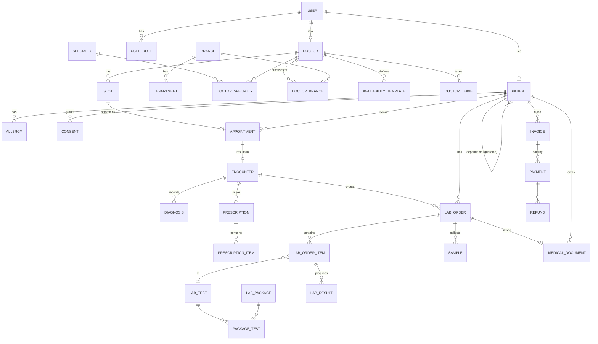
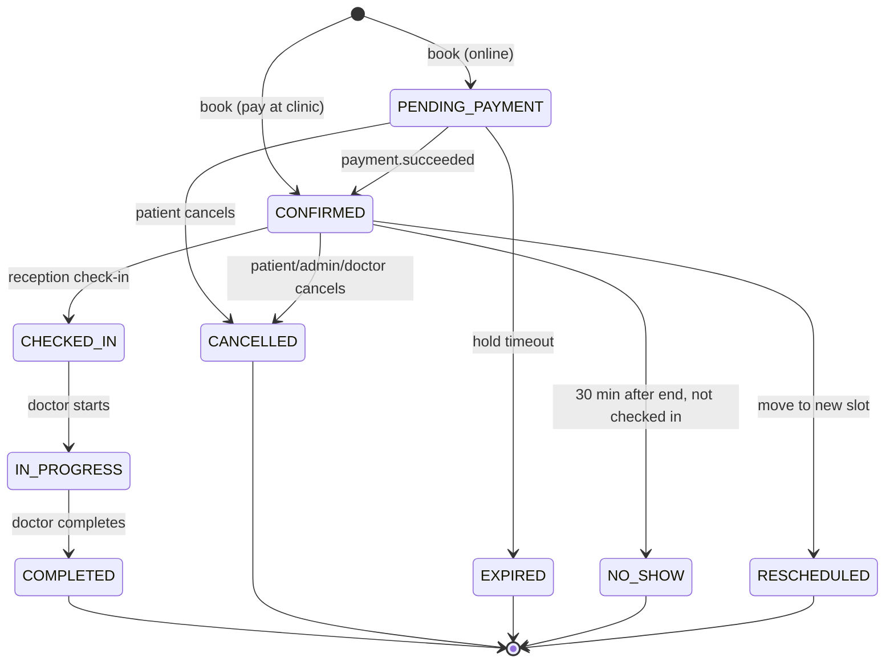
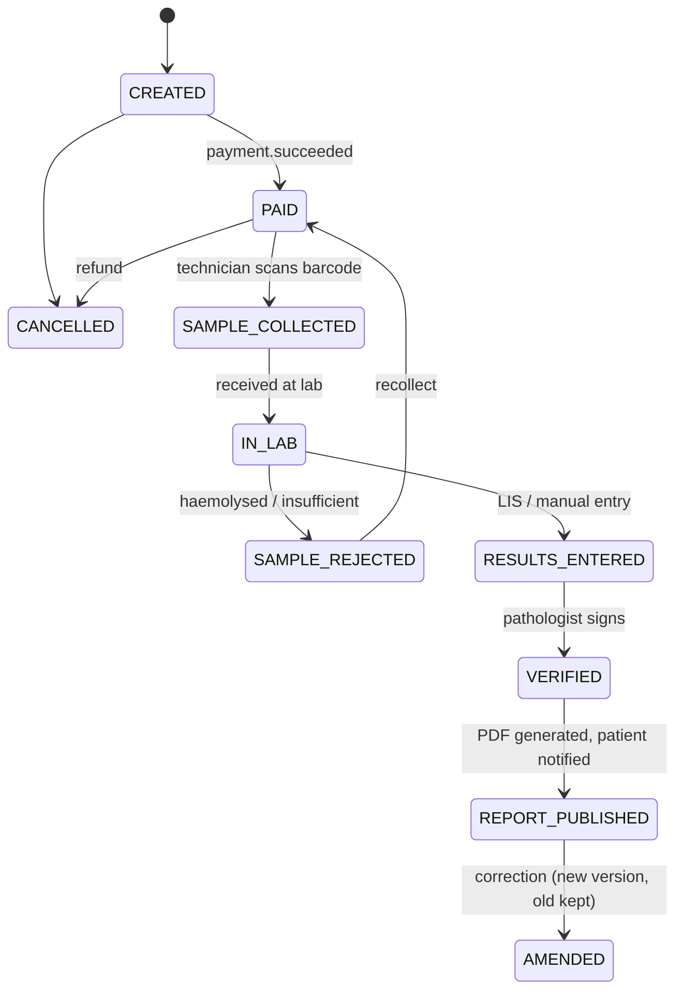
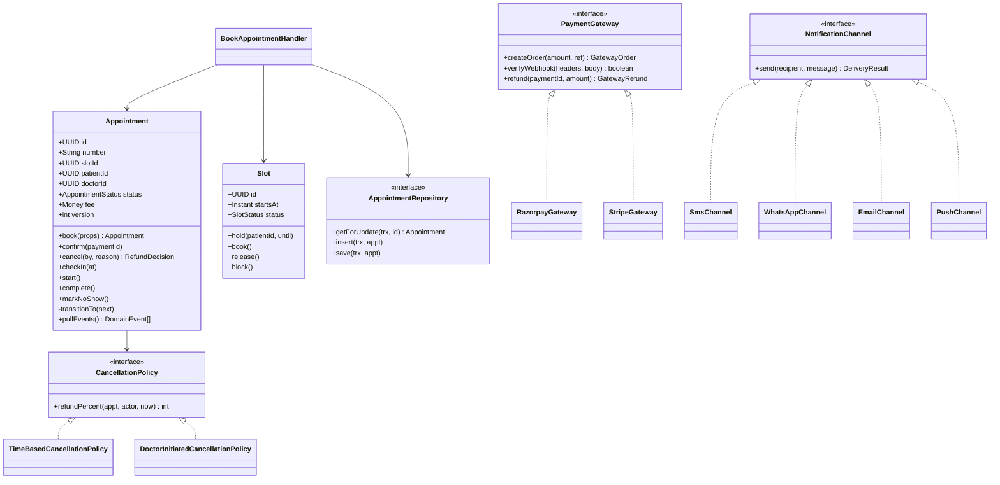
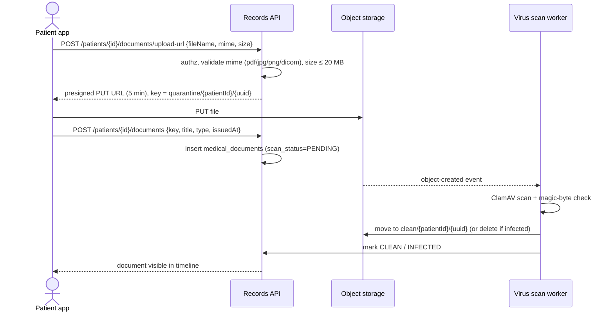

# MediCare CRM: Low-Level Design (LLD)

> Builds on [HLD.md](HLD.md). The AI agent layer (tables, orchestrator, tools) is in [AI-AGENTS.md](AI-AGENTS.md). Code samples use **TypeScript (NestJS-style) + PostgreSQL**, but the design is language-neutral.

Contents:
1. Code structure
2. Domain model (ER diagram)
3. Database schema (DDL)
4. State machines
5. Core algorithms (slot generation, booking, holds, reschedule, waitlist)
6. API specification
7. Authorisation design
8. Class design and patterns
9. Events and the outbox
10. Reports and file handling
11. Health timeline
12. Search
13. Caching
14. Notifications
15. Audit logging
16. Errors, idempotency, validation
17. Testing strategy

---

## 1. Code structure

> Updated: the system is built as **microservices** (backend repo) and **micro-frontends** (frontend repo). Repo layout is in [MICROSERVICES.md §7](MICROSERVICES.md) and [MICROFRONTENDS.md §6](MICROFRONTENDS.md).

Inside each service:

```
services/scheduling-service/
├── src/
│   ├── domain/        # entities, value objects, state machines, domain events (no framework imports)
│   ├── application/   # use cases (commands/queries), ports
│   ├── infra/         # repositories (SQL), Kafka producers/consumers, clients for other services
│   ├── api/           # controllers, DTOs, validation, guards (@RequirePermission / @RequireFeature)
│   └── workers/       # slot generator, hold expiry, outbox relay (separate deployment, same image)
├── migrations/
├── openapi.yaml
├── test/  (unit, integration with Testcontainers, pact)
└── Dockerfile, helm/values.yaml
```

| Layer | Rule |
|---|---|
| `domain/` | no framework or DB imports |
| `application/` | depends on domain + ports only |
| `infra/` | implements ports; the only place that talks to DB, Kafka or other services |
| `api/` | thin; calls application layer |

## 2. Domain model



---

## 3. Database schema

**One database per tenant (hospital), one schema per service** inside it: the schema names below (`scheduling.*`, `records.*`, ...) are exactly those per-service schemas, and every hospital's database has the same structure ([MULTI-TENANCY.md §3](MULTI-TENANCY.md)). References to other services' entities are plain UUIDs with no foreign keys. Because a database never holds two hospitals' data, tables have no `tenant_id` column. The `iam` tables below are replaced by Keycloak + control-plane identity in the SaaS setup. Roles, features and plan tables are in [FEATURES-AND-PLANS.md](FEATURES-AND-PLANS.md) §4. IDs are UUIDv7 (time-ordered, index-friendly). All tables have `created_at`, `updated_at`; mutable aggregates have `version` for optimistic locking.

### 3.1 `iam`

```sql
CREATE TABLE iam.users (
  id              UUID PRIMARY KEY,
  phone           VARCHAR(20) UNIQUE,
  email           CITEXT UNIQUE,
  password_hash   TEXT,                       -- argon2id; NULL for OTP-only patients
  mfa_secret_enc  BYTEA,                      -- encrypted TOTP secret
  status          VARCHAR(20) NOT NULL DEFAULT 'ACTIVE',  -- ACTIVE | LOCKED | DISABLED
  failed_logins   INT NOT NULL DEFAULT 0,
  last_login_at   TIMESTAMPTZ,
  created_at      TIMESTAMPTZ NOT NULL DEFAULT now(),
  updated_at      TIMESTAMPTZ NOT NULL DEFAULT now(),
  CHECK (phone IS NOT NULL OR email IS NOT NULL)
);

CREATE TABLE iam.roles (
  code        VARCHAR(30) PRIMARY KEY          -- PATIENT, DOCTOR, LAB_TECH, RECEPTIONIST, BRANCH_ADMIN, SUPER_ADMIN
);

CREATE TABLE iam.user_roles (
  user_id     UUID REFERENCES iam.users(id),
  role_code   VARCHAR(30) REFERENCES iam.roles(code),
  branch_id   UUID,                            -- NULL = all branches (scoped admin/staff)
  PRIMARY KEY (user_id, role_code, branch_id)
);

CREATE TABLE iam.refresh_tokens (
  id           UUID PRIMARY KEY,
  user_id      UUID NOT NULL REFERENCES iam.users(id),
  token_hash   BYTEA NOT NULL UNIQUE,
  family_id    UUID NOT NULL,                  -- for rotation + reuse detection
  expires_at   TIMESTAMPTZ NOT NULL,
  revoked_at   TIMESTAMPTZ,
  user_agent   TEXT, ip INET
);
```

### 3.2 `patient`

```sql
CREATE TABLE patient.patients (
  id               UUID PRIMARY KEY,
  user_id          UUID UNIQUE,                -- NULL for dependents without own login
  guardian_id      UUID REFERENCES patient.patients(id),
  mrn              VARCHAR(20) UNIQUE NOT NULL, -- medical record number, human readable
  full_name        VARCHAR(150) NOT NULL,
  dob              DATE NOT NULL,
  gender           VARCHAR(10),
  blood_group      VARCHAR(5),
  phone            VARCHAR(20),
  email            CITEXT,
  address          JSONB,
  national_id_enc  BYTEA,                      -- ABHA / SSN etc., field-encrypted
  national_id_bidx BYTEA,                      -- HMAC blind index for lookup
  emergency_contact JSONB,
  created_at TIMESTAMPTZ NOT NULL DEFAULT now(),
  updated_at TIMESTAMPTZ NOT NULL DEFAULT now(),
  version INT NOT NULL DEFAULT 0
);
CREATE INDEX ON patient.patients (guardian_id);
CREATE INDEX ON patient.patients (national_id_bidx);

CREATE TABLE patient.allergies (
  id UUID PRIMARY KEY, patient_id UUID NOT NULL REFERENCES patient.patients(id),
  substance VARCHAR(100) NOT NULL, severity VARCHAR(10), note TEXT
);

CREATE TABLE patient.consents (
  id            UUID PRIMARY KEY,
  patient_id    UUID NOT NULL REFERENCES patient.patients(id),
  grantee_type  VARCHAR(20) NOT NULL,          -- DOCTOR | ORGANIZATION | LINK
  grantee_id    UUID,
  scope         VARCHAR(30)[] NOT NULL,        -- {REPORTS, PRESCRIPTIONS, NOTES}
  valid_from    TIMESTAMPTZ NOT NULL,
  valid_until   TIMESTAMPTZ NOT NULL,
  revoked_at    TIMESTAMPTZ
);
CREATE INDEX ON patient.consents (grantee_id, patient_id) WHERE revoked_at IS NULL;
```

### 3.3 `provider`

```sql
CREATE TABLE provider.branches (
  id UUID PRIMARY KEY, name VARCHAR(120) NOT NULL, city VARCHAR(60) NOT NULL,
  address JSONB, geo POINT, timezone VARCHAR(40) NOT NULL DEFAULT 'Asia/Kolkata',
  active BOOLEAN NOT NULL DEFAULT true
);

CREATE TABLE provider.specialties (
  id UUID PRIMARY KEY, code VARCHAR(40) UNIQUE NOT NULL,   -- CARDIOLOGY
  name VARCHAR(80) NOT NULL, description TEXT, icon_url TEXT
);

CREATE TABLE provider.doctors (
  id                UUID PRIMARY KEY,
  user_id           UUID UNIQUE NOT NULL,
  full_name         VARCHAR(150) NOT NULL,
  registration_no   VARCHAR(40) UNIQUE NOT NULL,   -- medical council reg.
  qualifications    TEXT[],
  experience_years  SMALLINT,
  languages         VARCHAR(20)[],
  gender            VARCHAR(10),
  bio               TEXT,
  photo_url         TEXT,
  consult_modes     VARCHAR(10)[] NOT NULL DEFAULT '{IN_PERSON}', -- IN_PERSON, VIDEO
  rating_avg        NUMERIC(2,1), rating_count INT DEFAULT 0,
  status            VARCHAR(20) NOT NULL DEFAULT 'PENDING_APPROVAL', -- ACTIVE | INACTIVE
  version INT NOT NULL DEFAULT 0
);

CREATE TABLE provider.doctor_specialties (
  doctor_id UUID REFERENCES provider.doctors(id),
  specialty_id UUID REFERENCES provider.specialties(id),
  is_primary BOOLEAN DEFAULT false,
  PRIMARY KEY (doctor_id, specialty_id)
);

CREATE TABLE provider.doctor_branches (
  doctor_id UUID REFERENCES provider.doctors(id),
  branch_id UUID REFERENCES provider.branches(id),
  consultation_fee NUMERIC(10,2) NOT NULL,
  followup_fee     NUMERIC(10,2),
  followup_window_days SMALLINT DEFAULT 7,
  PRIMARY KEY (doctor_id, branch_id)
);
```

### 3.4 `scheduling`

```sql
CREATE TABLE scheduling.availability_templates (
  id              UUID PRIMARY KEY,
  doctor_id       UUID NOT NULL,
  branch_id       UUID NOT NULL,
  day_of_week     SMALLINT NOT NULL CHECK (day_of_week BETWEEN 1 AND 7),  -- ISO, Mon=1
  start_time      TIME NOT NULL,
  end_time        TIME NOT NULL,
  slot_minutes    SMALLINT NOT NULL CHECK (slot_minutes IN (5,10,15,20,30,45,60)),
  mode            VARCHAR(10) NOT NULL DEFAULT 'IN_PERSON',
  capacity_per_slot SMALLINT NOT NULL DEFAULT 1,  -- >1 for token/OPD style
  effective_from  DATE NOT NULL,
  effective_to    DATE,
  CHECK (end_time > start_time)
);

CREATE TABLE scheduling.doctor_leaves (
  id UUID PRIMARY KEY, doctor_id UUID NOT NULL,
  starts_at TIMESTAMPTZ NOT NULL, ends_at TIMESTAMPTZ NOT NULL, reason TEXT
);

CREATE TABLE scheduling.slots (
  id          UUID PRIMARY KEY,
  doctor_id   UUID NOT NULL,
  branch_id   UUID NOT NULL,
  starts_at   TIMESTAMPTZ NOT NULL,
  ends_at     TIMESTAMPTZ NOT NULL,
  mode        VARCHAR(10) NOT NULL,
  status      VARCHAR(12) NOT NULL DEFAULT 'OPEN',  -- OPEN | HELD | BOOKED | BLOCKED
  held_by     UUID,                                   -- patient_id holding it
  held_until  TIMESTAMPTZ,
  template_id UUID,
  version     INT NOT NULL DEFAULT 0,
  UNIQUE (doctor_id, starts_at)                        -- a doctor can't have 2 slots at the same time
);
CREATE INDEX slots_search_idx ON scheduling.slots (doctor_id, starts_at) WHERE status = 'OPEN';
CREATE INDEX slots_hold_expiry_idx ON scheduling.slots (held_until) WHERE status = 'HELD';

CREATE TABLE scheduling.appointments (
  id               UUID PRIMARY KEY,
  appointment_no   VARCHAR(20) UNIQUE NOT NULL,       -- APT-2026-000123
  slot_id          UUID NOT NULL REFERENCES scheduling.slots(id),
  patient_id       UUID NOT NULL,
  doctor_id        UUID NOT NULL,
  branch_id        UUID NOT NULL,
  starts_at        TIMESTAMPTZ NOT NULL,               -- denormalised from slot for queries
  mode             VARCHAR(10) NOT NULL,
  type             VARCHAR(12) NOT NULL DEFAULT 'NEW', -- NEW | FOLLOW_UP
  status           VARCHAR(20) NOT NULL,               -- see state machine
  reason           TEXT,                               -- patient's complaint
  fee              NUMERIC(10,2) NOT NULL,
  payment_mode     VARCHAR(10) NOT NULL,               -- ONLINE | AT_CLINIC
  invoice_id       UUID,
  booked_by        UUID NOT NULL,                      -- user who booked (patient or receptionist)
  rescheduled_from UUID REFERENCES scheduling.appointments(id),
  cancel_reason    TEXT,
  checked_in_at    TIMESTAMPTZ,
  token_no         SMALLINT,                           -- queue number for the day
  video_room_id    TEXT,
  version          INT NOT NULL DEFAULT 0,
  created_at TIMESTAMPTZ NOT NULL DEFAULT now(),
  updated_at TIMESTAMPTZ NOT NULL DEFAULT now()
);
-- The real double-booking guard: only one live appointment per slot.
CREATE UNIQUE INDEX one_active_appt_per_slot ON scheduling.appointments (slot_id)
  WHERE status IN ('PENDING_PAYMENT','CONFIRMED','CHECKED_IN','IN_PROGRESS','COMPLETED');
CREATE INDEX ON scheduling.appointments (patient_id, starts_at DESC);
CREATE INDEX ON scheduling.appointments (doctor_id, starts_at);

CREATE TABLE scheduling.waitlist (
  id UUID PRIMARY KEY, patient_id UUID NOT NULL, doctor_id UUID NOT NULL,
  date DATE NOT NULL, created_at TIMESTAMPTZ DEFAULT now(), notified_at TIMESTAMPTZ
);

CREATE TABLE scheduling.daily_counters (       -- queue token numbers (§5.7)
  doctor_id UUID NOT NULL, branch_id UUID NOT NULL, day DATE NOT NULL,
  last_token SMALLINT NOT NULL,
  PRIMARY KEY (doctor_id, branch_id, day)
);
```

> For `capacity_per_slot > 1` (OPD token systems), replace the `status` flag with `booked_count` and guard with `UPDATE ... SET booked_count = booked_count + 1 WHERE id = ? AND booked_count < capacity`, and drop the partial unique index.

### 3.5 `diagnostics`

```sql
CREATE TABLE diagnostics.lab_tests (
  id UUID PRIMARY KEY,
  code VARCHAR(30) UNIQUE NOT NULL,          -- CBC, LFT, HBA1C (LOINC code optional)
  loinc_code VARCHAR(20),
  name VARCHAR(150) NOT NULL,
  category VARCHAR(50),                       -- Haematology, Biochemistry, Radiology
  sample_type VARCHAR(30),                    -- BLOOD, URINE, NONE (imaging)
  preparation TEXT,                           -- "10-12 hours fasting"
  turnaround_hours SMALLINT,
  price NUMERIC(10,2) NOT NULL,
  home_collection BOOLEAN DEFAULT false,
  reference_ranges JSONB,                     -- [{param, unit, low, high, gender, ageFrom, ageTo}]
  active BOOLEAN DEFAULT true
);

CREATE TABLE diagnostics.lab_packages (
  id UUID PRIMARY KEY, name VARCHAR(150) NOT NULL, description TEXT,
  price NUMERIC(10,2) NOT NULL, active BOOLEAN DEFAULT true
);
CREATE TABLE diagnostics.package_tests (
  package_id UUID REFERENCES diagnostics.lab_packages(id),
  test_id UUID REFERENCES diagnostics.lab_tests(id),
  PRIMARY KEY (package_id, test_id)
);

CREATE TABLE diagnostics.lab_orders (
  id UUID PRIMARY KEY,
  order_no VARCHAR(20) UNIQUE NOT NULL,
  patient_id UUID NOT NULL,
  ordered_by_doctor UUID,                     -- NULL if patient self-booked
  encounter_id UUID,
  branch_id UUID NOT NULL,
  collection_type VARCHAR(10) NOT NULL,       -- AT_LAB | HOME
  collection_slot_at TIMESTAMPTZ,
  collection_address JSONB,
  status VARCHAR(20) NOT NULL,                -- see state machine
  invoice_id UUID,
  report_document_id UUID,
  version INT NOT NULL DEFAULT 0,
  created_at TIMESTAMPTZ DEFAULT now()
);
CREATE INDEX ON diagnostics.lab_orders (patient_id, created_at DESC);

CREATE TABLE diagnostics.lab_order_items (
  id UUID PRIMARY KEY, order_id UUID NOT NULL REFERENCES diagnostics.lab_orders(id),
  test_id UUID NOT NULL, package_id UUID, price NUMERIC(10,2) NOT NULL,
  status VARCHAR(20) NOT NULL
);

CREATE TABLE diagnostics.samples (
  id UUID PRIMARY KEY, order_id UUID NOT NULL REFERENCES diagnostics.lab_orders(id),
  barcode VARCHAR(30) UNIQUE NOT NULL, sample_type VARCHAR(30),
  collected_by UUID, collected_at TIMESTAMPTZ, received_at_lab TIMESTAMPTZ,
  status VARCHAR(20) NOT NULL                 -- PENDING | COLLECTED | RECEIVED | REJECTED
);

CREATE TABLE diagnostics.lab_results (
  id UUID PRIMARY KEY, order_item_id UUID NOT NULL REFERENCES diagnostics.lab_order_items(id),
  parameter VARCHAR(80) NOT NULL, value TEXT NOT NULL, unit VARCHAR(20),
  ref_low NUMERIC, ref_high NUMERIC,
  flag VARCHAR(10),                            -- NORMAL | LOW | HIGH | CRITICAL
  entered_by UUID, verified_by UUID, verified_at TIMESTAMPTZ
);
```

### 3.6 `records`

```sql
CREATE TABLE records.encounters (
  id UUID PRIMARY KEY,
  appointment_id UUID UNIQUE,
  patient_id UUID NOT NULL, doctor_id UUID NOT NULL, branch_id UUID NOT NULL,
  started_at TIMESTAMPTZ NOT NULL, ended_at TIMESTAMPTZ,
  vitals JSONB,                               -- {bp:"120/80", pulse:72, tempC:36.8, weightKg:70}
  chief_complaint TEXT,
  notes_enc BYTEA,                            -- clinical notes, field-encrypted
  status VARCHAR(12) NOT NULL,                -- OPEN | SIGNED | AMENDED
  signed_at TIMESTAMPTZ,
  version INT NOT NULL DEFAULT 0
);
CREATE INDEX ON records.encounters (patient_id, started_at DESC);

CREATE TABLE records.diagnoses (
  id UUID PRIMARY KEY, encounter_id UUID NOT NULL REFERENCES records.encounters(id),
  icd10_code VARCHAR(10), description TEXT NOT NULL, is_primary BOOLEAN DEFAULT false
);

CREATE TABLE records.prescriptions (
  id UUID PRIMARY KEY, encounter_id UUID NOT NULL REFERENCES records.encounters(id),
  patient_id UUID NOT NULL, doctor_id UUID NOT NULL,
  advice TEXT, follow_up_on DATE,
  document_id UUID,                           -- generated signed PDF
  created_at TIMESTAMPTZ DEFAULT now()
);
CREATE TABLE records.prescription_items (
  id UUID PRIMARY KEY, prescription_id UUID NOT NULL REFERENCES records.prescriptions(id),
  drug_name VARCHAR(150) NOT NULL, strength VARCHAR(40), form VARCHAR(20),
  dosage VARCHAR(40) NOT NULL,                -- "1-0-1"
  duration_days SMALLINT, instructions TEXT   -- "after food"
);

CREATE TABLE records.medical_documents (
  id UUID PRIMARY KEY,
  patient_id UUID NOT NULL,
  type VARCHAR(20) NOT NULL,                  -- LAB_REPORT | PRESCRIPTION | DISCHARGE | IMAGING | EXTERNAL
  title VARCHAR(200) NOT NULL,
  source VARCHAR(10) NOT NULL,                -- INTERNAL | UPLOADED
  storage_key TEXT NOT NULL,                  -- s3 key, never a public URL
  mime_type VARCHAR(60) NOT NULL, size_bytes BIGINT, sha256 CHAR(64),
  scan_status VARCHAR(10) NOT NULL DEFAULT 'PENDING', -- PENDING | CLEAN | INFECTED
  related_type VARCHAR(20), related_id UUID,  -- LAB_ORDER / ENCOUNTER
  issued_at TIMESTAMPTZ NOT NULL,
  uploaded_by UUID NOT NULL,
  deleted_at TIMESTAMPTZ                      -- soft delete; hard delete only by retention job
);
CREATE INDEX ON records.medical_documents (patient_id, issued_at DESC) WHERE deleted_at IS NULL;

-- Read model for the patient timeline (filled from events; see §11)
CREATE TABLE records.timeline_entries (
  id UUID PRIMARY KEY,
  patient_id UUID NOT NULL,
  occurred_at TIMESTAMPTZ NOT NULL,
  kind VARCHAR(20) NOT NULL,                  -- APPOINTMENT | ENCOUNTER | PRESCRIPTION | LAB_ORDER | REPORT | DOCUMENT
  ref_id UUID NOT NULL,
  title VARCHAR(200) NOT NULL,
  summary JSONB,                              -- small, non-sensitive preview
  doctor_id UUID, branch_id UUID,
  UNIQUE (kind, ref_id)
);
CREATE INDEX ON records.timeline_entries (patient_id, occurred_at DESC, id DESC);
```

### 3.7 `billing`

```sql
CREATE TABLE billing.invoices (
  id UUID PRIMARY KEY, invoice_no VARCHAR(20) UNIQUE NOT NULL,
  patient_id UUID NOT NULL, branch_id UUID NOT NULL,
  source_type VARCHAR(15) NOT NULL,           -- APPOINTMENT | LAB_ORDER
  source_id UUID NOT NULL,
  subtotal NUMERIC(10,2) NOT NULL, discount NUMERIC(10,2) DEFAULT 0,
  tax NUMERIC(10,2) DEFAULT 0, total NUMERIC(10,2) NOT NULL,
  currency CHAR(3) NOT NULL DEFAULT 'INR',
  status VARCHAR(12) NOT NULL,                -- DRAFT | ISSUED | PAID | REFUNDED | VOID
  UNIQUE (source_type, source_id)
);

CREATE TABLE billing.payments (
  id UUID PRIMARY KEY, invoice_id UUID NOT NULL REFERENCES billing.invoices(id),
  gateway VARCHAR(20) NOT NULL, gateway_order_id VARCHAR(80) UNIQUE,
  gateway_payment_id VARCHAR(80) UNIQUE,
  amount NUMERIC(10,2) NOT NULL, method VARCHAR(20),   -- UPI, CARD, CASH
  status VARCHAR(12) NOT NULL,                -- CREATED | CAPTURED | FAILED
  created_at TIMESTAMPTZ DEFAULT now()
);

CREATE TABLE billing.refunds (
  id UUID PRIMARY KEY, payment_id UUID NOT NULL REFERENCES billing.payments(id),
  amount NUMERIC(10,2) NOT NULL, reason TEXT, gateway_refund_id VARCHAR(80) UNIQUE,
  status VARCHAR(12) NOT NULL
);

CREATE TABLE billing.processed_webhooks (     -- dedupe gateway retries
  gateway_event_id VARCHAR(100) PRIMARY KEY, received_at TIMESTAMPTZ DEFAULT now()
);
```

### 3.8 Shared infrastructure tables

```sql
CREATE TABLE outbox (                         -- one per schema in practice
  id BIGSERIAL PRIMARY KEY,
  aggregate_type VARCHAR(40) NOT NULL, aggregate_id UUID NOT NULL,
  event_type VARCHAR(60) NOT NULL, payload JSONB NOT NULL,
  created_at TIMESTAMPTZ NOT NULL DEFAULT now(), published_at TIMESTAMPTZ
);
CREATE INDEX ON outbox (id) WHERE published_at IS NULL;

CREATE TABLE idempotency_keys (
  key VARCHAR(80) NOT NULL, user_id UUID NOT NULL,
  request_hash CHAR(64) NOT NULL, response_code INT, response_body JSONB,
  created_at TIMESTAMPTZ DEFAULT now(),
  PRIMARY KEY (user_id, key)
);

CREATE TABLE audit.audit_log (                -- app role has INSERT + SELECT only
  id BIGSERIAL PRIMARY KEY,
  occurred_at TIMESTAMPTZ NOT NULL DEFAULT now(),
  actor_id UUID NOT NULL, actor_role VARCHAR(30) NOT NULL,
  action VARCHAR(40) NOT NULL,                -- READ | CREATE | UPDATE | DELETE | EXPORT | BREAK_GLASS | LOGIN
  resource_type VARCHAR(40) NOT NULL, resource_id UUID,
  patient_id UUID,                            -- for "who looked at my record?"
  purpose VARCHAR(30),                        -- TREATMENT | BREAK_GLASS | ADMIN | PATIENT_SELF
  ip INET, user_agent TEXT, request_id VARCHAR(40),
  changes JSONB,                              -- field diff for writes (no clinical text)
  prev_hash BYTEA, hash BYTEA                 -- hash chain for tamper evidence
) PARTITION BY RANGE (occurred_at);           -- monthly partitions
CREATE INDEX ON audit.audit_log (patient_id, occurred_at DESC);
CREATE INDEX ON audit.audit_log (actor_id, occurred_at DESC);
```

---

## 4. State machines

### 4.1 Appointment



`RESCHEDULED` is terminal for the old row; a new appointment row is created with `rescheduled_from` pointing back. This keeps history clean and the unique slot index simple.

Transitions are defined in one table and checked in the domain entity:

```ts
const APPOINTMENT_TRANSITIONS: Record<AppointmentStatus, AppointmentStatus[]> = {
  PENDING_PAYMENT: ['CONFIRMED', 'EXPIRED', 'CANCELLED'],
  CONFIRMED:       ['CHECKED_IN', 'CANCELLED', 'RESCHEDULED', 'NO_SHOW'],
  CHECKED_IN:      ['IN_PROGRESS', 'CANCELLED'],
  IN_PROGRESS:     ['COMPLETED'],
  COMPLETED: [], CANCELLED: [], EXPIRED: [], NO_SHOW: [], RESCHEDULED: [],
};
```

### 4.2 Lab order



### 4.3 Slot

`OPEN → HELD → BOOKED`, `HELD → OPEN` (expiry or cancel before payment), `BOOKED → OPEN` (cancellation, if the slot is still in the future), `OPEN/HELD → BLOCKED` (doctor leave or admin block).

---

## 5. Core algorithms

### 5.1 Slot generation (worker, nightly + on template change)

Keeps a rolling window of `MAX_ADVANCE_DAYS` (e.g. 60) of slots per doctor.

```ts
async function generateSlots(doctorId: UUID, from: LocalDate, to: LocalDate) {
  const templates = await templatesRepo.activeFor(doctorId, from, to);
  const leaves    = await leavesRepo.overlapping(doctorId, from, to);
  const branchTz  = await branches.timezones(templates.map(t => t.branchId));

  const slots: NewSlot[] = [];
  for (let day = from; day <= to; day = day.plusDays(1)) {
    for (const t of templates.filter(t => t.dayOfWeek === day.dayOfWeek && t.isEffectiveOn(day))) {
      const tz = branchTz[t.branchId];
      let start = ZonedDateTime.of(day, t.startTime, tz);
      const end = ZonedDateTime.of(day, t.endTime, tz);
      while (start.plusMinutes(t.slotMinutes) <= end) {
        const s = { start, end: start.plusMinutes(t.slotMinutes) };
        if (!leaves.some(l => overlaps(l, s))) {
          slots.push({ doctorId, branchId: t.branchId, startsAt: s.start.toInstant(),
                       endsAt: s.end.toInstant(), mode: t.mode, templateId: t.id });
        }
        start = s.end;
      }
    }
  }
  // Idempotent: existing slots (any status) are left untouched.
  await db.query(`
    INSERT INTO scheduling.slots (id, doctor_id, branch_id, starts_at, ends_at, mode, template_id)
    SELECT * FROM unnest($1::uuid[], $2::uuid[], $3::uuid[], $4::timestamptz[], $5::timestamptz[], $6::text[], $7::uuid[])
    ON CONFLICT (doctor_id, starts_at) DO NOTHING`, toColumns(slots));
}
```

When a doctor **adds leave**: mark `OPEN`/`HELD` slots in the range `BLOCKED`; for `BOOKED` slots, cancel the appointments with reason `DOCTOR_UNAVAILABLE`, refund in full, notify patients and offer the next free slots. When a **template changes**: delete future `OPEN` slots from that template and regenerate; booked ones are kept.

Overlapping templates for the same doctor at two branches are rejected on save (validation query on time overlap), so a doctor can't be in two places at once.

### 5.2 Booking (hold) with the double-booking guard

Two independent guards: the conditional `UPDATE` on the slot (fast path) and the partial unique index on appointments (last line of defence).

```ts
@Injectable()
export class BookAppointmentHandler {
  async execute(cmd: BookAppointmentCommand, actor: Actor): Promise<BookingResult> {
    return this.idempotency.run(actor.userId, cmd.idempotencyKey, cmd, () =>
      this.tx.run(async (trx) => {
        // 1. Who is the patient? (self or a dependent the user manages)
        await this.patientAccess.assertCanActFor(actor, cmd.patientId);

        // 2. Business rules
        const policy = await this.policies.booking();
        const active = await this.appointments.countUpcoming(trx, cmd.patientId);
        if (active >= policy.maxActiveAppointments) throw new BusinessError('TOO_MANY_ACTIVE_BOOKINGS');
        if (await this.appointments.hasOverlap(trx, cmd.patientId, cmd.slotId))
          throw new BusinessError('PATIENT_HAS_OVERLAPPING_APPOINTMENT');

        // 3. Atomically grab the slot
        const holdMinutes = cmd.paymentMode === 'ONLINE' ? policy.holdMinutes : 0;
        const slot = await trx.oneOrNone<SlotRow>(`
          UPDATE scheduling.slots
             SET status = $2, held_by = $3,
                 held_until = CASE WHEN $2 = 'HELD' THEN now() + make_interval(mins => $4) END,
                 version = version + 1
           WHERE id = $1 AND status = 'OPEN' AND starts_at > now() + interval '15 minutes'
       RETURNING *`,
          [cmd.slotId, holdMinutes ? 'HELD' : 'BOOKED', cmd.patientId, holdMinutes]);
        if (!slot) throw new ConflictError('SLOT_UNAVAILABLE');

        // 4. Price (follow-up discount if a completed visit in the window)
        const fee = await this.pricing.consultationFee(slot.doctorId, slot.branchId, cmd.patientId);

        // 5. Create appointment
        const appt = Appointment.book({
          slot, patientId: cmd.patientId, bookedBy: actor.userId, fee,
          paymentMode: cmd.paymentMode, reason: cmd.reason,
        }); // status PENDING_PAYMENT or CONFIRMED; raises AppointmentBooked or AppointmentPendingPayment
        await this.appointments.insert(trx, appt);    // partial unique index protects here too
        await this.outbox.addAll(trx, appt.pullEvents());

        return { appt, slot, fee };
      }).then(async ({ appt, slot, fee }) => {
        // 6. Payment order: sync call to billing-service AFTER our commit (never hold a DB tx across a network call).
        //    Idempotent on (APPOINTMENT, appt.id); if it fails, the client retries with the same Idempotency-Key,
        //    and the hold simply expires if payment never starts.
        const payment = cmd.paymentMode === 'ONLINE'
          ? await this.billingClient.createPaymentOrder(actor.token, { source: 'APPOINTMENT', sourceId: appt.id, amount: fee, patientId: cmd.patientId })
          : null;

        return { appointmentId: appt.id, appointmentNo: appt.number, status: appt.status,
                 holdExpiresAt: slot.heldUntil, payment };
      }));
  }
}
```

Why the conditional `UPDATE` and not `SELECT ... FOR UPDATE`: one round trip, no explicit lock wait; under contention the loser simply sees 0 rows and gets a 409 with alternatives. Postgres row-level locking during the UPDATE makes it race-free.

### 5.3 Confirming on payment

```ts
// Consumer of billing's payment.succeeded event (idempotent)
async onPaymentSucceeded(evt: PaymentSucceeded) {
  if (evt.sourceType !== 'APPOINTMENT') return;
  await this.tx.run(async (trx) => {
    const appt = await this.appointments.getForUpdate(trx, evt.sourceId);
    if (appt.status === 'CONFIRMED') return;                       // duplicate event
    if (appt.status !== 'PENDING_PAYMENT') {                       // expired/cancelled meanwhile
      const reclaimed = await this.slots.tryReclaim(trx, appt.slotId, appt.patientId); // OPEN → BOOKED if still free
      if (!reclaimed) { await this.outbox.add(trx, new RefundRequested(evt.paymentId, 'SLOT_LOST')); return; }
      appt.reopenForConfirmation();   // EXPIRED → PENDING_PAYMENT (only allowed on reclaim)
    }
    appt.confirm(evt.paymentId);                                   // → CONFIRMED, raises AppointmentBooked
    await this.slots.markBooked(trx, appt.slotId);                 // HELD → BOOKED
    await this.appointments.save(trx, appt);                       // optimistic lock on version
    await this.outbox.addAll(trx, appt.pullEvents());
  });
}
```

### 5.4 Hold expiry (worker, every 30–60 s)

```sql
WITH expired AS (
  UPDATE scheduling.slots
     SET status = 'OPEN', held_by = NULL, held_until = NULL, version = version + 1
   WHERE status = 'HELD' AND held_until < now()
   RETURNING id
)
UPDATE scheduling.appointments a
   SET status = 'EXPIRED', updated_at = now()
  FROM expired e
 WHERE a.slot_id = e.id AND a.status = 'PENDING_PAYMENT'
RETURNING a.id;   -- then write AppointmentExpired events to outbox (same tx)
```

Run in batches (`LIMIT 500` via a CTE on ids) with `FOR UPDATE SKIP LOCKED` so multiple worker replicas don't collide. Expired slots trigger `slot.availability_changed`, which also notifies the **waitlist** (5.6).

### 5.5 Cancel and reschedule

**Cancel** (`POST /appointments/{id}/cancel`):
1. Check actor: patient (own/dependent), doctor (own), admin (branch).
2. Check state allows `CANCELLED`.
3. Compute refund using policy: e.g. ≥ 24 h before = 100%, 2–24 h = 50%, < 2 h = 0%; doctor/admin cancel = 100%.
4. In one transaction: appointment → `CANCELLED`; slot → `OPEN` if `starts_at > now()`; outbox `appointment.cancelled {refundPercent}`.
5. Billing consumes the event and calls the gateway refund API.

**Reschedule** (`POST /appointments/{id}/reschedule {newSlotId}`): one transaction that grabs the new slot with the same conditional UPDATE, marks the old appointment `RESCHEDULED`, frees the old slot, creates the new appointment linked via `rescheduled_from`, and **carries over the payment** (no new charge if same fee; difference invoiced or refunded otherwise). Limit reschedules per appointment (policy, e.g. 2).

### 5.6 Waitlist

When `slot.availability_changed` reports a freed slot for doctor D on date X, the waitlist consumer picks the oldest un-notified waitlist entries for (D, X) and notifies the first N with a deep link. First one to book wins (the normal booking path). No reserved holds for waitlisters, which keeps it simple and fair.

### 5.7 Queue and token number

On check-in, assign `token_no` per (doctor, branch, date) using a per-day counter:

```sql
INSERT INTO scheduling.daily_counters (doctor_id, branch_id, day, last_token)
VALUES ($1, $2, $3, 1)
ON CONFLICT (doctor_id, branch_id, day) DO UPDATE SET last_token = daily_counters.last_token + 1
RETURNING last_token;
```

The doctor's queue screen subscribes to a WebSocket/SSE channel `queue:{doctorId}:{date}` that pushes check-in and status changes.

---

## 6. API specification

REST, JSON, versioned under `/api/v1`. Auth: `Authorization: Bearer <JWT>`. All list endpoints use **cursor pagination** (`?limit=20&cursor=...`). All writes accept `Idempotency-Key`. Errors use RFC 7807 `application/problem+json`.

### 6.1 Auth (IAM)

| Method | Path | Who | Notes |
|---|---|---|---|
| POST | `/auth/otp/request` | public | `{phone}` → sends OTP; rate-limited 3/10 min per phone |
| POST | `/auth/otp/verify` | public | `{phone, otp}` → `{accessToken, refreshToken, isNewUser}` |
| POST | `/auth/login` | public | staff: `{email, password}` → `{mfaRequired, mfaToken}` |
| POST | `/auth/mfa/verify` | public | `{mfaToken, code}` → tokens |
| POST | `/auth/refresh` | public | rotating refresh token |
| POST | `/auth/logout` | any | revokes refresh token family |
| GET  | `/me` | any | profile + roles + branch scopes |

### 6.2 Patients

| Method | Path | Who |
|---|---|---|
| POST | `/patients` | patient (self registration), receptionist |
| GET/PATCH | `/patients/{id}` | owner/guardian, admin, treating doctor (GET only) |
| GET/POST | `/patients/{id}/dependents` | owner |
| GET/POST/DELETE | `/patients/{id}/allergies` | owner, treating doctor |
| GET/POST/DELETE | `/patients/{id}/consents` | owner |
| GET | `/patients/{id}/access-log` | owner ("who viewed my records") |

### 6.3 Directory and search

| Method | Path | Who |
|---|---|---|
| GET | `/specialties` | public (cached) |
| GET | `/branches` | public |
| GET | `/doctors?specialty=CARDIOLOGY&branch=..&city=..&lang=hi&gender=F&mode=VIDEO&availableOn=2026-10-25&sort=next_available&q=..` | public |
| GET | `/doctors/{id}` | public |
| POST/PATCH | `/admin/doctors`, `/admin/doctors/{id}` | admin |
| POST/PATCH | `/admin/specialties`, `/admin/branches` | admin |

Example doctor search response item:

```json
{
  "id": "0192f5c4-...",
  "name": "Dr. A. Sharma",
  "specialties": [{"code": "CARDIOLOGY", "name": "Cardiology", "primary": true}],
  "experienceYears": 14,
  "languages": ["en", "hi"],
  "branches": [{"id": "...", "name": "Sector 44, Gurugram", "fee": 1000}],
  "consultModes": ["IN_PERSON", "VIDEO"],
  "rating": 4.7,
  "nextAvailable": "2026-10-24T10:30:00+05:30"
}
```

### 6.4 Scheduling

| Method | Path | Who |
|---|---|---|
| GET | `/doctors/{id}/slots?from=2026-10-24&to=2026-10-30&branchId=..&mode=..` | public |
| GET/POST/PUT/DELETE | `/doctors/{id}/availability-templates` | doctor (own), admin |
| POST | `/doctors/{id}/leaves` | doctor (own), admin |
| POST | `/appointments` | patient, receptionist |
| GET | `/appointments?patientId=..&status=..&from=..` | patient (own), doctor (own), admin |
| GET | `/appointments/{id}` | participants, admin |
| POST | `/appointments/{id}/cancel` | patient, doctor, admin |
| POST | `/appointments/{id}/reschedule` | patient, admin |
| POST | `/appointments/{id}/check-in` | receptionist, patient (geo-fenced self check-in) |
| POST | `/appointments/{id}/start` | doctor |
| POST | `/appointments/{id}/complete` | doctor |
| POST | `/appointments/{id}/no-show` | doctor, receptionist |
| GET | `/doctors/me/queue?date=..` | doctor |
| POST | `/waitlist` | patient |

`POST /appointments`:

```http
POST /api/v1/appointments
Idempotency-Key: 6f1c2a...
{
  "slotId": "0192f5d1-...",
  "patientId": "0192f4aa-...",
  "paymentMode": "ONLINE",
  "reason": "Chest pain on exertion for 2 weeks"
}

201 Created
{
  "appointmentId": "0192f5e0-...",
  "appointmentNo": "APT-2026-004211",
  "status": "PENDING_PAYMENT",
  "holdExpiresAt": "2026-10-23T10:40:00Z",
  "payment": { "gateway": "RAZORPAY", "orderId": "order_Pq..", "amount": 1000, "currency": "INR" }
}

409 Conflict  (application/problem+json)
{
  "type": "https://medicare.example/errors/slot-unavailable",
  "title": "Slot is no longer available",
  "code": "SLOT_UNAVAILABLE",
  "alternatives": [{"slotId": "...", "startsAt": "2026-10-24T10:45:00+05:30"}]
}
```

### 6.5 Diagnostics

| Method | Path | Who |
|---|---|---|
| GET | `/lab-tests?q=&category=&homeCollection=` | public |
| GET | `/lab-packages`, `/lab-packages/{id}` | public |
| GET | `/lab-collection-slots?branchId=&date=&type=HOME&pincode=` | public |
| POST | `/lab-orders` | patient (self-booked), doctor (via encounter) |
| GET | `/lab-orders?patientId=` / `/lab-orders/{id}` | owner, ordering doctor, lab staff, admin |
| POST | `/lab-orders/{id}/samples/{sampleId}/collect` | lab tech |
| POST | `/lab-orders/{id}/results` | lab tech, LIS integration (service account) |
| POST | `/lab-orders/{id}/verify` | pathologist (doctor with LAB_SIGNATORY permission) |
| POST/PATCH | `/admin/lab-tests`, `/admin/lab-packages` | admin |

### 6.6 Medical records

| Method | Path | Who |
|---|---|---|
| POST | `/encounters` (from appointment) | doctor |
| PATCH | `/encounters/{id}` (vitals, notes, diagnoses) | doctor (author, while OPEN) |
| POST | `/encounters/{id}/sign` | doctor (author) → becomes read-only; later edits are amendments |
| POST | `/encounters/{id}/prescriptions` | doctor |
| POST | `/encounters/{id}/lab-orders` | doctor |
| GET | `/patients/{id}/timeline?kind=&from=&cursor=` | owner, treating doctor, consented doctor |
| GET | `/patients/{id}/documents?type=` | same |
| POST | `/patients/{id}/documents/upload-url` | owner (external reports) |
| POST | `/patients/{id}/documents` (confirm upload) | owner |
| GET | `/documents/{id}/download` | same → 302 to signed URL (5 min) |
| POST | `/patients/{id}/break-glass` | doctor `{reason}` → time-boxed access grant (e.g. 4 h) |

### 6.7 Billing and webhooks

| Method | Path | Who |
|---|---|---|
| GET | `/invoices?patientId=` / `/invoices/{id}` / `/invoices/{id}/pdf` | owner, admin |
| POST | `/payments/{invoiceId}/cash` | receptionist |
| POST | `/webhooks/razorpay` | gateway (HMAC signature, IP allowlist) |

### 6.8 Admin and analytics

| Method | Path |
|---|---|
| GET | `/admin/dashboard?branchId=&from=&to=` (bookings, utilisation, no-show %, revenue, lab TAT) |
| GET/PUT | `/admin/policies/{key}` (cancellation, refund, holdMinutes, maxAdvanceDays, reminders) |
| GET | `/admin/audit?patientId=&actorId=&action=&from=&to=` |
| POST | `/admin/users/{id}/disable`, `/admin/users/{id}/roles` |
| POST | `/admin/appointments/{id}/override` `{action, reason}` |

---

## 7. Authorisation design

### 7.1 Default permission matrix (RBAC)

This is the **default template**. Roles are data and tenant admins can edit them or create custom roles; feature availability also depends on the subscription plan. See [FEATURES-AND-PLANS.md](FEATURES-AND-PLANS.md).

| Permission | Patient | Doctor | Lab tech | Receptionist | Branch admin | Super admin |
|---|:-:|:-:|:-:|:-:|:-:|:-:|
| Search doctors/tests | ✅ | ✅ | ✅ | ✅ | ✅ | ✅ |
| Book appointment | own + dependents | — | — | branch | branch | all |
| Cancel appointment | own | own | — | branch | branch | all |
| Manage availability | — | own | — | — | branch | all |
| View patient demographics | own | treating | order-linked | branch | branch | all |
| View clinical notes / prescriptions | own | treating / consented | — | — | — | break-glass only |
| View lab reports | own | treating / ordering | order-linked | — | — | — |
| Write encounter / prescription | — | treating | — | — | — | — |
| Enter / verify lab results | — | signatory | enter | — | — | — |
| Manage catalog, prices, doctors | — | — | — | — | branch | all |
| View audit log | own access log | — | — | — | branch | all |

"Treating" = the doctor has a non-cancelled appointment or encounter with the patient within `TREATING_WINDOW` (e.g. 12 months), or an active consent, or an active break-glass grant.

### 7.2 Implementation

```ts
// 1. Coarse RBAC on the route
@Get('/patients/:id/timeline')
@Requires('records:read')
getTimeline(@Param('id') patientId: UUID, @CurrentActor() actor: Actor, @Query() q: TimelineQuery) {
  return this.timeline.get(actor, patientId, q);
}

// 2. Fine-grained policy in the application layer
export class PatientDataPolicy {
  async canRead(actor: Actor, patientId: UUID, scope: DataScope): Promise<AccessDecision> {
    if (actor.is('PATIENT')) {
      const ok = await this.patients.isSelfOrDependent(actor.userId, patientId);
      return ok ? allow('PATIENT_SELF') : deny();
    }
    if (actor.is('DOCTOR')) {
      if (await this.care.hasTreatingRelationship(actor.doctorId, patientId)) return allow('TREATMENT');
      if (await this.consents.active(patientId, actor.doctorId, scope))       return allow('CONSENT');
      if (await this.breakGlass.active(actor.doctorId, patientId))            return allow('BREAK_GLASS');
      return deny();
    }
    if (actor.is('LAB_TECH') && scope === 'LAB') {
      return (await this.labOrders.existsForBranch(patientId, actor.branchIds)) ? allow('LAB_WORK') : deny();
    }
    if (actor.isAdminFor(await this.patients.homeBranch(patientId)) && scope === 'DEMOGRAPHICS') return allow('ADMIN');
    return deny();
  }
}

// 3. Every allowed read of PHI is audited (sync, same request)
const decision = await this.policy.canRead(actor, patientId, 'CLINICAL');
if (!decision.allowed) throw new ForbiddenError();
await this.audit.record({ actor, action: 'READ', resourceType: 'TIMELINE', patientId, purpose: decision.purpose });
```

The treating-relationship check is cached in Redis for 5 minutes (`care:{doctorId}:{patientId}`) and invalidated on appointment events.

---

## 8. Class design and patterns



Patterns used and why:

| Pattern | Where | Why |
|---|---|---|
| **State** (transition table) | Appointment, LabOrder, Slot | Illegal transitions fail in one place |
| **Strategy** | CancellationPolicy, PricingRule (new/follow-up/package), NotificationChannel | Business rules change per hospital without code edits elsewhere |
| **Adapter / Ports and adapters** | PaymentGateway, SmsProvider, LIS connector, VideoProvider | Swap vendors; easy to fake in tests |
| **Repository** | Every aggregate | Domain stays free of SQL |
| **Transactional outbox + Observer** | All domain events | Reliable side effects (notifications, search index, timeline) |
| **Saga (choreography)** | Booking ↔ payment ↔ refund | Consistency across Scheduling and Billing without distributed transactions |
| **CQRS read model** | Patient timeline, doctor search | Fast reads shaped for the screen |
| **Factory** | `Appointment.book()`, `LabOrder.fromEncounter()` | Construction rules in one place |
| **Template method** | Report PDF generation (header/footer/branding fixed, body per test type) | Consistent report layout |

---

## 9. Events and the outbox

### 9.1 Event envelope

```json
{
  "eventId": "0192f600-...",
  "type": "appointment.booked",
  "version": 1,
  "occurredAt": "2026-10-23T10:31:02Z",
  "aggregateId": "0192f5e0-...",
  "correlationId": "req-7f3a...",
  "data": {
    "appointmentId": "0192f5e0-...",
    "appointmentNo": "APT-2026-004211",
    "patientId": "0192f4aa-...",
    "doctorId": "0192f5c4-...",
    "branchId": "0192f111-...",
    "startsAt": "2026-10-24T05:00:00Z",
    "mode": "IN_PERSON"
  }
}
```

Events carry **IDs and non-sensitive fields only**. Consumers that need clinical details fetch them through the owning service, which applies access control and audits.

### 9.2 Topics

| Topic (key) | Events | Main consumers |
|---|---|---|
| `scheduling.appointments` (appointmentId) | booked, pending_payment, confirmed, cancelled, rescheduled, checked_in, completed, no_show, expired | Notification, Billing, Records (timeline), Analytics |
| `scheduling.slots` (doctorId) | availability_changed | Search (next available), Waitlist |
| `provider.doctors` (doctorId) | created, updated, activated, deactivated | Search |
| `diagnostics.orders` (orderId) | created, paid, sample_collected, result_ready, report_published | Notification, Records, Billing |
| `records.encounters` (patientId) | completed, lab_ordered, prescription_issued | Diagnostics, Notification, Timeline |
| `billing.payments` (invoiceId) | succeeded, failed, refunded | Scheduling, Diagnostics, Notification |
| `*.dlq` | failed after retries | On-call alert, replay tool |

Partition keys keep events for one aggregate in order.

### 9.3 Outbox relay

```ts
// worker: loop every 200 ms (or use Debezium CDC on the outbox table instead)
const rows = await db.query(`
  SELECT * FROM outbox WHERE published_at IS NULL
  ORDER BY id LIMIT 200 FOR UPDATE SKIP LOCKED`);
for (const r of rows) await kafka.send({ topic: topicFor(r.event_type), key: r.aggregate_id, value: r.payload, headers: { eventId: r.payload.eventId } });
await db.query(`UPDATE outbox SET published_at = now() WHERE id = ANY($1)`, [rows.map(r => r.id)]);
```

Delivery is at-least-once, so every consumer is **idempotent**: it stores processed `eventId`s in a `processed_events (consumer, event_id)` table inside the same transaction as its own changes.

---

## 10. Reports and file handling

### 10.1 Patient uploads an external report



### 10.2 Lab report generation

1. Pathologist verifies → `lab_order.verified`.
2. Report worker renders HTML template (branch letterhead, patient details, results table with reference ranges and HIGH/LOW flags, signatory, QR code to verify authenticity) → PDF (headless Chromium or a PDF library).
3. Store in `clean/{patientId}/reports/{orderId}-v{n}.pdf`, SSE-KMS, compute SHA-256.
4. Insert `medical_documents`, link `lab_orders.report_document_id`, publish `report.published`.
5. Amendments create a new version; the old one stays, marked superseded.

### 10.3 Download

`GET /documents/{id}/download` → authz + audit → `302` to a presigned GET URL valid for 5 minutes with `Content-Disposition: attachment`. The bucket blocks all public access; URLs are never stored or emailed. For email/WhatsApp, send a deep link into the app, not the file.

---

## 11. Health timeline

The timeline is a **read model** built from events so one indexed query serves the screen:

| Event | Timeline entry |
|---|---|
| `appointment.confirmed` | APPOINTMENT "Consultation with Dr. X (Cardiology)" |
| `encounter.completed` | ENCOUNTER with primary diagnosis label |
| `prescription.issued` | PRESCRIPTION with item count |
| `lab_order.created` | LAB_ORDER with test names |
| `report.published` | REPORT with flagged-abnormal count |
| document uploaded | DOCUMENT |
| `appointment.cancelled` | updates the existing entry |

```sql
-- keyset pagination, newest first
SELECT * FROM records.timeline_entries
 WHERE patient_id = $1
   AND ($2::text[] IS NULL OR kind = ANY($2))
   AND (occurred_at, id) < ($3, $4)          -- cursor
 ORDER BY occurred_at DESC, id DESC
 LIMIT 20;
```

Detail views (open a prescription, a report) go to the owning table/service, which re-checks access and audits.

For trend charts (e.g. HbA1c over time): `SELECT value, verified_at FROM diagnostics.lab_results r JOIN ... WHERE patient_id=$1 AND parameter='HbA1c' ORDER BY verified_at`.

---

## 12. Search

### 12.1 Doctor index (OpenSearch)

```json
{
  "mappings": {
    "properties": {
      "doctorId":       { "type": "keyword" },
      "name":           { "type": "text", "fields": { "kw": { "type": "keyword" } } },
      "specialties":    { "type": "keyword" },
      "specialtyNames": { "type": "text" },
      "conditionsTreated": { "type": "text" },
      "branches": {
        "type": "nested",
        "properties": {
          "branchId": { "type": "keyword" }, "city": { "type": "keyword" },
          "location": { "type": "geo_point" }, "fee": { "type": "scaled_float", "scaling_factor": 100 }
        }
      },
      "languages":      { "type": "keyword" },
      "gender":         { "type": "keyword" },
      "consultModes":   { "type": "keyword" },
      "experienceYears":{ "type": "integer" },
      "rating":         { "type": "float" },
      "nextAvailableAt":{ "type": "date" },
      "availableDates": { "type": "date" },
      "active":         { "type": "boolean" }
    }
  }
}
```

- `nextAvailableAt` and `availableDates` (next 14 days with ≥1 open slot) are updated from `slot.availability_changed`, debounced per doctor (e.g. at most once per 10 s).
- Symptom search ("chest pain") maps to specialties through a synonym list maintained by admins (`chest pain → CARDIOLOGY`).
- The slot list itself is **never** served from the index; it comes from Postgres/Redis, so it is always correct.

**v1 without OpenSearch**: Postgres with `pg_trgm` on names and a join on `doctor_specialties` is enough for a single hospital.

### 12.2 Test search

Same approach for lab tests and packages: name, aliases ("sugar test" → FBS, HbA1c), category, price, home collection flag.

---

## 13. Caching

| Key | Value | TTL | Invalidation |
|---|---|---|---|
| `specialties:all` | list | 1 h | admin update event |
| `doctor:{id}` | profile DTO | 10 min | `doctor.updated` |
| `slots:{doctorId}:{date}` | free slots | 30 s | `slot.availability_changed` deletes key |
| `care:{doctorId}:{patientId}` | bool | 5 min | appointment events |
| `otp:{phone}` | hash, attempts | 5 min | on verify |
| `rl:{route}:{ip/user}` | counter | window | — |
| `idem:{userId}:{key}` | response | 24 h | — (DB table is the source of truth) |

Rule: cache only what can be slightly stale. Booking always goes to the DB.

---

## 14. Notifications

```ts
// Consumer
async on(evt: DomainEvent) {
  const rules = this.rules.for(evt.type);            // e.g. appointment.booked → [CONFIRMATION, REMINDER_24H, REMINDER_2H]
  for (const rule of rules) {
    const sendAt = rule.offset ? computeSendAt(evt, rule) : now();
    await this.jobs.schedule({ dedupeKey: `${rule.id}:${evt.aggregateId}`, sendAt, payload: { ruleId: rule.id, ref: evt.aggregateId } });
  }
}

// Dispatcher (worker), at send time:
// 1. reload the appointment; skip if cancelled/rescheduled (avoid stale reminders)
// 2. resolve recipient preferences + language
// 3. render versioned template
// 4. send via channel chain: WhatsApp → SMS fallback; email in parallel; push if app installed
// 5. write notification_log (status, provider message id); retry with backoff; DLQ after 5 tries
```

Message content stays minimal ("Your appointment APT-2026-004211 is confirmed for 24 Oct, 10:30 AM at Sector 44"), with no diagnosis or test names in SMS.

---

## 15. Audit logging

- Written **synchronously** for PHI reads and all writes (same request; if the audit write fails, the read fails). Business events also land in audit asynchronously for completeness.
- `prev_hash`/`hash` form a hash chain (`hash = SHA256(prev_hash || row_content)`), checked nightly; any break raises an alert.
- The application DB role has only `INSERT, SELECT` on `audit.audit_log`; monthly partitions older than the hot period are exported to WORM object storage.
- Patients can see their own access log (`GET /patients/{id}/access-log`), which builds trust and meets "right to access" rules.
- Break-glass entries trigger an immediate alert to the compliance officer.

---

## 16. Errors, idempotency, validation

**Error codes** (in `code` of the problem response):

| HTTP | Code | When |
|---|---|---|
| 400 | `VALIDATION_FAILED` | DTO validation (with field errors) |
| 401 | `UNAUTHENTICATED` / `TOKEN_EXPIRED` | |
| 403 | `FORBIDDEN` / `NO_TREATING_RELATIONSHIP` | |
| 404 | `NOT_FOUND` | also used instead of 403 when revealing existence leaks data |
| 409 | `SLOT_UNAVAILABLE`, `INVALID_STATE_TRANSITION`, `VERSION_CONFLICT` | |
| 422 | `TOO_MANY_ACTIVE_BOOKINGS`, `CANCELLATION_WINDOW_PASSED`, `RESCHEDULE_LIMIT_REACHED` | business rule |
| 429 | `RATE_LIMITED` | |
| 502/503 | `UPSTREAM_UNAVAILABLE` | payment/SMS provider down (circuit open) |

**Idempotency**: for `POST` writes, the server stores `(userId, Idempotency-Key, request hash, response)`. A repeat with the same body returns the stored response; same key with a different body returns `422 IDEMPOTENCY_KEY_REUSED`. Payment webhooks dedupe on the gateway's event ID.

**Optimistic locking**: aggregates carry `version`; `UPDATE ... WHERE id=? AND version=?`; 0 rows → `409 VERSION_CONFLICT`; clients send `If-Match: "<version>"` for admin edits.

**Time**: store everything as `TIMESTAMPTZ` in UTC; convert with the **branch's** timezone for slot generation and display. Use an injectable `Clock` so tests can control time.

**Validation highlights**: phone in E.164, DOB not in future, slot must be ≥ 15 min ahead and ≤ `maxAdvanceDays`, file types by magic bytes not extension, prescription dosage format, lab values numeric when the test parameter is numeric.

---

## 17. Testing strategy

| Level | Focus |
|---|---|
| Unit | Appointment/LabOrder state machines, cancellation and pricing strategies, slot generation (DST, leave overlaps, template edges) |
| Integration (Testcontainers: Postgres, Redis, Kafka) | Repositories, booking transaction, hold expiry job, outbox relay, idempotent consumers |
| Concurrency | 100 parallel `POST /appointments` for one slot → exactly 1 success, 99 × 409 |
| Contract | Event schemas (JSON Schema registry), payment gateway webhook fixtures |
| Security | Authz matrix tests: every role × every endpoint × own/other patient; OWASP ZAP scan; no PHI in logs (log scanner) |
| E2E (Playwright) | Patient: search → book → pay (sandbox) → reminder → report download. Doctor: queue → encounter → prescription → lab order. Admin: onboard doctor → set fees → dashboard |
| Load (k6) | Morning rush: 200 search req/s + 20 bookings/s for 30 min; p95 targets from HLD |
| Chaos | Kill Kafka/Redis/payment provider; bookings still correct, reminders delayed but not lost |
