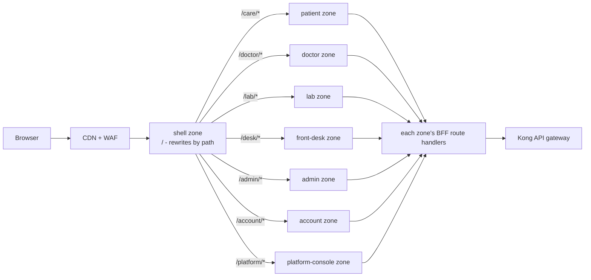

# MediCare CRM: Micro-frontends

> Backend services are in [MICROSERVICES.md](MICROSERVICES.md). How the UI decides what each user sees is in [FEATURES-AND-PLANS.md](FEATURES-AND-PLANS.md).

## 1. Approach: Next.js Multi-Zones

Each portal is a separate Next.js app (**zone**), built and deployed on its own, served under one domain by path. This is the same approach as the agentic-commerce project.

| Option | Verdict |
|---|---|
| **Next.js Multi-Zones** (route-level split) | **Chosen.** Each portal is naturally its own area of the app with different users, so splitting by route fits. Simple, SSR-friendly, no runtime module loading, each zone fully independent. Moving between zones is a full page load, which is fine because users rarely jump between portals. |
| Module Federation (runtime composition) | Use only if you need several teams' widgets **on the same page**. More fragile (shared dependency versions, runtime failures). Not needed here. |
| iframes | Only for third-party embeds (e.g. video consult provider). |

Small pieces shared across zones (chat widget, notification bell, header) are **versioned npm packages** built into each zone, not loaded at runtime.

---

## 2. Zones

| Zone | Path | Users | Main screens | Backend services |
|---|---|---|---|---|
| **shell** | `/` | everyone | landing, login/OTP, tenant branding, role-based home redirect, global header/nav, 404 | iam, tenant, entitlement |
| **patient** | `/care` | patients, family | find doctor, specialties, slots and booking, lab tests, my appointments, reports, health timeline, family members | provider, search, scheduling, diagnostics, records, billing |
| **doctor** | `/doctor` | doctors | today's queue, consultation (notes, prescription, lab order), schedule and leave, patient chart, AI copilot panel | scheduling, records, diagnostics, ai-assistant |
| **lab** | `/lab` | lab techs, pathologists | worklist, sample collection, result entry, verification | diagnostics |
| **front-desk** | `/desk` | receptionists | walk-in booking, check-in, counter payment | scheduling, billing, patient |
| **admin** | `/admin` | branch admins, super admins | doctors, specialties, branches, test catalog, prices, **role editor**, policies, dashboards, audit | provider, diagnostics, tenant, entitlement, analytics, audit |
| **account** | `/account` | patients (membership), tenant owners (hospital plan) | plans and pricing, upgrade/downgrade, invoices, usage meters, payment methods | subscription, billing |
| **platform-console** | `/platform` | SaaS operator only (MediCare's own account, host `medicare.<domain>`) | hospitals and their contracts, plan builder and approvals, editions, module registry, audit (feature flags, global usage: later) | subscription (tenant, entitlement through it) |



**Tenant awareness:** the edge router maps the host (`care.apollo-example.in`, `apollo.medicare.app`) to a tenant and cell ([MULTI-TENANCY.md](MULTI-TENANCY.md) §2). The shell loads that tenant's branding and settings and passes them to every zone; the same zone builds serve all tenants. The shared patient app adds a hospital switcher.

The shell zone's `next.config` holds rewrites built from a `zones.json` manifest (path → zone URL per environment), so adding a zone is a manifest change, not a code change in other zones. In production the CDN or an ingress can route by path directly.

---

## 3. Shared packages (`frontend/packages/*`)

| Package | Contents |
|---|---|
| `@mc/ui` | Design system: tokens, theming per tenant (logo, colours), accessible components, charts |
| `@mc/auth` | OIDC with Keycloak, httpOnly session cookie on the shared domain, `getSession()` for server components, silent refresh |
| `@mc/features` | Capabilities client: `getCapabilities()` (server), `useFeature()`, `usePermission()`, `<Feature>` and `<Can>` gates, `<Upsell>` component |
| `@mc/api-client` | Typed clients generated from each service's OpenAPI spec |
| `@mc/bff` | Helpers for zone route handlers: forward session token to gateway, idempotency keys, error mapping |
| `@mc/nav` | Global header and side nav driven by the capabilities `nav` list |
| `@mc/ai-chat` | Concierge / copilot chat widget (streaming, action cards with Confirm) |
| `@mc/i18n` | Translations (English, Hindi, regional) |

Rules: zones never import from each other; shared code only through these packages; breaking changes go out as a new major version and zones upgrade on their own schedule.

---

## 4. Role- and plan-based UI

The UI never decides access on its own; it asks the entitlement service once per session (and on `entitlements.changed`):

```http
GET /api/v1/me/capabilities
```

```json
{
  "tenant": { "id": "t_apollo", "plan": "PROFESSIONAL" },
  "roles": ["DOCTOR"],
  "permissions": ["appointment:read:own", "encounter:write:treating", "lab_order:create", "..."],
  "features": {
    "ai.copilot.summary": { "enabled": true },
    "ai.copilot.scribe":  { "enabled": false, "reason": "PLAN", "upgradeTo": "ENTERPRISE" },
    "video_consult":      { "enabled": true },
    "ai.copilot.messages": { "enabled": true, "limit": 2000, "used": 412 }
  },
  "nav": [
    { "key": "queue", "label": "Today", "href": "/doctor/queue" },
    { "key": "schedule", "label": "My schedule", "href": "/doctor/schedule" }
  ],
  "home": "/doctor/queue",
  "version": 42
}
```

How each zone uses it:
- **Routing:** each zone's `middleware.ts` checks that the user's capabilities allow that zone (e.g. `/admin` needs `zone:admin`), otherwise redirects to `home`.
- **Navigation:** nav items are declared in each module's manifest ([PRODUCT-MODULES-AND-PLANS.md](PRODUCT-MODULES-AND-PLANS.md) §2.1); the capabilities API returns only those whose module is active and whose permission the user has. `@mc/nav` renders that list, so menus change when a plan or role changes, with no deploy. A whole zone (e.g. `/lab`) is unreachable for a hospital that hasn't bought its module.
- **Components:**

```tsx
<Can permission="lab_order:create">
  <OrderLabTestButton encounterId={id} />
</Can>

<Feature name="ai.copilot.scribe" fallback={<Upsell feature="ai.copilot.scribe" />}>
  <AmbientScribeButton encounterId={id} />
</Feature>
```

- **Server components** read capabilities once per request (cached in the session for a few minutes), so hidden features are not even sent to the browser.
- Hiding in the UI is for **experience only**. Services re-check every request (FEATURES-AND-PLANS.md §5).

---

## 5. Cross-zone concerns

| Concern | Approach |
|---|---|
| Single sign-on | One httpOnly cookie on the shared domain, set by shell; all zones read it via `@mc/auth` |
| Consistent look | `@mc/ui` + tenant theme loaded from tenant-service by the shell and passed as CSS variables |
| Cross-zone links | Plain `<a href>` (full navigation) between zones; `next/link` inside a zone |
| Shared state | None at runtime. Data comes from APIs; small cross-tab signals (logout, entitlements changed) via `BroadcastChannel` |
| Analytics and errors | Same telemetry package in each zone, tagged with the zone name |
| Performance | Each zone ships only its own code; shared packages are tree-shaken; patient zone is SSR + edge-cached for public pages (doctor profiles, specialties) |
| Mobile | One React Native/Flutter patient app (not split); it uses the same capabilities API to show or hide features |

---

## 6. Repo layout

```
frontend/
├── zones.json                    # zone name → base path → dev port → prod URL
├── apps/
│   ├── zone-shell/   (3400)
│   ├── zone-patient/ (3401)
│   ├── zone-doctor/  (3402)
│   ├── zone-lab/     (3403)
│   ├── zone-desk/    (3404)
│   ├── zone-admin/   (3405)
│   ├── zone-account/ (3406)
│   └── zone-platform/(3406)
└── packages/ ui, auth, features, api-client, bff, nav, ai-chat, i18n
```

Each zone has its own Dockerfile, deployment and pipeline; only changed zones are rebuilt.
