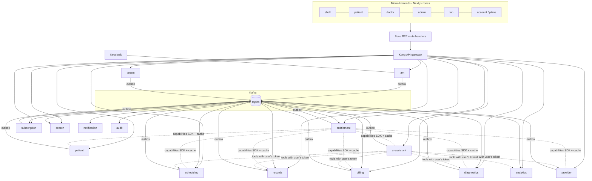
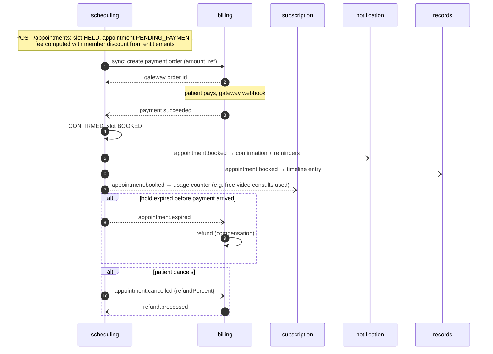

# MediCare CRM: Microservices Architecture

> Replaces the "modular monolith first" recommendation in [HLD.md §5.4](HLD.md). Bounded contexts, schemas and flows from [HLD.md](HLD.md) and [LLD.md](LLD.md) stay the same; this doc explains how they run as separate services. The frontends are in [MICROFRONTENDS.md](MICROFRONTENDS.md); roles, features and plans are in [FEATURES-AND-PLANS.md](FEATURES-AND-PLANS.md).

---

## 1. Principles

1. **One service = one business capability = one team's deployable.**
2. **Database per tenant, schema per service.** Each hospital has its own database; inside it each service owns one schema and connects with a role that can only see that schema ([MULTI-TENANCY.md §3](MULTI-TENANCY.md)). No service reads another service's tables. Shared data is copied through events (read models) or fetched through APIs.
3. **Sync for queries, async for side effects.** A user request may call at most 1–2 other services synchronously. Everything else (notifications, search index, timeline, analytics, audit trail) reacts to events.
4. **Transactional outbox** in every service that publishes events; **idempotent consumers** everywhere.
5. **Sagas** (event choreography) instead of distributed transactions.
6. **Every service enforces authorisation itself**, using the shared entitlement SDK. The gateway is a first filter, not the only one.
7. **Contracts are versioned**: OpenAPI for REST, JSON Schema in a schema registry for events, consumer-driven contract tests (Pact).

---

## 2. Service catalogue

| # | Service | Owns (database) | Key sync APIs | Publishes | Consumes |
|---|---|---|---|---|---|
| 1 | **api-gateway** (Kong) | — | Routing, JWT validation, rate limits, request IDs, coarse feature gates | — | — |
| 2 | **identity** (Keycloak) + **iam-service** | users, credentials, MFA, sessions (Keycloak); profile, role assignments (iam db) | login/OTP, `/me`, user admin | `user.registered`, `user.role_assigned` | `tenant.created` |
| 3 | **tenant-service** (control plane: catalog + onboarding orchestrator; cell: settings) | tenants, tier, cell, domains, branches, branding, typed settings, provisioning steps | onboarding, tenant/branch CRUD, settings, host → tenant resolution | `tenant.provisioned/updated/suspended`, `tenant.settings_changed`, `branch.*` | `subscription.*` |
| 4 | **entitlement-service** | module registry (from manifests), features, permissions, settings definitions, roles, overrides, feature flags; per tenant: active modules, settings | `/me/capabilities`, `/entitlements/check`, role editor, tenant settings | `entitlements.changed`, `module.enabled/disabled` (and calls each module's enable/disable hook) | `subscription.*`, `user.role_assigned` |
| 5 | **subscription-service** | editions, plan versions, price books, coupons, contracts and quotes (hospital SaaS), each hospital's own patient-membership plans, subscriptions, add-ons, usage counters, invoice calculator | plan catalogue, subscribe/upgrade/cancel, usage | `subscription.activated/changed/past_due/cancelled`, `usage.limit_reached` | `payment.succeeded/failed` |
| 6 | **patient-service** | patients, dependents, allergies, consents | patient CRUD, consent | `patient.*`, `consent.*` | `user.registered` |
| 7 | **provider-service** | doctors, specialties, doctor–branch, fees | directory CRUD, doctor profile | `doctor.*`, `specialty.*` | `branch.*` |
| 8 | **scheduling-service** | templates, leaves, slots, appointments, waitlist, queue | slots, book, cancel, reschedule, queue | `appointment.*`, `slot.availability_changed` | `payment.*`, `doctor.*`, `subscription.*` (priority booking) |
| 9 | **diagnostics-service** | test catalog, packages, lab orders, samples, results | catalog, lab booking, results entry | `lab_order.*`, `lab_result.ready` | `payment.*`, `encounter.lab_ordered` |
| 10 | **records-service** | encounters, prescriptions, documents, timeline read model | encounters, timeline, documents, signed URLs | `encounter.*`, `report.published` | `appointment.*`, `lab_result.ready`, `document.uploaded` |
| 11 | **billing-service** | invoices, payments, refunds, gateway webhooks | invoices, payment orders, webhooks | `payment.succeeded/failed`, `refund.processed` | `appointment.*`, `lab_order.*`, `subscription.invoice_due` |
| 12 | **notification-service** | templates, preferences, delivery log, schedules | preferences | `notification.sent/failed` | most business events |
| 13 | **search-service** | OpenSearch indexes | doctor and test search | — | `doctor.*`, `slot.*`, catalog events *(as built, Phase 21: port 4414; `provider.doctor_*`, `scheduling.availability_changed` and appointment events, `tenant.provisioned`; the lab catalog is re-read every 30 minutes instead of from events)* |
| 14 | **audit-service** | append-only audit store | audit query | — | all services (plus direct gRPC for PHI reads) |
| 15 | **analytics-service** | warehouse loaders, metric definitions | dashboards, semantic-layer metrics | — | all business events (de-identified) |
| 16 | **ai-assistant-service** | conversations, pending actions, clinical drafts, knowledge index | chat, copilot, ops agent | `assistant.action_confirmed` | `entitlements.changed`, knowledge updates *(as built, Phase 22: port 4415; knowledge-only concierge, no events yet; knowledge set up by the `ai` module's enable hook; test preparation re-read from the lab catalog every 30 minutes)* |
| 17 | **file-scan worker** | — | — | `document.scanned` | object storage events |

Workers (slot generator, hold expiry, reminders, outbox relays) run as separate deployments **inside** the service that owns the data, not as separate services.



---

## 3. Communication

| Style | Used for | Tech |
|---|---|---|
| **External sync** | Frontends → backend | HTTPS/JSON through zone BFF → Kong |
| **Internal sync** | Queries another service needs right now (e.g. scheduling asks provider for the fee; AI asks scheduling for slots) | REST or gRPC over Kubernetes DNS, mTLS via service mesh (Istio/Linkerd), timeouts + retries + circuit breakers |
| **Async** | Side effects, read models, sagas | Kafka, outbox per service, JSON Schema registry, DLQ per consumer |
| **Real-time to browser** | Doctor queue, chat streaming, report-ready badge | WebSocket/SSE through a small `realtime` gateway subscribed to Kafka |

**Token handling:** the gateway validates the user JWT and forwards it. When service A calls service B on behalf of the user, it forwards the user token (or exchanges it via OAuth token exchange for a narrower audience), so B applies the user's permissions. For background jobs, services use their own **service-account** tokens with only the scopes they need.

---

## 4. Sagas

### 4.1 Booking with online payment (choreography)



### 4.2 Hospital subscribes to a plan

`subscription.activated` → **tenant-service** enables the tenant → **entitlement-service** recomputes the tenant's features and publishes `entitlements.changed` → services and frontends drop cached capabilities → **notification-service** sends the welcome email. Payment failure → `subscription.past_due` → grace period → `subscription.suspended` → entitlement-service switches the tenant to read-only features.

---

## 5. Data that crosses service boundaries

| Need | Solution |
|---|---|
| Scheduling needs doctor name/fee for an appointment | Copies a **snapshot** at booking time (`doctor_name`, `fee`) and keeps a local `doctor_summary` read model updated from `doctor.*` events |
| Patient timeline needs appointments, prescriptions, lab reports | records-service builds `timeline_entries` from events (LLD §11) |
| Doctor search needs "next available" | search-service indexes from `slot.availability_changed` |
| Admin dashboard across everything | analytics-service warehouse fed by events/CDC, de-identified |
| "Is this doctor treating this patient?" (authz) | records-service/scheduling expose a fast `GET /care-relationships/{doctorId}/{patientId}`; result cached 5 min |
| Reporting joins | Never cross-service SQL; use the warehouse |

---

## 6. Multi-tenancy

MediCare is sold to many hospitals, so every service is tenant-aware. Full design in [MULTI-TENANCY.md](MULTI-TENANCY.md). In short:

- **Control plane** (tenant catalog, onboarding, platform billing, entitlement definitions, global patient identity) vs **cells** (the business services per region).
- **Separate database for every hospital**, with one schema per service inside it. Small hospitals' databases share Postgres servers; Enterprise hospitals get dedicated servers. A tenant DB router in every service picks the database from the tenant context and verifies it.
- Tenant comes only from the verified JWT (`tid`), checked against the request host; it flows through every service call, Kafka event, cache key, storage path and log line.
- Automated cross-tenant leak tests run in CI for every API.

## 7. Repositories and code layout

Same convention as the agentic-commerce project: three repos.

```
medicare/
├── platform/      docs, infra (docker-compose, Helm charts, Terraform), k6, CLI scripts
├── backend/       pnpm workspace
│   ├── services/
│   │   ├── iam-service/  tenant-service/  entitlement-service/  subscription-service/
│   │   ├── patient-service/  provider-service/  scheduling-service/  diagnostics-service/
│   │   ├── records-service/  billing-service/  notification-service/  search-service/
│   │   └── audit-service/  analytics-service/  ai-assistant-service/
│   ├── libs/
│   │   ├── contracts/          # OpenAPI + event JSON Schemas + generated TS types (published)
│   │   ├── nest-common/        # logging, tracing, errors, idempotency, outbox, health
│   │   ├── entitlements-sdk/   # @RequirePermission / @RequireFeature guards, cached checks
│   │   ├── kafka/              # producer/consumer with DLQ + processed-events table
│   │   └── fhir-mappers/
│   └── gateway/kong.yaml       # declarative routes + plugins
└── frontend/      see MICROFRONTENDS.md
```

Each service: NestJS, its own `DATABASE_URL`, migrations (Prisma/TypeORM/Flyway), Dockerfile, Helm values, OpenAPI spec, Pact tests, and its own CI pipeline that builds only when its folder or a lib it uses changes (Turborepo/Nx affected).

---

## 8. Platform and operations

| Concern | Choice |
|---|---|
| Runtime | Kubernetes (GKE fits Gemini/Vertex AI; EKS also fine), one namespace per environment |
| Deploy | Helm chart per service, Argo CD (GitOps), canary via Argo Rollouts |
| Service mesh | Istio or Linkerd: mTLS, retries, traffic split |
| Data | Postgres servers per cell, each hosting many small-tenant databases (one per hospital) behind PgBouncer; dedicated servers for Enterprise tenants; a separate control-plane database; migration orchestrator applies each service's migrations to all tenant DBs |
| Events | Kafka (Confluent Cloud / MSK / Strimzi) + schema registry |
| Cache | Redis (Memorystore/ElastiCache), key prefix per service |
| Secrets | Secret Manager / Vault via External Secrets Operator |
| Observability | OpenTelemetry → Grafana Tempo/Loki/Prometheus (or Cloud Operations); one trace across gateway → services → Kafka consumers |
| Local dev | docker-compose with all infra + `tilt`/`skaffold` for the services you are changing |

---

## 9. Trade-offs to accept

| You gain | You pay |
|---|---|
| Independent deploys and scaling (e.g. search and notifications scale separately from records) | More moving parts: 15+ services, Kafka, mesh, more on-call |
| Teams own services end to end | Cross-service changes need contract versioning |
| Failure isolation (SMS outage doesn't stop booking) | Eventual consistency in read models; sagas instead of transactions |
| Tech freedom per service (e.g. Python for analytics/AI if wanted) | Harder local development and debugging; needs good tracing |

Mitigation: start with the **core 8** (gateway, iam+Keycloak, entitlement, subscription, provider, scheduling, billing, notification), then add diagnostics, records, search, audit, analytics and AI as the roadmap reaches them.
