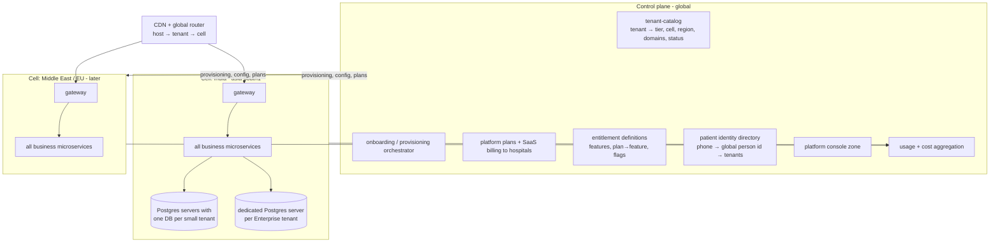
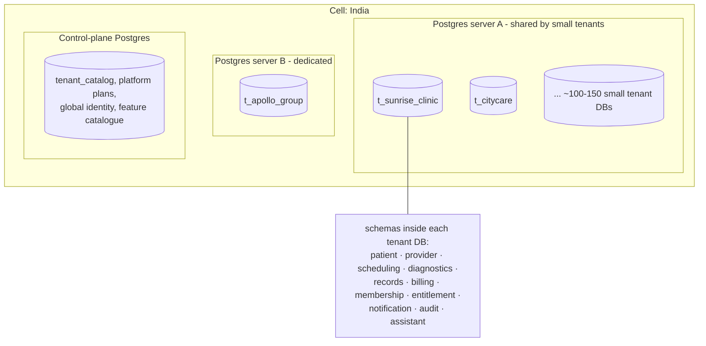

# MediCare CRM: Multi-tenant SaaS Design

> Decision (2026-10-23): MediCare is sold to **many hospitals and clinics** as SaaS. Each hospital (group) is a **tenant**. This doc is the source of truth for tenancy; [MICROSERVICES.md](MICROSERVICES.md), [MICROFRONTENDS.md](MICROFRONTENDS.md) and [FEATURES-AND-PLANS.md](FEATURES-AND-PLANS.md) follow it.

---

## 1. Product model

| Question | Decision |
|---|---|
| What does a hospital buy? | A **white-label** CRM: its own branded patient portal, staff portals, patient app experience, reports and notifications, under its own subdomain or custom domain |
| What is a tenant? | A hospital or hospital group (legal entity that signs the contract). A tenant has many **branches**. |
| How do patients see it? | On the hospital's site (`care.apollo-example.in` or `apollo.medicare.app`) they only see that hospital. In the shared **MediCare patient app**, they add the hospitals they visit and switch between them. Enterprise tenants can get their **own branded app** built from the same codebase. |
| Cross-hospital marketplace (search all hospitals' doctors)? | **Not in v1.** Possible later as an opt-in public directory (§10). |
| Who owns patient data? | The **hospital** is the data controller (data fiduciary under India's DPDP Act). **MediCare is the processor**, acting on the hospital's instructions under a data processing agreement. |
| Who sells what? | MediCare sells **hospital plans** to tenants. Hospitals sell **patient memberships** to their own patients (if their plan includes it), at prices they set. |

---

## 2. Control plane and application plane

Standard SaaS split: a small **global control plane** that manages tenants, and **application cells** that run the hospital workloads.



- **Control plane** services: tenant-catalog, onboarding orchestrator, platform billing (subscription-service in "platform" mode), entitlement definitions, global patient identity directory, platform console. No clinical data lives here.
- **Cell** = a full copy of the business microservices + data stores in one region. Patient data never leaves its cell. Start with **one cell (India)**; add cells for data residency (e.g. Gulf, EU) or scale. A cell can also be dedicated to one very large tenant.
- **Global router:** the CDN/edge resolves `host → tenant → cell` from a cached copy of the tenant catalog and forwards the request to that cell's gateway.

---

## 3. Database per tenant

> Decision (2026-10-23): **every hospital gets its own database.** No table anywhere holds two hospitals' data.

### 3.1 Layout: one database per tenant, one schema per service



| Choice | Why |
|---|---|
| **One database per tenant** (`t_<slug>`) | Hard isolation: a bug or bad query can only touch one hospital. Per-hospital backup, restore, export, deletion and data residency become simple database operations. |
| **One schema per service inside it** | Keeps microservice ownership: `scheduling-service` connects as role `svc_scheduling`, which has rights **only** on schema `scheduling` in each tenant DB. No service can read another service's schema. Same rule as "database per service", without multiplying databases (300 tenants × 12 services would be 3,600 databases). |
| **Many tenant DBs per Postgres server** for small hospitals | Cost: a clinic with 3 doctors doesn't need its own server. Target ~100–150 small tenant DBs per server. |
| **Dedicated Postgres server** (optionally dedicated cell) for Enterprise | Performance isolation, own backup schedule and PITR, contractual isolation, customer-managed keys if required. |
| **Control-plane database** (separate) | Tenant catalog, MediCare's hospital plans and SaaS subscriptions, feature/permission catalogue, global patient identity directory. No clinical data. |

What lives where:

| Data | Location |
|---|---|
| Patients, doctors, slots, appointments, encounters, lab orders, invoices, patient memberships, custom roles and role assignments, notification log, audit log, AI conversations | **Tenant database**, in the owning service's schema |
| Tenant catalog (tier, server, region, domains, schema versions), hospital plans and SaaS subscriptions, feature and permission catalogue, flags, global person identity | **Control-plane database** |
| Search indexes | **One index per tenant** (`doctors_t_citycare`), one primary shard for small tenants |
| Files | **Bucket per tenant** (or prefix per tenant for very small ones) with a **KMS key per tenant** |
| Cache | Redis, key prefix `t:{tenantId}:` (no tenant data persisted there) |
| Kafka | Shared topics; every event carries `tenantId` (events hold IDs, not clinical content) |
| Analytics warehouse | Dataset per tenant; cross-tenant benchmarks only from de-identified aggregates of opted-in tenants |

Because each database holds one tenant, tables do **not** need `tenant_id` columns or row-level security. Each tenant DB instead has a one-row `tenant_meta` table that is checked whenever a connection is opened (below).

### 3.2 Connection routing

```ts
// libs/nest-common/tenancy/tenant-db.router.ts
@Injectable()
export class TenantDbRouter {
  private pools = new LRUCache<string, Pool>({ max: 300, dispose: (p) => p.end() });  // idle tenant pools closed

  async forTenant(tenantId: string): Promise<Pool> {
    const cached = this.pools.get(tenantId);
    if (cached) return cached;

    const t = await this.catalog.placement(tenantId);   // { host, dbName, status, schemaVersion }, cached + push-invalidated
    if (t.status !== "ACTIVE" && t.status !== "READ_ONLY") throw new TenantUnavailableError(tenantId);

    const pool = new Pool({
      host: t.pgbouncerHost,                  // PgBouncer in front of each Postgres server
      database: t.dbName,                     // t_citycare
      user: SERVICE_DB_ROLE,                  // svc_scheduling: rights only on schema "scheduling"
      password: await this.secrets.dbPassword(t.host, SERVICE_DB_ROLE),
      max: 5,                                 // small per-tenant pool; PgBouncer multiplexes
      idleTimeoutMillis: 60_000,
      options: `-c search_path=${SERVICE_SCHEMA}`,
    });

    // Guard against mis-routing: the database must say it belongs to this tenant.
    const { rows } = await pool.query("SELECT tenant_id FROM public.tenant_meta");
    if (rows[0]?.tenant_id !== tenantId) { await pool.end(); throw new TenantRoutingError(tenantId, t.dbName); }

    this.pools.set(tenantId, pool);
    return pool;
  }
}

// Repositories get the pool from the request's TenantContext, never a global pool.
const pool = await this.router.forTenant(TenantContext.require().tenantId);
```

Connection budget: each Postgres server runs **PgBouncer in transaction mode**. Service pods keep small, lazily created pools per active tenant and close idle ones, so the number of real Postgres connections stays bounded however many tenants exist.

### 3.3 Provisioning a tenant database

1. Pick a server in the tenant's region with spare capacity (or create a dedicated one for Enterprise via Terraform).
2. `CREATE DATABASE t_<slug> TEMPLATE medicare_template;` The template database already has every service's schema at the current version, service roles and grants, and reference seed data. This takes seconds.
3. Insert `tenant_meta (tenant_id, slug, created_at)`.
4. Seed tenant-specific defaults (role templates, specialties, test catalog, policies, notification templates).
5. Create the search indexes, storage bucket and KMS key; record everything in the tenant catalog.

### 3.4 Schema migrations across all tenant databases

Each service ships migrations as usual; a **migration orchestrator** (a job in the platform) applies them to every tenant DB:

- Tracks `schema_version` per (tenant, service) in the tenant catalog.
- Runs in **rings**: template DB → internal test tenant → pilot tenants → small-tenant servers in batches (parallel per server, limited concurrency) → dedicated Enterprise DBs in their maintenance windows.
- Migrations are **expand/contract**: the service code must work with both the old and new schema during the rollout; destructive steps (drop column) ship in a later release.
- A failure stops the ring, alerts, and leaves the remaining tenants on the previous version (still compatible).
- The template DB is updated first so new tenants are always created at the latest version.

### 3.5 Moving a tenant

To move a tenant to another server (rebalancing, upgrade to a dedicated server, region move): set up **logical replication** from the old DB to the new one → catch up → set the tenant `READ_ONLY` for seconds → switch the catalog entry → services reconnect (catalog change event evicts their pools) → `ACTIVE`. Alternatively `pg_dump`/`pg_restore` in a short maintenance window for small tenants.

### 3.6 Outbox and background jobs with many databases

- Each tenant DB has an `outbox` table per service schema. The **outbox relay** for a service is sharded across replicas by tenant (consistent hashing over the tenant list); each replica polls its tenants' outbox tables and also listens for `NOTIFY` so new events go out immediately.
- Workers (slot generation, hold expiry, reminders) also shard by tenant and process each tenant in its own context and connection.
- Kafka consumers read `tenantId` from the event and use the router to write to that tenant's DB.

### 3.7 Trade-offs

| You gain | You pay | Mitigation |
|---|---|---|
| Strongest practical isolation; simple per-hospital restore, export, deletion, residency | Many databases to migrate and monitor | Migration orchestrator, template DB, per-server dashboards |
| No `tenant_id`/RLS bugs can leak data across hospitals | Connection count grows with tenants | PgBouncer + small lazy pools + LRU eviction |
| Per-tenant performance tuning; big tenants on own servers | Cross-tenant reporting needs the warehouse | Event-fed warehouse, never cross-DB queries |
| Easy to sell "your data in your own database" to hospitals | Slightly higher infra cost per small clinic | Pack 100–150 small tenant DBs per server |

## 4. Tenant context: how every request knows its tenant

```mermaid
sequenceDiagram
  participant B as Browser
  participant E as Edge router
  participant Z as Zone (Next.js)
  participant K as Keycloak
  participant G as Gateway
  participant S as Service
  B->>E: GET https://care.apollo-example.in/care/doctors
  E->>E: host → tenant t_apollo, cell IN-1
  E->>Z: forward + X-Tenant-Host
  Z->>K: login (organization = t_apollo)
  K-->>Z: JWT { sub, tid: t_apollo, roles, capv }
  Z->>G: API call with JWT
  G->>G: verify JWT; tid must match the host's tenant
  G->>S: request + verified tenant context
  S->>S: route to tenant's own database, check entitlements
```

Rules:
1. Tenant comes **only** from the verified token (checked against the host). Never from a request body, query parameter or a header the client can set.
2. Every service gets a `TenantContext` (AsyncLocalStorage in Node) from a shared middleware; repositories refuse to run without one.
3. Every Kafka event carries `tenantId`; consumers set the context before handling.
4. Background jobs loop over tenants explicitly and set the context per tenant.
5. Every cache key, storage bucket, search index and log line is tenant-specific.
6. **Automated leak tests:** in CI, create two tenants, run every API as tenant A against tenant B's IDs, and expect 404 every time.

---

## 5. Identity across hospitals

| User type | Model |
|---|---|
| **Patient** | One **global person identity** (phone-verified login) in the control-plane directory. Per hospital, a separate **patient record** (own MRN, own consents) in that tenant. Hospital A cannot see hospital B's records for the same person unless the patient shares them through a consent (or a national health exchange such as ABDM). |
| **Staff** | One login per person; **memberships** in one or more tenants with roles per tenant. A doctor visiting two hospitals switches tenant in the header; their token is re-issued for that tenant. |
| **Enterprise SSO** | Tenant connects its own identity provider (Azure AD, Google Workspace) through Keycloak identity brokering for staff. |
| **Platform staff** | Separate admin realm; no standing access to tenants (see §8). |

Keycloak setup: one realm for the platform, using **Keycloak Organizations** (one organization per tenant) for staff membership and per-tenant identity providers; tokens carry `tid` (and `org`) claims. Very large tenants can get a dedicated realm.

---

## 6. Onboarding (provisioning saga)

```mermaid
sequenceDiagram
  autonumber
  actor H as Hospital admin
  participant ONB as Onboarding orchestrator
  participant TC as tenant-catalog
  participant SUB as subscription (platform)
  participant IAM as Keycloak / iam
  participant CELL as Cell services
  participant PAY as Payment gateway (Route / Connect)
  H->>ONB: sign up (hospital name, registration no., GSTIN, admin email, plan)
  ONB->>ONB: verify email/phone; KYC + facility registration check (manual review for v1)
  ONB->>TC: create tenant (PROVISIONING, tier, cell, subdomain)
  ONB->>SUB: start trial / subscription
  ONB->>CELL: provision: tenant database from template (§3.3), bucket + KMS key, search indexes
  ONB->>CELL: seed defaults: role templates, specialties, test catalog template, policies, notification templates
  ONB->>IAM: create organization, invite admin
  ONB->>PAY: create sub-merchant / connected account for patient payments
  ONB->>TC: status ACTIVE
  ONB-->>H: welcome email → setup wizard
```

Each step is idempotent and recorded, so a failed step can be retried or rolled back (delete created resources in reverse order).

**Setup wizard** (admin zone): branding and domain → branches → departments and specialties → invite doctors and staff → doctor availability → test catalog and prices → payment account activation → notification sender IDs → go live checklist.

---


**As built (Phase 20):** self-serve signups start on MediCare's site (`/signup`), are confirmed by an e-mailed link before anything is created, and then run the saga above: tenant-service creates the database and catalogue entry and publishes `tenant.provisioned` (with `source: SIGNUP` and the owner's name); iam-service creates the Keycloak organisation (unique name) and the owner; entitlement-service the roles; subscription-service the contract and a free trial; records-service the storage bucket and data key; other services their defaults. tenant-service's status endpoint reports each step from the services themselves, so the signup page shows real progress. CLI/console-created hospitals use the same saga with `source: SALES` (no trial; invoiced).

## 7. Per-tenant configuration

| Area | Configurable per tenant |
|---|---|
| Branding | Logo, colours, fonts, favicon, email/SMS sender name, report letterhead, invoice template |
| Domains | Subdomain (`<slug>.medicare.app`), custom domains with automatic TLS (managed certificates) |
| Locale | Timezone per branch, languages, currency, date formats |
| Policies | Cancellation/refund windows, hold time, max advance days, reminder schedule, no-show rules |
| Clinical | Specialty list, test catalog and prices, prescription template, ICD coding on/off |
| Payments | Connected payment account, accepted methods, tax (GST) registration and invoice numbering series |
| Messaging | SMS sender ID and DLT template registration (required in India, per hospital), WhatsApp Business number, email domain (SPF/DKIM) |
| Patient memberships | The hospital's own membership tiers, prices and benefits (only if its plan includes `patient_memberships`) |
| Roles | Custom roles and permissions ([FEATURES-AND-PLANS.md](FEATURES-AND-PLANS.md)) |
| AI | Concierge name and greeting, knowledge base content (FAQs, policies), enabled channels, escalation contacts |
| Integrations | LIS, PACS, ABDM facility IDs, insurance/TPA, HIS export (Enterprise) |

Stored in **tenant-service** (`tenant_settings` as typed JSON with a JSON Schema per section, versioned), cached in each service, invalidated on `tenant.settings_changed`.

---

## 8. Two money flows

| Flow | Who pays whom | How |
|---|---|---|
| **SaaS billing** | Hospital → MediCare | subscription-service (platform mode) + MediCare's own gateway account; monthly/annual invoices with GST; usage-based add-ons (AI messages, SMS, storage) |
| **Patient payments** | Patient → Hospital | Each tenant has a **connected account** (Razorpay Route / Stripe Connect) so money settles directly to the hospital. MediCare can take an optional per-transaction platform fee. Enterprise tenants may bring their own gateway keys (stored encrypted per tenant). |

Patient memberships are products **of the hospital**: subscription-service stores them as plans with `owner_tenant_id`, and patient payments for them go to the hospital's connected account.

---

## 9. Security, privacy and operations per tenant

| Topic | Design |
|---|---|
| Encryption keys | One KMS key per tenant for field-level and file encryption (envelope encryption). Offboarding can **crypto-shred** by destroying the key after the legal retention period ends. |
| Object storage | Bucket per tenant (`medicare-in-1-t-<slug>`), encrypted with the tenant's KMS key |
| Search | Index per tenant; search-service picks the index from the tenant context (never from the caller). *As built (Phase 21): `<prefix>-<tenantId>-doctors` and `-tests`, chosen from the hospital resolved from the host; covered by the tenancy leak test.* |
| Noisy neighbours | Per-tenant rate limits at the gateway (by plan), per-tenant AI/SMS quotas, per-database connection limits in PgBouncer, per-database `statement_timeout`; heavy tenants moved to a dedicated server (§3.5) |
| Support access | Platform support gets **just-in-time** access: request → tenant admin approves → time-boxed (e.g. 2 h), read-only by default, no clinical data unless the tenant explicitly allows, every action audited and visible to the tenant |
| Audit | Tenant admins see their own audit log; platform-level audit for control-plane actions |
| Backups | Server-level PITR for every Postgres server, plus a nightly **per-tenant `pg_dump`** (encrypted with the tenant key) so one hospital can be restored on its own; dedicated servers get their own PITR window |
| Observability | Traces and logs tagged with `tenant_id`; per-database size, connections and slow queries; dashboards for top tenants; SLOs per plan |
| Cost per tenant | AI tokens, SMS, storage, compute share aggregated per tenant → margin reports and usage billing |
| Releases | **Ring deployment**: internal test tenant → pilot tenants → small-tenant servers in batches → dedicated tenants; new features behind per-tenant flags; DB migrations per §3.4 |

### Offboarding

1. Tenant cancels → read-only period (e.g. 60 days).
2. Full **data export**: FHIR bulk export (Patient, Encounter, Observation, DiagnosticReport, DocumentReference...) + PDFs + CSVs of appointments and invoices.
3. Hospital confirms receipt (it must keep medical records for the legal period).
4. MediCare drops the tenant database, search indexes and bucket, destroys the tenant KMS key (so backups become unreadable too), and issues a certificate of deletion.

---

## 10. Later: cross-hospital features

- **Public doctor directory:** tenants opt in; search-service builds a separate public index with only public profile fields; booking still happens inside the chosen tenant.
- **Patient-controlled sharing:** a patient shares a report from hospital A with hospital B through a consent record, or via ABDM's health information exchange (each tenant registered as a health facility, MediCare as the integrating software).
- **Benchmarks for hospitals:** anonymised, aggregated metrics across tenants (e.g. average no-show rate) for Enterprise analytics, only from tenants that opt in.

---

## 11. Compliance checklist (India first)

- Data processing agreement with each hospital (MediCare as processor, hospital as data fiduciary under the DPDP Act 2023).
- Data stored and processed in India for Indian tenants (India cell; Gemini through Vertex AI in an Indian region where the model is available).
- Telemedicine Practice Guidelines 2020 for video consults; SMS DLT registration per hospital; GST invoicing for SaaS fees and patient invoices.
- ABDM integration certification if offering health ID linking and record sharing.
- For tenants outside India: HIPAA BAA (US), GDPR DPA (EU), served from the matching cell.
- Get these checked by a lawyer before launch; this list is a starting point, not legal advice.
