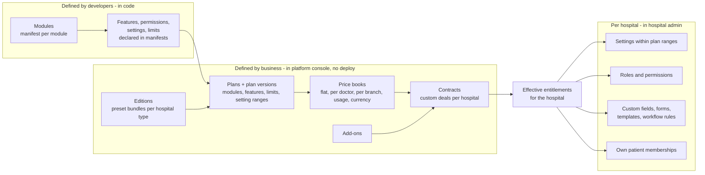
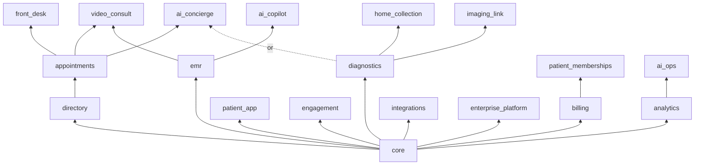

# MediCare CRM: Modular Product, Editions and Plan Builder

> Goal: one codebase that can be **sold to any kind of hospital or clinic in any combination**. A dental clinic, a diagnostic lab and a 20-branch hospital each buy only what they need. New plans, bundles, prices and custom deals are created by the business **in the platform console, without code changes or deploys**.
>
> This doc covers **packaging** (what is sold and how). [FEATURES-AND-PLANS.md](FEATURES-AND-PLANS.md) covers **runtime access** (how every request is checked against roles, plan and limits). [MULTI-TENANCY.md](MULTI-TENANCY.md) covers tenants and their databases.

---

## 1. The flexibility model in one picture



Three layers, each edited by different people:

| Layer | Who | Changes need a deploy? |
|---|---|---|
| **Capabilities:** modules, features, permissions, settings, limits | Developers | Yes (new code) |
| **Packaging:** editions, plans, prices, add-ons, contracts, trials, coupons | MediCare product/sales team in the platform console | **No** |
| **Configuration:** settings, roles, custom fields/forms, templates, workflow rules, patient memberships | Each hospital's admin, inside what its plan allows | **No** |

---

## 2. Module catalogue

A **module** is a sellable unit of the product. Each module brings its own features, permissions, screens (micro-frontend routes), background jobs, settings and seed data.

| Module key | What it gives | Depends on | Backend services | UI zone(s) |
|---|---|---|---|---|
| `core` (always on) | Tenant, branches, users, roles, patient registry, basic notifications, audit | — | tenant, iam, entitlement, patient, notification, audit | shell, admin (basic) |
| `directory` | Doctors, specialties, departments, public doctor profiles and search | core | provider, search | patient, admin |
| `appointments` | Availability, slots, online booking, reschedule/cancel, reminders, waitlist | directory | scheduling | patient, doctor, admin |
| `front_desk` | Walk-ins, check-in, queue tokens, counter payments | appointments | scheduling, billing | desk |
| `video_consult` | Teleconsultation rooms, consent, e-prescription delivery | appointments, emr | scheduling, records | patient, doctor |
| `emr` | Encounters, clinical notes, diagnoses, e-prescriptions, patient chart, timeline | core | records | doctor, patient (records view) |
| `diagnostics` | Test catalog, packages, lab orders, samples, results, report PDFs | core | diagnostics, records | lab, patient, admin |
| `home_collection` | Home sample collection slots, phlebotomist routes | diagnostics | diagnostics | lab, patient |
| `imaging_link` | Link to PACS viewers, radiology report workflow | diagnostics | diagnostics, records | lab, doctor |
| `billing` | Invoices, online payments, refunds, GST invoices, packages | core | billing | account, desk, admin |
| `patient_memberships` | Hospital sells its own patient membership tiers | billing | subscription (tenant mode), billing | account, admin |
| `patient_app` | White-label patient web portal + presence in the MediCare app; own branded app on top tier | core | — | patient |
| `engagement` | WhatsApp channel, campaigns, follow-up and care-gap nudges, feedback/NPS | core | notification | admin |
| `ai_concierge` | Patient AI assistant (chat, WhatsApp, voice) | appointments or diagnostics | ai-assistant | patient |
| `ai_copilot` | Pre-visit summary, ambient scribe, draft notes | emr | ai-assistant | doctor |
| `ai_ops` | Admin analytics agent, daily brief | analytics | ai-assistant | admin |
| `analytics` | Dashboards (basic) and advanced analytics/exports | core | analytics | admin |
| `integrations` | FHIR API, webhooks, API keys, LIS/HIS connectors, ABDM, insurance/TPA | core | gateway, integration adapters | admin |
| `enterprise_platform` | SSO, custom domain, dedicated database server, data region choice, extended audit retention, sandbox tenant | core | tenant, iam | admin |



The plan builder refuses to save a plan whose modules miss a dependency (e.g. `ai_copilot` without `emr`).

### 2.1 Module manifest (developer-owned)

Each module is described once, in a versioned manifest in the backend repo. The platform reads all manifests into the **module registry** at deploy time. This is what makes packaging flexible: the business combines whatever the manifests declare.

```yaml
# backend/modules/diagnostics.module.yaml
key: diagnostics
name: Diagnostics & Lab
version: 3
dependsOn: [core]
services: [diagnostics-service, records-service]
zones:
  - zone: lab
    nav: [{ key: worklist, label: Lab worklist, href: /lab/worklist, permission: lab_order:read:branch }]
  - zone: patient
    nav: [{ key: tests, label: Book a test, href: /care/tests, permission: lab_order:create:own }]
features:
  - key: diagnostics.catalog            # BOOLEAN
  - key: diagnostics.packages
  - key: diagnostics.report_pdf_branding
  - key: diagnostics.critical_value_alerts
limits:
  - key: diagnostics.orders_per_month   # METERED
    unit: orders
    reset: MONTH
settings:                                # hospital-editable, plan can bound them
  - key: diagnostics.report_release
    type: enum
    values: [AUTO_AFTER_VERIFY, MANUAL]
    default: AUTO_AFTER_VERIFY
  - key: diagnostics.max_tests_per_order
    type: int
    default: 20
    planBounded: true                    # plan sets min/max allowed
permissions:
  - lab_order:create:own
  - lab_order:read:branch
  - lab_result:enter:branch
  - lab_result:verify:branch
defaultRoleGrants:
  LAB_TECH: [lab_order:read:branch, lab_result:enter:branch]
  PATHOLOGIST: [lab_order:read:branch, lab_result:verify:branch]
  PATIENT: [lab_order:create:own]
seed:
  - catalog/test-catalog-india-v5.json   # copied into the tenant DB when the module is enabled
jobs: [report-generator, tat-monitor]
lifecycle:
  onEnable: diagnostics-service:/internal/modules/diagnostics/enable
  onDisable: diagnostics-service:/internal/modules/diagnostics/disable
```

---

## 3. Editions: ready-made bundles per hospital type

An **edition** is a starting template the sales team or self-serve signup uses. It decides which modules are included and which are offered as add-ons. Editions are data; new ones are added in the console.

| Edition | Typical buyer | Included modules | Usual add-ons |
|---|---|---|---|
| **Clinic** | 1–10 doctors, single location | core, directory, appointments, front_desk, emr, billing, patient_app | video_consult, engagement, ai_concierge |
| **Diagnostic Center** | Pathology/radiology labs, no consultations | core, diagnostics, home_collection, billing, patient_app | imaging_link, engagement, ai_concierge, integrations |
| **Multi-specialty Hospital** | Hospitals and chains | core, directory, appointments, front_desk, emr, diagnostics, billing, patient_app, analytics | everything else |
| **Telehealth** | Online-first providers | core, directory, appointments, video_consult, emr, billing, patient_app | ai_concierge, engagement |
| **Dental / Eye / Specialty chain** | Single-specialty chains | Clinic edition + multi-branch limits, packages in billing | patient_memberships, engagement |
| **Custom** | Anything else | Pick modules freely (dependencies enforced) | — |

Each edition comes in **tiers** (e.g. Starter / Professional / Enterprise) that change limits, settings ranges and premium features, not the module list. So "Diagnostic Center – Professional" and "Hospital – Enterprise" are both just plans built from the same catalogue.

---

## 4. Plans, versions and add-ons

### 4.1 What a plan contains

| Part | Example (Hospital – Professional) |
|---|---|
| Modules | core, directory, appointments, front_desk, emr, diagnostics, billing, patient_app, analytics, engagement |
| Features on/off inside modules | `diagnostics.report_pdf_branding: on`, `analytics.advanced: off`, `ai_copilot.scribe: off` |
| Limits | doctors 100, branches 5, `ai_concierge.messages` 20,000/month, SMS 20,000/month, storage 500 GB |
| Setting ranges | `appointments.max_advance_days` allowed 1–90; `appointments.hold_minutes` allowed 5–15 |
| Overage behaviour per limit | doctors: BLOCK; SMS: ALLOW_BILL at ₹0.20; AI messages: SOFT_WARN then BLOCK at 120% |
| Allowed add-ons | `ai_copilot` (₹X/doctor/month), `integrations` (₹Y/month), `+10,000 AI messages` |
| Trial | 30 days, limits capped at 10 doctors |
| Isolation | own database on a shared server (dedicated server is Enterprise only) |

### 4.2 Plan versions and grandfathering

- A plan is edited by creating a **new version** (`HOSPITAL_PRO v3`). Existing hospitals stay on the version they bought until they are migrated.
- The console shows the **impact** before publishing: how many hospitals are on each version, and which features or limits would change for them.
- Migration options per change: *new customers only*, *migrate at renewal*, or *migrate now* (with notice to hospital admins).
- Retiring a feature: mark it deprecated → stop selling it in new versions → migrate remaining hospitals → remove from code. Never silently removed from a paying hospital.

### 4.3 Add-ons

Add-ons are small plans attached to a subscription: a module (`ai_copilot`), a feature (`custom_domain`), or a quota pack (`+10,000 SMS`). They have their own price, can be monthly or one-time, and can be restricted to certain base plans.

---

## 5. Pricing models

All pricing lives in **price books** (per currency/region), so the same plan can be priced differently for India, the Gulf or the US.

| Model | Example | Where used |
|---|---|---|
| Flat | ₹4,999/month | Clinic Starter |
| Per seat | ₹999 per active doctor per month | Clinic/Hospital tiers |
| Per branch | ₹2,500 per branch per month | Chains |
| Tiered volume | Doctors 1–50 at ₹999, 51–200 at ₹799, 200+ at ₹599 | Large hospitals |
| Usage (metered) | AI messages, SMS, WhatsApp, video minutes, lab orders, storage GB | Add-ons and overage |
| Transaction fee | 1% of patient payments through the platform (optional) | Marketplace-style pricing |
| One-time | Setup/onboarding fee, data migration, custom branded app | Enterprise |
| Discounts | Annual prepay (−15%), coupons, partner/reseller discounts, introductory pricing | Any |

The **invoice calculator** in subscription-service: base price + seats × seat price + branches × branch price + add-ons + usage overage (from usage counters) − discounts + GST, prorated for mid-period changes.

---

## 6. Contracts: custom deals without custom code

Large hospitals rarely buy a plan exactly as listed. A **contract** captures what one hospital actually bought:

```
Contract (Apollo-example group, 3 years)
├── base plan:       HOSPITAL_ENTERPRISE v2
├── add-ons:         ai_copilot (all doctors), integrations, +50,000 AI messages/month
├── overrides:       branches limit 40 (plan says 25); analytics.advanced on
├── custom prices:   ₹650/doctor/month (list ₹799), setup fee waived
├── term:            2026-11-01 → 2029-10-31, annual billing, 5% yearly increase
├── isolation:       dedicated database server, region asia-south1
└── SLA:             99.95%, named support manager
```

Contracts are created in the platform console (sales enters a quote → hospital accepts → contract becomes active). The entitlement engine treats a contract as **plan version + add-ons + overrides**, so nothing in the services is special-cased for big customers.

---

## 7. Hospital-level configuration (inside the plan)

What a hospital admin can change themselves, if their plan includes the related feature:

| Configuration | Example | Gated by |
|---|---|---|
| **Settings** within plan ranges | Max advance booking 60 days (plan allows 1–90) | Setting bounds in plan |
| **Roles and permissions** | Custom `SENIOR_NURSE` role | `core.custom_roles` |
| **Custom fields** | Extra patient field "Corporate employee ID"; extra appointment field "Referral source" | `core.custom_fields` (limit on number of fields) |
| **Forms** | Pre-consultation questionnaire per specialty; consent forms | `emr.custom_forms` |
| **Templates** | Prescription layout, report letterhead, notification wording per language | `core.templates`, `diagnostics.report_pdf_branding` |
| **Workflow rules** | "If a lab value is CRITICAL → notify ordering doctor and branch head by SMS" ; "If no-show twice → require prepayment" | `core.workflow_rules` (limit on number of rules) |
| **Patient memberships** | Hospital's own Care+ tier | `patient_memberships` module |
| **Webhooks / API keys** | Push appointment events to the hospital's HIS | `integrations` module |
| **Branding / domain** | Logo, colours; custom domain | `patient_app`, `enterprise_platform.custom_domain` |

**As built (Phase 20):** settings (declared per module in the manifests, `planBounded` ones narrowed by the plan) are stored per hospital in entitlement-service and validated against both ranges; a tighter plan clamps the effective value. Roles: custom roles (feature `core.custom_roles`) and copy-on-write edits of system roles, with a preview of the role's screens and a change history. Branding and message templates are edited by the hospital admin. Custom domains (feature `core.custom_domain`, off by default; Enterprise v3) are verified by a DNS TXT record. Custom fields, forms and workflow rules are not built yet.

Implementation notes:
- **Custom fields:** definitions in the tenant DB (`custom_field_defs`: entity, key, type, validation, visibility by role); values stored in a `custom_fields JSONB` column on the entity, validated against the definitions; indexed fields get a GIN/expression index created by a background job.
- **Workflow rules:** a small rules engine (trigger event → conditions → actions) evaluated by a `workflow` worker that consumes domain events. Actions are a fixed, safe list (notify, create task, add tag, require prepayment), never arbitrary code.
- **Forms:** JSON Schema forms rendered by a shared `@mc/forms` package; answers stored on the encounter or appointment.

---

## 8. Turning modules on and off (module lifecycle)

```mermaid
sequenceDiagram
  autonumber
  participant SUB as subscription-service
  participant ENT as entitlement-service
  participant SVC as owning service(s)
  participant FE as zones (UI)
  participant NOT as notification

  SUB->>ENT: subscription.changed (plan v3 + add-on ai_copilot)
  ENT->>ENT: diff old vs new entitlements → modules added / removed
  ENT->>SVC: POST onEnable(tenant) for each added module
  SVC->>SVC: seed data into tenant DB, create search index, start jobs for tenant
  SVC-->>ENT: module ready
  ENT--)FE: entitlements.changed → nav and screens appear
  ENT--)NOT: tell hospital admin "AI Copilot is now available"

  Note over ENT,SVC: Module removed (downgrade / non-payment)
  ENT->>SVC: POST onDisable(tenant)
  SVC->>SVC: stop jobs for tenant; data kept, read-only
  ENT--)FE: screens hidden; existing records still viewable where needed for care
```

Rules:
- **Never delete data when a module is turned off.** It becomes read-only or hidden; turning the module back on restores it.
- **Patient safety first:** clinical records created by a disabled module (e.g. lab reports, notes) stay viewable by the patient and treating doctors.
- **No new database work per module:** every service's schema already exists in every tenant database (created from the template, [MULTI-TENANCY.md §3.3](MULTI-TENANCY.md)), so enabling a module only seeds data and starts jobs. This keeps schema migrations uniform across all hospitals.
- Enable/disable hooks are **idempotent** and retried until they succeed; the module shows as "activating" in the admin UI meanwhile.

**As built (Phase 17):**

- Module states per hospital: `ACTIVATING → ACTIVE` and `DISABLING → READ_ONLY` (a module never bought has no row). A manifest's `lifecycle: [<service schema>…]` lists whose hooks run; every service exposes them through `@mc/nest-common` (`POST /internal/tenants/:t/modules/:key/enable|disable`) and registers what to do in `ModuleHooks`. entitlement-service's lifecycle job calls them with backoff and finishes the move.
- **Read-only** is one rule in `@mc/entitlements-sdk`, so services need no per-module code: GET requests from signed-in users are answered, everything else gets `403 MODULE_READ_ONLY`; only the module's `resource:read:scope` permissions remain, so menus keep the "look up" screens. Signed-out requests treat a read-only module as off.
- `subscription.contract_changed` carries the full effective state (event-carried state, with a per-hospital `seq`); entitlement-service stores the plan, feature switches/limits and setting bounds in the hospital database and bumps the capabilities version in the same transaction.
- Add-ons allowed with a plan version are a list (`plan_version_addons`) instead of `plan_version_modules.included = ADDON_ALLOWED`, because quota add-ons (e.g. +5 branches) need it too. Until the plan builder (Phase 18), the catalogue is seeded from `backend/modules/plans.yaml`.

---

## 9. Data model additions

**Control-plane database:**

```sql
CREATE TABLE modules (
  key VARCHAR(40) PRIMARY KEY, name VARCHAR(80) NOT NULL,
  manifest_version INT NOT NULL, manifest JSONB NOT NULL,      -- loaded from *.module.yaml at deploy
  status VARCHAR(12) NOT NULL DEFAULT 'ACTIVE'                 -- ACTIVE | DEPRECATED
);
CREATE TABLE module_dependencies (
  module_key VARCHAR(40) REFERENCES modules(key),
  depends_on VARCHAR(40) REFERENCES modules(key),
  kind VARCHAR(6) NOT NULL DEFAULT 'ALL',                      -- ALL | ANY (e.g. ai_concierge needs appointments OR diagnostics)
  PRIMARY KEY (module_key, depends_on)
);
CREATE TABLE setting_defs (
  key VARCHAR(80) PRIMARY KEY, module_key VARCHAR(40) REFERENCES modules(key),
  type VARCHAR(10) NOT NULL, json_schema JSONB NOT NULL, default_value JSONB NOT NULL,
  plan_bounded BOOLEAN NOT NULL DEFAULT false
);

CREATE TABLE editions (
  id UUID PRIMARY KEY, code VARCHAR(40) UNIQUE NOT NULL,       -- CLINIC, DIAGNOSTIC_CENTER, HOSPITAL
  name VARCHAR(80) NOT NULL, description TEXT
);

CREATE TABLE plan_versions (
  id UUID PRIMARY KEY, plan_id UUID NOT NULL REFERENCES plans(id),
  version INT NOT NULL, edition_id UUID REFERENCES editions(id),
  status VARCHAR(12) NOT NULL,                                 -- DRAFT | PUBLISHED | RETIRED
  published_at TIMESTAMPTZ, published_by UUID,
  UNIQUE (plan_id, version)
);
CREATE TABLE plan_version_modules (
  plan_version_id UUID REFERENCES plan_versions(id), module_key VARCHAR(40) REFERENCES modules(key),
  included VARCHAR(8) NOT NULL,                                -- INCLUDED | ADDON_ALLOWED
  PRIMARY KEY (plan_version_id, module_key)
);
-- plan_features (from FEATURES-AND-PLANS.md §4.2) is keyed by plan_version_id instead of plan_id
CREATE TABLE plan_setting_bounds (
  plan_version_id UUID REFERENCES plan_versions(id), setting_key VARCHAR(80) REFERENCES setting_defs(key),
  min_value JSONB, max_value JSONB, allowed_values JSONB, locked_value JSONB,
  PRIMARY KEY (plan_version_id, setting_key)
);

CREATE TABLE price_books (
  id UUID PRIMARY KEY, code VARCHAR(30) UNIQUE NOT NULL,       -- IN_INR_2026, AE_AED_2026
  currency CHAR(3) NOT NULL, region VARCHAR(20), tax_profile VARCHAR(20),
  valid_from DATE NOT NULL, valid_to DATE
);
CREATE TABLE price_components (
  id UUID PRIMARY KEY, price_book_id UUID REFERENCES price_books(id),
  plan_version_id UUID, addon_key VARCHAR(80),                 -- one of the two
  model VARCHAR(12) NOT NULL,                                  -- FLAT | PER_SEAT | PER_BRANCH | TIERED | USAGE | ONE_TIME | TXN_PERCENT
  unit VARCHAR(20), interval VARCHAR(8),                       -- MONTH | YEAR | ONCE
  amount NUMERIC(12,2), tiers JSONB                            -- [{upTo: 50, amount: 999}, {upTo: null, amount: 599}]
);

CREATE TABLE contracts (
  id UUID PRIMARY KEY, tenant_id UUID NOT NULL,
  plan_version_id UUID NOT NULL REFERENCES plan_versions(id),
  price_book_id UUID NOT NULL REFERENCES price_books(id),
  starts_on DATE NOT NULL, ends_on DATE, billing_interval VARCHAR(8) NOT NULL,
  custom_prices JSONB,                                         -- overrides of price_components
  overrides JSONB,                                             -- feature/limit/setting-bound overrides
  isolation VARCHAR(12) NOT NULL DEFAULT 'SHARED_SERVER',      -- SHARED_SERVER | DEDICATED_SERVER
  region VARCHAR(20) NOT NULL,
  status VARCHAR(12) NOT NULL,                                 -- QUOTE | ACTIVE | ENDED
  signed_document_id UUID
);
CREATE TABLE coupons (
  code VARCHAR(30) PRIMARY KEY, percent_off NUMERIC(5,2), amount_off NUMERIC(12,2),
  applies_to JSONB, max_redemptions INT, valid_until DATE
);
```

**Each tenant database** (written by entitlement-service when a contract changes):

```sql
CREATE TABLE entitlement.tenant_modules (
  module_key VARCHAR(40) PRIMARY KEY,
  state VARCHAR(12) NOT NULL,                  -- ACTIVATING | ACTIVE | DISABLING | DISABLED
  since TIMESTAMPTZ NOT NULL, source VARCHAR(10) NOT NULL   -- PLAN | ADDON | OVERRIDE | TRIAL
);
CREATE TABLE entitlement.tenant_settings (
  setting_key VARCHAR(80) PRIMARY KEY, value JSONB NOT NULL,
  updated_by UUID NOT NULL, updated_at TIMESTAMPTZ NOT NULL DEFAULT now()
);
CREATE TABLE core.custom_field_defs (
  id UUID PRIMARY KEY, entity VARCHAR(30) NOT NULL,           -- PATIENT | APPOINTMENT | LAB_ORDER
  key VARCHAR(40) NOT NULL, label JSONB NOT NULL,             -- per language
  type VARCHAR(12) NOT NULL, validation JSONB, visible_to_roles TEXT[], indexed BOOLEAN DEFAULT false,
  UNIQUE (entity, key)
);
CREATE TABLE core.workflow_rules (
  id UUID PRIMARY KEY, name VARCHAR(80) NOT NULL, trigger_event VARCHAR(60) NOT NULL,
  conditions JSONB NOT NULL, actions JSONB NOT NULL, enabled BOOLEAN NOT NULL DEFAULT true,
  version INT NOT NULL DEFAULT 0
);
```

Setting validation: when a hospital admin saves a setting, the value must pass the setting's JSON Schema **and** the plan's bounds. If a later plan change tightens the bounds, values outside the new range are clamped and the admin is notified.

---

## 10. Sales and signup flows

**Self-serve (small clinics and labs):**
1. Public pricing page is **generated from published plan versions and price books**, so marketing never hard-codes prices.
2. Choose edition and tier → sign up → trial tenant created ([MULTI-TENANCY.md §6](MULTI-TENANCY.md)) with demo data option.
3. In-app upsell when a gated feature is clicked (`<Upsell>` shows the cheapest plan or add-on that unlocks it, computed from the catalogue).
4. Checkout → subscription active → entitlements recomputed → modules activated.

**Sales-led (hospitals and chains):**
1. Sales builds a **quote** in the platform console from an edition + add-ons + custom prices; the console validates dependencies and shows margin (expected AI/SMS/infra cost from usage assumptions).
2. Hospital accepts → contract ACTIVE → provisioning, including dedicated server if contracted.
3. Renewals, upsells and true-ups (e.g. more doctors than contracted) come from usage reports.

---

## 11. Platform console screens (packaging)

| Screen | What it does |
|---|---|
| **Module registry** | Read-only view of modules, features, settings and permissions from manifests, with versions |
| **Edition editor** | Define editions and their default module sets |
| **Plan builder** | Pick modules → toggle features → set limits, overage behaviour, setting bounds, allowed add-ons → attach prices per price book → validate → publish as a new version |
| **Plan simulator** | "What would hospital X get on plan Y?" Shows modules, features, limits and invoice before switching |
| **Impact preview** | Before publishing a version: affected hospitals, gained/lost features, revenue change |
| **Price books and coupons** | Regional prices, currency, tax profile, promotions |
| **Contracts and quotes** | Custom deals, approvals for discounts above a threshold, signed documents |
| **Tenant entitlements view** | For support: the effective modules, features, limits and the source of each (plan, add-on, override, trial) |

All changes are audited and require a second approver for publishing plan versions and large discounts.

**As built (Phase 18)** (zone `/platform` on the `medicare` account, API `subscription-service /v1/platform`):

- Plan versions go `DRAFT → PENDING → PUBLISHED → RETIRED` (`PENDING → DRAFT` when sent back with a note). Drafts are saved even when invalid; the problems (same checks as the seed file: dependencies, always-on and internal modules, features/limits of included modules, setting ranges inside the manifest's, add-ons) block submitting. One open draft per plan.
- **Two-person rule:** whoever created, last saved or submitted a version cannot approve it (`TWO_PERSON_RULE`).
- Publishing retires the plan's previous published version (no longer sold; hospitals keep it). The approver chooses *keep hospitals on their version* or *move them now* ("at renewal" needs billing, Phase 19). The impact preview shows the change against the published version and, per hospital on an older version, modules gained/lost, limits, price, add-ons no longer sold with it and dependency problems.
- **Simulator** ("what would hospital X get on version Y", drafts included) and **assign** keep the hospital's overrides; **overrides** (module on/off, a limit) need a reason. Internal plans and modules can never be given to a hospital.
- Every change is in `platform_audit` (who, action, target, before/after, note), written in the same transaction as the change.
- Price books, discounts and their approval thresholds, quotes and contract terms arrive with billing (Phase 19).

---

## 12. Testing the flexibility

- **Manifest validation in CI:** every module manifest is schema-checked; every permission and feature referenced in code exists in some manifest, and vice versa.
- **Plan matrix tests:** for each published plan version, spin up a test tenant, compute capabilities, and assert expected screens/APIs are allowed or denied (generated from the plan definition).
- **Module on/off tests:** enable → use → disable → verify read-only behaviour → re-enable → verify data intact.
- **Billing tests:** invoice calculator against fixtures for every pricing model, proration and currency.
- **Upgrade/downgrade simulations** across all live plan versions before publishing a new one.
